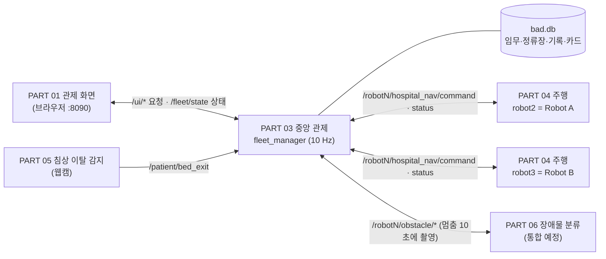

<div align="center">

# BAD · 병원 다중 AMR 이송 시스템 (`bad_ws`)

병원 안에서 TurtleBot4 두 대가 환자 이송·물품 전달·호출을 나눠 맡는 시스템입니다. **중앙 관제(PART 03)** 가 모든 판단을 하고, 관제 화면(PART 01)·자율주행(PART 04)·침상 이탈 감지(PART 05)·장애물 분류(PART 06)가 관제와 토픽으로 연결됩니다.


[시스템 구조](#시스템-구조) · [파트별 상태](#파트별-상태) · [인터페이스](#인터페이스-실제-코드-기준) · [실행](#실행) · [테스트](#테스트) · [문서](#문서) · [협업 규칙](#협업-규칙)

</div>

## 시스템 구조



**호출 한 건이 처리되는 순서**

1. 간호사가 관제 화면에서 환자 이송·물품 전달·로봇 호출을 등록합니다.
2. 관제가 배터리가 많은 대기 로봇을 고릅니다. 복도(로봇 두 대가 함께 쓰는 길)와 B·E 구역 출입을 써도 되는지 판단한 다음, 그 로봇에 `MOVE <구역> <응급도>`를 보냅니다.
3. PART 04가 Nav2로 로봇을 움직이고 1초마다 상태를 보냅니다. 관제는 위치를 보며 다음을 판단합니다.
   - 복도에서 마주치면 응급도가 낮은 로봇을 잠깐 세웁니다 (복도 양보).
   - 서로 길을 막으면 교착을 풉니다.
   - 10초 이상 못 움직이면 막힘을 판단합니다.
   - 침상 이탈이나 침상 감시 끊김이 오면 로봇을 세웁니다.
4. 도착하면 화면에 '확인 대기'가 뜨고, 간호사가 [수령 완료]를 누르면 다음 정류장으로 가거나 홈으로 복귀합니다.
5. 사람이 정해야 하는 일은 화면의 결정 카드로 물어봅니다 (교착, 막힘, 확인 불일치, 침상 감시 끊김).
6. 모든 요청·판단·조작자 이름은 `bad.db`에 남고, 화면의 이송 작업·운영 기록에서 다시 볼 수 있습니다.

## 파트별 상태

| 패키지 | 파트 | 하는 일 | 상태 (2026-11-18) |
|---|---|---|---|
| `part1_ui_dashboard` | PART 01 | 관제 화면 5쪽: 종합 관제(지도·로봇·복도), 이송 작업, 환자 등록, 의료물품 요청, 운영 기록 | 구현. 실제 로봇 연결 시험 중 |
| `part3_fleet_manager` | PART 03 | 중앙 관제: 배정, 복도·출입 판단, 교착·막힘, 안전 정지, 기록 DB, 연결 점검 도구 | 구현. 실제 로봇 연결 시험 중 |
| `part4_amr_nav` | PART 04 | 로봇별 명령 수신(`hospital_nav`), Nav2 주행, 상태 보고 | 구현 (`hospital_nav` 모듈) |
| `part5_bed_exit` | PART 05 | 웹캠으로 침상 이탈 감지 → `/patient/bed_exit` | 확정 |
| `part6_obstacle_classifier` | PART 06 | 멈춘 로봇 앞 장애물 분류 (사람·물건) | `part6` 브랜치. 관제는 연결 준비 완료 |
| `part2_qr_verifier` | PART 02 | 손목·물품 QR 검증 | 뼈대 |

## 인터페이스 (실제 코드 기준)

모든 JSON은 `std_msgs/msg/String`에 담습니다. 자세한 필드는 [docs/part3/BRIEF.md](docs/part3/BRIEF.md) 3·4장에 있습니다.

| 보내는 쪽 → 받는 쪽 | 이름 | 타입 | 내용 |
|---|---|---|---|
| 화면 → 관제 | `/ui/mission_req` · `/ui/operator_cmd` · `/ui/decision` | String (JSON) | 임무 등록 · 직접 명령(정지·재개·확인·취소 등) · 결정 카드 선택 |
| 관제 → 화면 | `/fleet/state` (5 Hz) · `/mission/event` · `/fleet/decision_req` · `/ui/ack` | String (JSON) | 전체 상태 · 이벤트 · 결정 카드 · 요청 결과 |
| 누구나 → 관제 | `/robot/pause` · `/robot/resume` | `std_srvs/srv/Trigger` | 전체 정지·재개 (ROS 명령줄용) |
| 관제 → PART 04 | `/robot2/hospital_nav/command` · `/robot3/...` | String (글자) | `MOVE <A~F> <1~3>`, `PAUSE`, `RESUME`, `CANCEL` |
| PART 04 → 관제 | `/robotN/hospital_nav/status` | String (JSON) | 1초마다 `STATE`, 생길 때 `STATUS`(도착·실패 등) |
| 로봇 → 관제 | `/robotN/amcl_pose` · `battery_state` · `hazard_detection` · `dock_status` | 표준 메시지 | 위치 · 배터리 · 범퍼 · 도킹 |
| PART 05 → 관제 | `/patient/bed_exit` | `std_msgs/msg/Bool` | `true` = 이탈 감지 (확정) |
| 관제 ↔ PART 06 | `/robotN/obstacle/inspect_image` → `/robotN/obstacle_classifier/result` | `std_msgs/msg/Empty` → String (JSON) | 멈춤 10초에 촬영 요청 → 분류 결과 |

- 로봇 이름: `robot2` = Robot A, `robot3` = Robot B. 구역 A~F 좌표는 PART 04 `goal_manager.py`와 관제 `config/fleet.yaml`이 같은 값을 씁니다.
- 지도: `main_map/main_maps.yaml`

## 실행

Ubuntu 24.04 + ROS 2 Jazzy, 저장소 루트(`~/bad_ws`)에서 실행합니다. 새 컴퓨터 설치는 [docs/part3/CONTROL_PC_SETUP.md](docs/part3/CONTROL_PC_SETUP.md)를 따릅니다.

### 1) 빌드

```bash
source /opt/ros/jazzy/setup.bash
sudo apt install -y python3-flask python3-shapely python3-networkx python3-yaml \
  ros-jazzy-irobot-create-msgs ros-jazzy-nav2-msgs python3-opencv python3-pytest
colcon build --symlink-install
source install/setup.bash
```

### 2) 로봇 없이 시연 (가짜 로봇 2대)

가짜 로봇도 `/robot2`·`/robot3` 이름을 씁니다. 강의실 네트워크와 섞이지 않도록 그 터미널을 이 컴퓨터 안으로만 막습니다.

```bash
unset ROS_DISCOVERY_SERVER ROS_SUPER_CLIENT
export ROS_AUTOMATIC_DISCOVERY_RANGE=LOCALHOST ROS_DOMAIN_ID=81
ros2 launch part1_ui_dashboard demo_mock.launch.py
```

브라우저에서 http://localhost:8090 을 엽니다. 화면 오른쪽 아래 톱니바퀴(시험 도구)로 복도 양보·교착·막힘·침상 이탈 같은 시나리오를 돌릴 수 있습니다.

### 3) 실제 로봇 (강의실)

자세한 순서와 시험 항목은 [docs/part3/REAL_TEST.md](docs/part3/REAL_TEST.md)에 있습니다.

1. **관제 PC · 터미널 1: 발견 서버.** 모든 로봇·노트북이 이 서버로 서로를 찾습니다. IP는 관제 PC의 `hostname -I` 값입니다.
   ```bash
   /usr/bin/fastdds discovery --server-id 0 --ip-address 192.168.108.31 --port 11811
   ```
2. **PART 04:** 로봇마다 Nav2와 `hospital_nav` 명령 노드를 띄우고 초기 위치를 잡습니다. 로봇은 도크에서 떼어 둡니다.
   - ⚠ PART 04의 `keyboard_control`은 관제와 동시에 켜지 않습니다. 같은 로봇에 명령이 두 군데서 갑니다.
3. **PART 05:** 침상 감시를 켭니다 (아래 4번). 없으면 화면 결정 카드에서 [감시 없이 운행]을 고릅니다.
4. **관제 PC · 터미널 2: 점검 → 관제·화면.**
   ```bash
   export ROS_DISCOVERY_SERVER=192.168.108.31:11811 ROS_SUPER_CLIENT=True
   ros2 run part3_fleet_manager preflight          # 마지막 줄 "실제 실행 가능" 확인 (명령은 보내지 않음)
   ros2 launch part1_ui_dashboard real.launch.py   # 기록은 ~/.bad/bad_real.db
   ```
5. 브라우저에서 http://localhost:8090 을 엽니다. 같은 와이파이의 다른 기기에서는 `http://<관제 PC IP>:8090`으로 엽니다.

### 4) PART 05 침상 이탈 감지

`method`는 `BedExitMethod` 규약(`judge(self, frame) -> bool`)을 구현한 클래스 경로입니다. 양식은 [method_template.py](src/part5_bed_exit/part5_bed_exit/method_template.py), 자세한 사용법은 [USAGE.md](src/part5_bed_exit/USAGE.md)에 있습니다.

```bash
ros2 run part5_bed_exit bed_exit --ros-args \
  -p method:=your_package.your_method:YourBedExitMethod \
  -p output_topic:=/patient/bed_exit -p camera_index:=0 -p capture_fps:=30.0
```

최근 5프레임 중 3번 이상 `true`면 이탈로 판정합니다. 카메라 오류나 판정 예외가 나면 그 프레임은 발행하지 않습니다.

## 테스트

```bash
# PART 01·03 (ROS 없이 실행, 가짜 시계)
PYTHONPATH=src/part1_ui_dashboard:src/part3_fleet_manager \
  python3 -m pytest -q src/part1_ui_dashboard/test src/part3_fleet_manager/test

# PART 05
PYTHONPATH=src/part5_bed_exit python3 -m pytest -q src/part5_bed_exit/test
```

## 문서

| 문서 | 내용 |
|---|---|
| [docs/part3/BRIEF.md](docs/part3/BRIEF.md) | 관제·화면 설계 기준 (인터페이스, 판단 규칙, 설정, 테스트 목록) |
| [docs/part3/WEB_DB_DESIGN.md](docs/part3/WEB_DB_DESIGN.md) | 화면 5쪽 구성, DB 테이블 5개, 버튼별 처리 로직 |
| [docs/part3/CONTROL_PC_SETUP.md](docs/part3/CONTROL_PC_SETUP.md) | 관제 PC를 처음부터 설치하는 방법 |
| [docs/part3/REAL_TEST.md](docs/part3/REAL_TEST.md) | 강의실 실제 로봇 시험 순서 |
| [docs/part3/PART04_REQUESTS.md](docs/part3/PART04_REQUESTS.md) · [PART05_REQUESTS.md](docs/part3/PART05_REQUESTS.md) | 관제가 다른 파트에 요청한 변경 |
| [docs/troubleshooting/README.md](docs/troubleshooting/README.md) | 문제 해결 기록 |

## 저장소 구조

```text
bad_ws/
├── AGENTS.md                  # 협업·파트 경계·Git 규칙
├── README.md
├── main_map/                  # 공용 지도 (main_maps.yaml / .pgm)
├── docs/
│   ├── part3/                 # 관제·화면 설계, 설치, 현장 시험 문서
│   └── troubleshooting/
└── src/
    ├── part1_ui_dashboard/    # PART 01 관제 화면
    ├── part2_qr_verifier/     # PART 02 QR 검증 (뼈대)
    ├── part3_fleet_manager/   # PART 03 중앙 관제
    ├── part4_amr_nav/         # PART 04 주행 (hospital_nav)
    └── part5_bed_exit/        # PART 05 침상 이탈 감지
```

## 협업 규칙

- 각자 자기 파트 폴더(`src/part<N>_*/`) 안에서 작업하고, 다른 파트 폴더는 그 담당과 합의한 뒤에 고칩니다. 자세한 규칙은 [AGENTS.md](AGENTS.md)에 있습니다.
- 파트 간 토픽 이름이나 JSON 형식을 바꿀 때는 위 인터페이스 표와 [BRIEF.md](docs/part3/BRIEF.md)를 같이 고칩니다.
- 변경은 파트별 브랜치에서 PR로 `main`에 합칩니다.
- `build/`, `install/`, `log/`, `.env`, 모델 가중치(`*.pt` `*.onnx` `*.engine`), 영상(`*.mp4` `*.avi`)은 커밋하지 않습니다.
- `git add .` 대신 자기 폴더만 지정해서 올립니다. 개인 설정 폴더(`.vscode`, 각종 키 폴더)가 섞여 올라가는 것을 막습니다.
