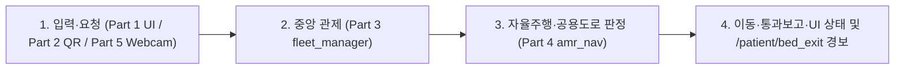

<div align="center">

# BAD · 병원 다중 AMR 자율주행 ROS 2 워크스페이스 (`bad_ws`)

병원 내 환자·물품 이송 로봇 관제, QR 검증, 자율주행 및 별도 웹캠 침대 이탈 감지를 5개 독립 ROS 2 패키지로 분리해 협업·연동하는 단일 `colcon` 워크스페이스입니다.


[Quick Start](#quick-start) · [How It Works](#how-it-works) · [Capability Matrix](#capability-matrix) · [Verification](#verification--evidence) · [Reference](#reference) · [FAQ](#faq) · [Troubleshooting](docs/troubleshooting/README.md)

`colcon build --symlink-install && source install/setup.bash`

</div>

## Quick Start

Ubuntu 24.04 및 ROS 2 Jazzy 환경의 저장소 루트(`bad_ws/`)에서 실행합니다.

### 1) 환경 구성 및 전체 빌드 (Setup & Build)

```bash
source /opt/ros/jazzy/setup.bash
sudo apt install -y python3-opencv python3-pytest python3-colcon-common-extensions ros-jazzy-std-msgs
colcon build --symlink-install
source install/setup.bash
```

### 2) 핵심 실행 (Run `part5_bed_exit`)

`your_package.your_method:YourBedExitMethod`는 `BedExitMethod` 규약(`judge(self, frame) -> bool`)을 구현한 클래스(`module:ClassName`, 노드에서 객체 생성) 또는 생성 완료된 객체(`module:object_name`) 경로로 교체합니다. 팀원 구현용 단일 양식은 [method_template.py](src/part5_bed_exit/part5_bed_exit/method_template.py)에 있습니다.

```bash
ros2 run part5_bed_exit bed_exit --ros-args \
  -p method:=your_package.your_method:YourBedExitMethod \
  -p output_topic:=/patient/bed_exit \
  -p camera_index:=0 \
  -p capture_fps:=30.0
```

### 3) 단위 테스트 및 패키지 확인 (Test & Inspect)

```bash
PYTHONPATH=src/part5_bed_exit python3 -m pytest src/part5_bed_exit/test -v
ros2 pkg list | grep -E "^part[1-5]_"
```

## How It Works




### 저장소 구조

```text
bad_ws/
├── AGENTS.md                       # 협업·파트 경계·Git 규칙
├── README.md
├── .gitignore
├── docs/
│   └── troubleshooting/            # 건별 트러블슈팅 기록
│       ├── README.md
│       └── _template.md
└── src/
    ├── part1_ui_dashboard/         # PART 01: 관제실 Web UI (ROS 2 골격)
    ├── part2_qr_verifier/          # PART 02: QR 인식·검증 (ROS 2 골격)
    ├── part3_fleet_manager/        # PART 03: 중앙 관제 코어 (ROS 2 골격)
    ├── part4_amr_nav/              # PART 04: NAV2 자율주행 (ROS 2 골격)
    └── part5_bed_exit/             # PART 05: 침대 이탈 감지 (구현·확정)
        ├── part5_bed_exit/
        │   ├── __init__.py
        │   ├── bed_exit_method.py  # BedExitMethod 인터페이스 및 객체 로더
        │   ├── bed_exit_node.py
        │   ├── bed_exit_state.py
        │   └── method_template.py  # 팀원 구현용 단일 클래스 양식
        ├── resource/
        ├── test/
        ├── USAGE.md
        ├── compare_methods.py      # ROS 2 없이 메서드 객체 비교·평가 스크립트
        ├── package.xml
        ├── setup.py
        └── setup.cfg
```

## Capability Matrix

| 대상/기능 (Target / Feature) | 반환 결과 및 동작 (What It Returns) | 요구사항 및 트리거 (Requirements & Guide) |
| --- | --- | --- |
| `part1_ui_dashboard` | 관제 Web UI·`rosbridge` 연동 골격 | `[미확정]` ROS 2 패키지 뼈대 (`colcon build` 가능) |
| `part2_qr_verifier` | 손목·물품·인계 QR 검증 노드 골격 | `[미확정]` ROS 2 패키지 뼈대 (`colcon build` 가능) |
| `part3_fleet_manager` | 배차·도로점유 송신·예외 제어 골격 | `[미확정]` ROS 2 패키지 뼈대 (`colcon build` 가능) |
| `part4_amr_nav` | Nav2 주행·공용도로 대기/통과 판정 골격 | `[미확정]` ROS 2 패키지 뼈대 (`colcon build` 가능) |
| `part5_bed_exit` 메서드 교체 | 클래스/객체의 `judge(frame) -> bool` 호출 | `-p method:=module:ClassOrObject` (또는 `BedExitNode(detector=...)`) |
| `part5_bed_exit` 상태 집계 | 최근 5프레임 중 3회 이상 시 `True` | 초기 4프레임 `False`, 비-`bool` 반환 시 `TypeError` |
| `part5_bed_exit` ROS 발행 | 정상 프레임마다 `std_msgs/msg/Bool` 발행 | 기본 토픽 `/patient/bed_exit` `[확정]` |
| `part5_bed_exit` 오류 Fail-Safe | 이력(`history`) 초기화 및 해당 프레임 미발행 | 카메라 단선·판단 예외 시 거짓 정상 발행 차단 |
| `part5_bed_exit` 메서드 비교기 | ROS 2 없이 웹캠/영상으로 클래스별 판정·FPS 비교 | `python3 src/part5_bed_exit/compare_methods.py` |

## Verification & Evidence

| 검증 항목 | 범위 및 실행 조건 | 확인 결과 |
| --- | --- | --- |
| 전체 워크스페이스 빌드 | `colcon build --symlink-install` (ROS 2 Jazzy) | 5개 패키지(`part1_*`~`part5_*`) 빌드 통과 |
| 패키지 등록 확인 | `source install/setup.bash && ros2 pkg list` | 5개 패키지 모두 `ament_python` 인식 확인 |
| Part 5 단위 테스트 | `pytest src/part5_bed_exit/test -v` | 17개 테스트(상태·로더·비교 스크립트 포함) 통과 |
| 실웹캠·외부 추론·Part 1~4 | 실제 하드웨어/YOLO/구독 노드 연동 | 미검증 (팀원 구현 및 실기 연동 대기) |

## Reference

### 1) `part5_bed_exit` ROS 2 파라미터

| 파라미터명 | 기본값 | 설명 |
| --- | --- | --- |
| `method` | `""` (`detector` 미주입 시 필수) | 판단 클래스/객체 경로 (`module:ClassName` 또는 `module:object_name`, `judge(frame) -> bool`) |
| `output_topic` | `/patient/bed_exit` | 침대 이탈 상태 발행 토픽 (`std_msgs/msg/Bool`) |
| `camera_index` | `0` | OpenCV `VideoCapture` 카메라 인덱스 |
| `capture_fps` | `30.0` | 타이머 기반 프레임 수집 시도 주기 (`> 0`) |

### 2) 5파트 ICD 인터페이스 기준 요약

| IF ID | 송신 파트 | 토픽 / 서비스명 | 메시지 / 서비스 타입 | 확정 상태 |
| --- | --- | --- | --- | --- |
| `IF-05` | PART 05 | `/patient/bed_exit` | `std_msgs/msg/Bool` | **확정** |
| `IF-01` | PART 01 | `/ui/mission_req` | `hospital_msgs/msg/MissionReq` (또는 `String` JSON) | 미확정 |
| `IF-06b` | PART 01 | `/robot/resume` | `std_srvs/srv/Trigger` | 미확정 |
| `IF-02` | PART 02 | `/qr/verify_result` | `hospital_msgs/msg/QrVerify` (또는 `String` JSON) | 미확정 |
| `IF-03` | PART 03 | `/robot_{a,b}/goal_pose` | `geometry_msgs/msg/PoseStamped` | 미확정 |
| `IF-04a` | PART 03 | `/road1/occupied` | `std_msgs/msg/Bool` | 미확정 |
| `IF-06a` | PART 03 | `/robot/pause` | `std_srvs/srv/Trigger` | 미확정 |
| `IF-07` | PART 03 | `/fleet/state` | `hospital_msgs/msg/FleetState` (또는 `String` JSON) | 미확정 |
| `IF-04b` | PART 04 | `/road1/pass_report` | `std_msgs/msg/String` | 미확정 |
| `IF-07a` | PART 04 | `/robot_{a,b}/{pose,battery,goal_reached}` | `PoseStamped` / `BatteryState` / `Bool` | 미확정 |

상세 사용 가이드는 [Part 5 사용 안내](src/part5_bed_exit/USAGE.md), 문제 해결 이력은 [트러블슈팅 기록](docs/troubleshooting/README.md)을 참고합니다.

## FAQ

<details><summary><b>Part 1~4 담당자는 어디에 노드를 작성하나요?</b></summary>

`src/part1_ui_dashboard/`, `src/part2_qr_verifier/`, `src/part3_fleet_manager/`, `src/part4_amr_nav/` 아래 각 패키지 디렉토리에 Python 모듈을 추가하고 `setup.py`의 `entry_points['console_scripts']`에 실행 노드를 등록합니다. 루트 `bad_ws/`에서 `colcon build --symlink-install`로 5개 패키지를 한 번에 빌드합니다.

</details>

<details><summary><b>Part 5에서 카메라나 모델 오류가 나면 False가 발행되나요?</b></summary>

아닙니다. `capture.read()` 실패, 판단 함수 예외, 또는 `bool`이 아닌 반환값이 발생하면 최근 5프레임 이력을 초기화(`BedExitState()`)하고 에러 로그만 남기며 해당 프레임은 발행하지 않습니다. 복구 후 다시 5프레임을 연속 정상 수신할 때까지 `False`를 유지합니다.

</details>

<details><summary><b>GitHub 협업 시 무엇을 주의해야 하나요?</b></summary>

`build/`, `install/`, `log/`, `.env`, 가중치(`*.pt`, `*.onnx`, `*.engine`), 영상(`*.mp4`, `*.avi`)은 `.gitignore`로 제외됩니다. 파트별 변경은 브랜치·PR 단위로 공유하고, `AGENTS.md`의 파트별 경계를 유지합니다.

</details>

<details><summary><b>패키지 라이선스와 메인테이너 정보는 확정됐나요?</b></summary>

현재 `package.xml`·`setup.py`에는 임시 값(`UNLICENSED`, `maintainer@example.com`)이 들어가 있으며, 저장소 공개 배포 전 팀 합의 값으로 교체해야 합니다.

</details>
