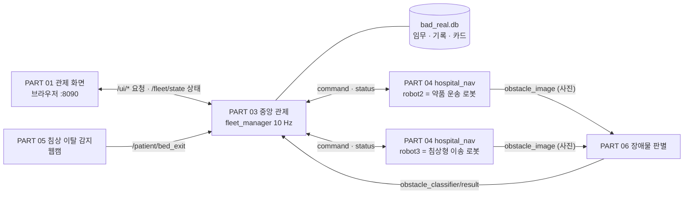

<div align="center">

# BAD · 병원 다중 AMR 이송 시스템 (`bad_ws`)

병원 안에서 TurtleBot4 두 대가 환자 이송, 약품 운송, 호출을 나눠 맡는 시스템입니다. **중앙 관제(PART 03)** 가 배정과 통행 판단을 모두 합니다. 관제 화면(PART 01), 자율주행(PART 04), 침상 이탈 감지(PART 05), 장애물 판별(PART 06)은 관제와 ROS 토픽으로 연결됩니다.


[시스템 구조](#시스템-구조) · [로봇과 구역](#로봇과-구역) · [파트별 상태](#파트별-상태) · [관제 규칙](#관제가-지키는-규칙) · [인터페이스](#인터페이스) · [실행](#실행) · [시뮬레이션](#gazebo-시뮬레이션) · [테스트](#테스트) · [문서](#문서) · [협업 규칙](#협업-규칙)

</div>

## 시스템 구조



**요청 한 건이 처리되는 순서**

1. 간호사가 관제 화면에서 환자 이송, 의료물품 요청, 로봇 호출을 등록합니다. 응급도는 1~3이고 3이 가장 급합니다.
2. 관제가 역할에 맞는 로봇을 고릅니다. 환자 이송은 침상형 이송 로봇, 약품 운송과 호출은 약품 운송 로봇이 맡습니다.
3. 복도, B·E 방의 문, 교차로, 목적지 자리를 지금 써도 되는지 판단한 뒤, 그 로봇에 `MOVE <구역><자리> <응급도>`를 보냅니다(예: `MOVE F2 3`).
4. PART 04가 Nav2로 로봇을 움직이고, 1초마다 상태를 보냅니다. 관제는 두 로봇의 위치를 보며 아래를 판단합니다.
   - 복도는 같은 방향끼리만 함께 들어가고, 반대 방향은 복도 밖에서 기다립니다.
   - 앞 로봇과 가까워지면 뒤 로봇을 세웠다가, 간격이 벌어지면 다시 보냅니다.
   - 두 로봇이 너무 가까워지면 움직이는 쪽을 세웁니다.
   - 침상 이탈이나 침상 감시 끊김이 오면 침상형 이송 로봇을 세웁니다.
5. 도착하면 화면에 '확인 대기'가 뜹니다. 간호사가 [수령 완료]를 누르면 다음 정류장으로 가거나 홈으로 돌아갑니다.
6. 사람이 정해야 하는 일은 화면의 결정 카드로 묻습니다. 막힘, 장애물, 주행 실패, 정지 미확인, 침상 감시 끊김이 해당합니다.
7. 모든 요청, 판단, 조작자 이름은 DB에 남고 화면의 이송 작업과 운영 기록에서 다시 볼 수 있습니다.

## 로봇과 구역

| 관제 이름 | 네임스페이스 | 로봇 | 맡는 일 | 홈 | 도크 |
|---|---|---|---|---|---|
| `robot_a` (A) | `/robot3` | 침상형 이송 로봇 | 환자 이송 | D | 미등록 (홈 구역으로 복귀) |
| `robot_b` (B) | `/robot2` | 약품 운송 로봇 | 약품 운송, 호출 | F | F 구역 쪽 (-0.330, -5.110, -3°) |

- 구역은 A~F 여섯 곳이고, 구역마다 자리가 2개 있습니다. 좌표는 PART 04 `goal_manager.py`의 `SLOTS`와 관제 `config/fleet.yaml`이 같은 값을 씁니다. 관제 점검 도구(`preflight`)가 두 값을 대조합니다.
- B·E 방은 교차로(-1.500, -2.180)를 거쳐 드나듭니다. 문과 교차로는 한 번에 한 대씩 쓰고, 방 안에는 두 대가 함께 설 수 있습니다.
- 지도는 `main_map/main_maps.yaml`입니다.

## 파트별 상태

2026-11-20 기준입니다.

| 패키지 | 파트 | 하는 일 | 상태 |
|---|---|---|---|
| `part1_ui_dashboard` | PART 01 | 관제 화면 5쪽: 종합 관제(지도·로봇·복도), 이송 작업, 환자 등록, 의료물품 요청, 운영 기록 | 구현, 실물 시험 통과 |
| `part3_fleet_manager` | PART 03 | 배정, 복도·문·교차로·자리 판단, 근접 정지, 안전 정지, 결정 카드, 기록 DB, 연결 점검 도구, Gazebo 검증 도구 | 구현, 실물 시험 통과 |
| `part4_amr_nav` (`hospital_nav`) | PART 04 | 로봇별 명령 수신, Nav2 주행, 상태 보고, 주행 중 YOLO 장애물 감지, Nav2 포기 시 사진 보고 | 구현 |
| `part5_bed_exit` | PART 05 | 웹캠으로 침상 이탈 감지 → `/patient/bed_exit` | 구현 (v1.3.4, 웹캠 재연결) |
| `part6_obstacle_classifier` | PART 06 | PART 04가 보낸 사진에서 의료용 상자 판별 | 구현 (1번 노드 `obstacle_classifier` 사용) |
| `part2_qr_verifier` | PART 02 | 손목·물품 QR 검증 | 뼈대 |

## 관제가 지키는 규칙

자세한 값은 `src/part3_fleet_manager/config/fleet.yaml`, 결정 근거는 [DECISIONS.md](docs/part3/DECISIONS.md)에 있습니다.

| 상황 | 관제가 하는 일 |
|---|---|
| 복도 통행 | 같은 방향만 함께 들어갑니다(`DIRECTIONAL`). 반대 방향은 복도 밖에서 기다립니다. 현장에서는 `corridor_mode:=EXCLUSIVE`로 한 대씩만 쓰게 바꿀 수 있습니다. |
| 앞 로봇 따라가기 | 복도 축 간격이 1.0 m 이하면 뒤 로봇을 세우고, 1.4 m 이상 벌어지면 다시 보냅니다. |
| 두 로봇이 가까움 | 중심 거리 0.6 m 미만이면 움직이는 쪽을 세우고, 0.9 m 이상이면 풉니다. 자리에 서 있는 로봇 옆을 지나갈 때는 0.45 m를 씁니다. 카드에서 [이 로봇 먼저 보내기]를 고르면 거리가 줄지 않는 한에서만 움직입니다. |
| 같은 구역 자리 | 1번 자리에 로봇이 있으면 2번 자리로 보냅니다. F·A는 2번 자리가 1번 자리 출구 앞에 있어서, 2번 자리에 로봇이 있으면 1번 자리 로봇은 출발하지 않고 기다립니다(30초 뒤 카드). |
| B·E 방 | 교차로에서 방향을 맞춘 뒤 들어갑니다. 문과 교차로는 한 대씩 씁니다. |
| 운영자 정지 | `PAUSE`를 보낸 뒤 로봇 상태가 1.5초 안에 정지로 바뀌지 않으면 다시 보냅니다. 세 번 넘게 안 되면 '정지 미확인' 카드를 띄웁니다. 화면에는 로봇이 정지를 보고한 뒤에만 '정지 확인'으로 표시합니다. |
| 장애물 | 주행 중 YOLO가 감지하면 로봇은 계속 가고, 로봇 카드에 문장과 사진을 30초간 표시합니다. Nav2가 결국 포기하면 마지막 사진과 PART 06 판별로 결정 카드를 띄웁니다. 상자가 없다고 나와도 저절로 다시 출발하지 않습니다. |
| 침상 이탈 | `true`가 오면 침상형 이송 로봇만 즉시 세웁니다. 정상은 `false`가 1초 넘게 이어질 때만 인정합니다. 정상으로 돌아와도 운영자가 재개해야 움직입니다. |
| 침상 감시 끊김 | 신호가 3초 끊기면 침상형 이송 로봇을 세우고 카드를 띄웁니다. 카드에서 [감시 없이 운행]을 고를 수 있습니다. |
| 임무를 마친 뒤 | 홈 구역으로 돌아갑니다. 시험용 설정에서 `return_to: DOCK`이면 도크로 돌아갑니다. |

## 인터페이스

관제 내부 JSON은 `std_msgs/msg/String`에 담습니다. 필드는 [BRIEF.md](docs/part3/BRIEF.md) 3·4장에 있습니다.

| 보내는 쪽 → 받는 쪽 | 이름 | 타입 | 내용 |
|---|---|---|---|
| 화면 → 관제 | `/ui/mission_req` · `/ui/operator_cmd` · `/ui/decision` | String (JSON) | 임무 등록 · 직접 명령(정지·재개·확인·취소 등) · 결정 카드 선택 |
| 관제 → 화면 | `/fleet/state` (5 Hz) · `/mission/event` · `/fleet/decision_req` · `/ui/ack` | String (JSON) | 전체 상태 · 이벤트 · 결정 카드 · 요청 결과 |
| 누구나 → 관제 | `/robot/pause` · `/robot/resume` | `std_srvs/srv/Trigger` | 전체 정지·재개 (명령줄용) |
| 관제 → PART 04 | `/robot3/hospital_nav/command` · `/robot2/hospital_nav/command` | String (글자) | `MOVE <A~F>[1·2] <1~3>`, `PAUSE`, `RESUME`, `CANCEL`, `DOCK`, `UNDOCK` |
| PART 04 → 관제 | `/robotN/hospital_nav/status` | String (JSON) | 1초마다 `STATE`(상태·위치·배터리·도킹·자리), 생길 때 이벤트(`MISSION_ACCEPTED`·`ARRIVED`·`MISSION_FAILED`·`PAUSED`·`VIA_PASSED`·`OBSTACLE` 등) |
| PART 04 → 화면·PART 06 | `/robotN/hospital_nav/obstacle_image` | `sensor_msgs/msg/CompressedImage` | YOLO 감지 사진, Nav2 포기 사진 |
| PART 06 → 관제·화면 | `/robotN/obstacle_classifier/result` · `/robotN/obstacle_classifier/image/compressed` | String (JSON) · CompressedImage | 판별 결과 · 표시한 사진 |
| PART 05 → 관제 | `/patient/bed_exit` | `std_msgs/msg/Bool` | `true` = 이탈 |
| 로봇 → 점검 도구 | `/robotN/amcl_pose` · `battery_state` · `dock_status` | 표준 메시지 | `preflight` 참고용 |

## 실행

Ubuntu 24.04 + ROS 2 Jazzy, 저장소 루트(`~/bad_ws`)에서 실행합니다. 새 컴퓨터 설치는 [CONTROL_PC_SETUP.md](docs/part3/CONTROL_PC_SETUP.md)를 따릅니다.

### 1) 빌드

```bash
source /opt/ros/jazzy/setup.bash
sudo apt install -y python3-flask python3-shapely python3-networkx python3-yaml \
  ros-jazzy-irobot-create-msgs ros-jazzy-nav2-msgs python3-opencv python3-pytest
colcon build --symlink-install
source install/setup.bash
```

새 코드를 받을 때는 아래처럼 합니다. 빌드가 `No such file or directory`로 실패하면 `rm -rf build install log` 후 다시 빌드합니다.

```bash
git pull --no-rebase --no-edit origin main
colcon build --symlink-install
source install/setup.bash
```

### 2) 로봇 없이 시연 (가짜 로봇 2대)

가짜 로봇도 `/robot2`·`/robot3` 이름을 씁니다. 강의실 네트워크와 섞이지 않도록 이 터미널은 컴퓨터 안에서만 통신하게 막습니다.

```bash
unset ROS_DISCOVERY_SERVER ROS_SUPER_CLIENT
export ROS_AUTOMATIC_DISCOVERY_RANGE=LOCALHOST ROS_DOMAIN_ID=81
ros2 launch part1_ui_dashboard demo_mock.launch.py
```

브라우저에서 http://localhost:8090 을 엽니다. 화면 오른쪽 아래 톱니바퀴(시험 도구)로 복도 대기, 막힘, 침상 이탈 같은 상황을 만들어 볼 수 있습니다.

### 3) 실제 로봇 (강의실)

자세한 순서와 시험 항목은 [REAL_TEST.md](docs/part3/REAL_TEST.md)에 있습니다.

**관제 PC · 터미널 1: 발견 서버.** 로봇과 노트북이 이 서버를 통해 서로를 찾습니다. 시험이 끝날 때까지 켜 둡니다. IP는 관제 PC의 `hostname -I` 값입니다.

```bash
/usr/bin/fastdds discovery --server-id 0 --ip-address 192.168.108.31 --port 11811
```

**관제 PC · 터미널 2: 점검 → 관제와 화면.**

```bash
source ~/venvs/rokey_venv/bin/activate
source /opt/ros/jazzy/setup.bash
cd ~/bad_ws && source install/setup.bash

# 로봇들과 같은 통신망에 붙기 (시뮬레이션·시연 설정이 남아 있어도 덮어씀)
unset ROS_AUTOMATIC_DISCOVERY_RANGE ROS_LOCALHOST_ONLY
export ROS_DISCOVERY_SERVER=192.168.108.31:11811 ROS_SUPER_CLIENT=True \
       ROS_DOMAIN_ID=3 RMW_IMPLEMENTATION=rmw_fastrtps_cpp
ros2 daemon stop

ros2 run part3_fleet_manager preflight          # 10초 점검, 명령은 보내지 않음. 마지막 줄 "실제 실행 가능" 확인
ros2 launch part1_ui_dashboard real.launch.py   # 관제 + 화면. 기록은 ~/.bad/bad_real.db
```

브라우저에서 http://localhost:8090 을 열고 연결 **2 / 2**를 확인한 뒤 조작자 이름을 넣습니다. 같은 와이파이의 다른 기기에서는 `http://<관제 PC IP>:8090`으로 엽니다.

| `real.launch.py` 옵션 | 쓰는 때 |
|---|---|
| `bed_monitor_require_at_start:=false` | 침상 감시 없이 주행만 시험할 때. 출발 제한과 끊김 카드가 생기지 않습니다. |
| `corridor_mode:=EXCLUSIVE` | 복도를 한 번에 한 대만 쓰게 할 때 |
| `db_path:=…` · `config_file:=…` · `map_yaml:=…` | 다른 기록 파일, 설정, 지도를 쓸 때 |

**다른 파트 실행 (각 담당 PC).** 모두 터미널 2와 같은 발견 서버 설정을 불러온 뒤 실행합니다.

```bash
# PART 04 · 로봇마다 하나 (Nav2와 초기 위치를 먼저 준비)
ros2 run hospital_nav command_receiver --robot robot3   # 침상형 이송 로봇
ros2 run hospital_nav command_receiver --robot robot2   # 약품 운송 로봇
#   첫 줄이 "[YOLO] 모델 … 로드"인지 확인합니다. "모델 파일 없음"이면 경로를 직접 줍니다.
#   --yolo-model "$HOME/bad_ws/src/part4_amr_nav/hospital_nav/models/medical_box_yolo11n.pt"

# PART 05 · 침상 감시
ros2 run part5_bed_exit bed_exit --ros-args \
  -p method_config:="$(pwd)/src/part5_bed_exit/config/methods.local.json" \
  -p camera_index:=0 -p capture_fps:=30.0 -p output_topic:=/patient/bed_exit

# PART 06 · 장애물 판별 (선택, 로봇마다 하나)
ros2 run part6_obstacle_classifier obstacle_classifier --ros-args \
  -r __ns:=/robot2 -p save_dir:="$HOME/part6_captures"
```

- ⚠ PART 04의 `keyboard_control`은 관제와 동시에 켜지 않습니다. 같은 로봇에 명령이 두 군데서 갑니다.
- PART 05가 없으면 화면 카드에서 [감시 없이 운행]을 고르거나, 관제를 `bed_monitor_require_at_start:=false`로 켭니다.
- PART 05의 카메라 구도별 설정(`methods.local.json`) 만들기는 [PART 05 README](src/part5_bed_exit/README.md)에 있습니다.

## Gazebo 시뮬레이션

실물 시험 전에 두 로봇의 충돌 방지와 시나리오를 Gazebo에서 확인할 수 있습니다. 실물과 섞이지 않도록 로컬 발견 서버(127.0.0.1:11888)와 별도 도메인(97), 별도 DB(`~/.bad/bad_sim.db`)를 씁니다.

- 도구: `src/part3_fleet_manager/sim/` (환경 `sim_env.sh`, 회차 초기화 `sim_reset.py`, 자동 시나리오 `run_scenarios.py`, 거리 기록 `gt_distance_logger.py`), `launch/sim_world.launch.py`, `launch/sim_spawn_robot.launch.py`
- 실행 순서, 결과, 원인 분석: [docs/part3/sim/sim-report.md](docs/part3/sim/sim-report.md)
- 11/20 결과: 시나리오 a~g 24회 중 19회 통과. F1 출구 접촉(c)은 4L의 출구 막힘 대기로, D1 옆 근접 정지(g 예비)는 서 있는 로봇 0.45 m 규칙으로 고쳤습니다.

```bash
python3 src/part3_fleet_manager/sim/run_scenarios.py --scenarios a b c d e f g --trials 3
```

## 테스트

```bash
# PART 01·03 (ROS 없이, 가짜 시계) · 11/20 기준 546개
PYTHONPATH=src/part1_ui_dashboard:src/part3_fleet_manager \
  python3 -m pytest -q src/part1_ui_dashboard/test src/part3_fleet_manager/test

# PART 05
PYTHONPATH=src/part5_bed_exit python3 -m pytest -q src/part5_bed_exit/test

# PART 03 + PART 05 통합 (ROS 실행, MP4 입력)
bash part_integration/part3_part5/run.sh --video-path <침상 영상.mp4>
```

## 현장에서 알아 둘 것

- 침상형 이송 로봇(robot3)은 도크 좌표가 없어서 임무를 마치면 홈 D로 돌아갑니다.
- F와 A는 2번 자리가 1번 자리 출구 앞에 있습니다. 2번 자리에 로봇이 오래 서 있으면 1번 자리 로봇이 출발하지 못하고 기다립니다.
- PART 04 `setup.py`가 YOLO 모델을 설치하지 않습니다. 기본 경로에 모델이 없으면 YOLO가 꺼진 채로 실행되니 `--yolo-model`로 경로를 줍니다.
- PART 06 `save_dir` 기본값은 `/home/mu-02/...`입니다. 다른 PC에서는 `-p save_dir:=`로 쓸 수 있는 폴더를 지정합니다.
- 침상 이탈로 멈춘 로봇은 화면이 '정상'으로 바뀌어도 저절로 출발하지 않습니다. 환자를 눈으로 확인한 뒤 재개합니다.

## 문서

| 문서 | 내용 |
|---|---|
| [docs/part3/BRIEF.md](docs/part3/BRIEF.md) | 관제·화면 설계 기준 (인터페이스, 판단 규칙, 설정, 테스트 목록) |
| [docs/part3/DECISIONS.md](docs/part3/DECISIONS.md) | 결정 기록 (D-번호, 날짜, 이유) |
| [docs/part3/STAGES.md](docs/part3/STAGES.md) | 단계별 작업 내역과 보고서 (`docs/part3/ui/stage*-report.md`) |
| [docs/part3/WEB_DB_DESIGN.md](docs/part3/WEB_DB_DESIGN.md) | 화면 구성, DB 테이블, 버튼별 처리 |
| [docs/part3/CONTROL_PC_SETUP.md](docs/part3/CONTROL_PC_SETUP.md) | 관제 PC를 처음부터 설치하는 방법 |
| [docs/part3/REAL_TEST.md](docs/part3/REAL_TEST.md) | 강의실 실제 로봇 시험 순서 |
| [docs/part3/sim/sim-report.md](docs/part3/sim/sim-report.md) | Gazebo 두 로봇 검증 보고서 |
| [docs/part3/PART04_REQUESTS.md](docs/part3/PART04_REQUESTS.md) · [PART05_REQUESTS.md](docs/part3/PART05_REQUESTS.md) | 관제가 다른 파트에 요청한 변경 |
| [docs/troubleshooting/README.md](docs/troubleshooting/README.md) | 문제 해결 기록 |

## 저장소 구조

```text
bad_ws/
├── AGENTS.md                    # 협업·파트 경계·Git 규칙
├── README.md
├── main_map/                    # 공용 지도 (main_maps.yaml / .pgm)
├── docs/
│   ├── part3/                   # 관제·화면 설계, 결정, 단계 보고서, 설치, 현장 시험, 시뮬레이션
│   └── troubleshooting/
├── part_integration/
│   └── part3_part5/             # 관제 + 침상 감시 통합 시험
├── Work with AI/                # PART 05 AI 협업 자료 (실행 메모, 입력 자료)
└── src/
    ├── part1_ui_dashboard/      # PART 01 관제 화면
    ├── part2_qr_verifier/       # PART 02 QR 검증 (뼈대)
    ├── part3_fleet_manager/     # PART 03 중앙 관제 (sim/ = Gazebo 검증 도구)
    ├── part4_amr_nav/           # PART 04 주행 (hospital_nav)
    ├── part5_bed_exit/          # PART 05 침상 이탈 감지
    └── part6_obstacle_classifier/  # PART 06 장애물 판별
```

## 협업 규칙

- 각자 자기 파트 폴더(`src/part<N>_*/`) 안에서 작업합니다. 다른 파트 폴더는 그 담당과 합의한 뒤에 고칩니다. 자세한 규칙은 [AGENTS.md](AGENTS.md)에 있습니다.
- 파트 간 토픽 이름이나 메시지 형식을 바꿀 때는 위 인터페이스 표와 [BRIEF.md](docs/part3/BRIEF.md)를 같이 고칩니다.
- 변경은 파트별 브랜치에서 PR로 `main`에 합칩니다.
- `build/`, `install/`, `log/`, `__pycache__/`, `.env`, 영상(`*.mp4` `*.avi`)은 커밋하지 않습니다. 모델 가중치(`*.pt` `*.onnx` `*.engine`)도 올리지 않습니다. PART 04 YOLO 모델 한 개만 예외입니다.
- `git add .` 대신 올릴 파일이나 자기 폴더만 지정합니다. 개인 설정 폴더(`.vscode`, 각종 키 폴더)가 섞여 올라가는 것을 막습니다.
