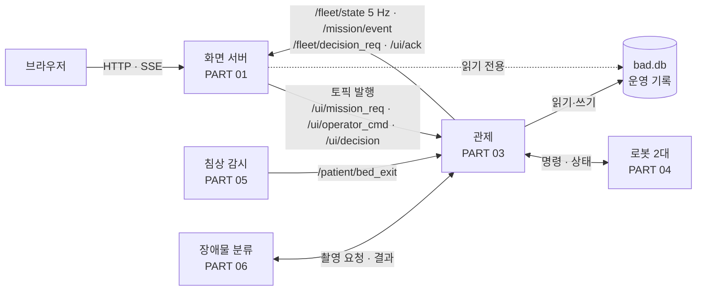
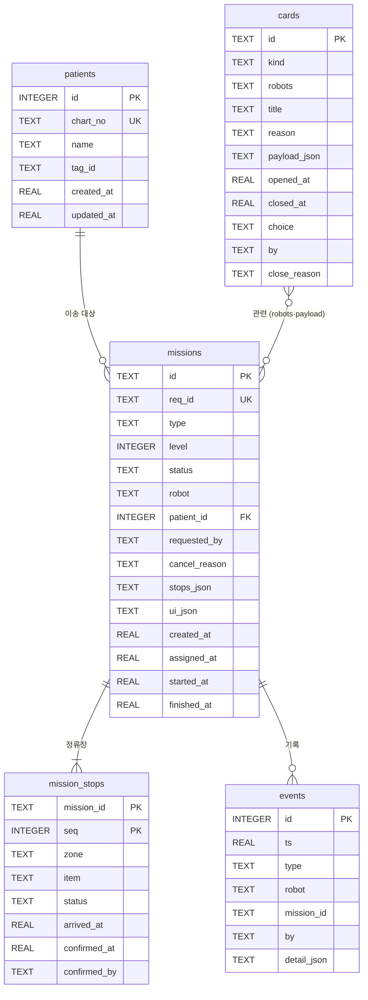
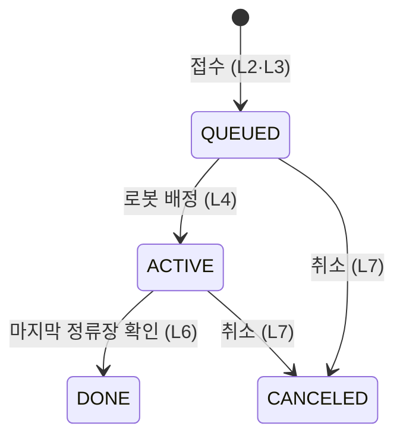
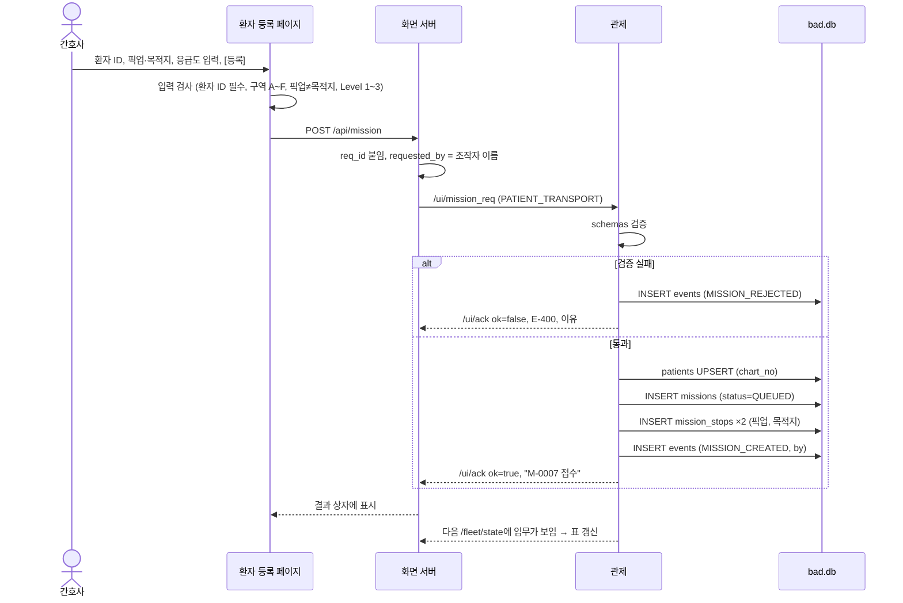
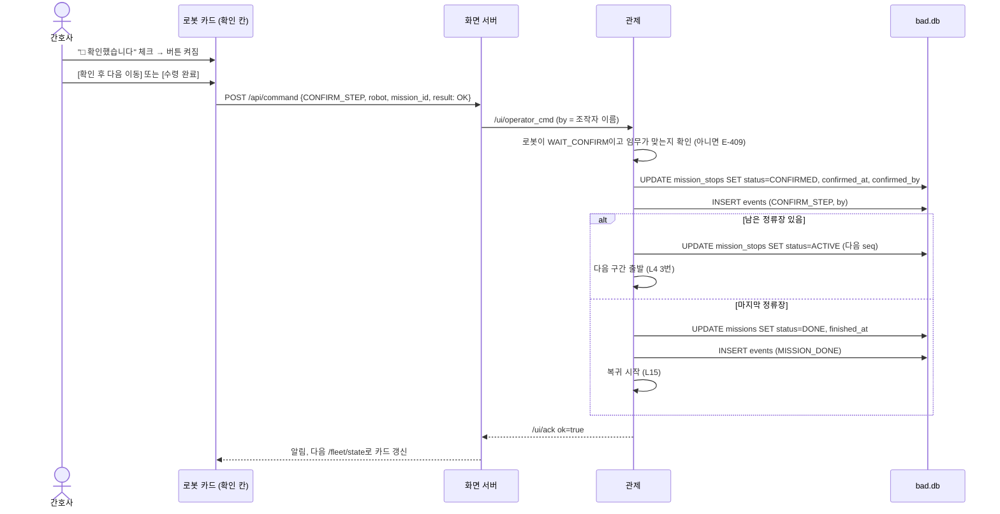

# 관제 화면·DB·로직 설계 (PART 01 화면 + PART 03 DB)

담당 김준성 · 2026-11-19 정리본

- 이 문서: 화면 페이지와 버튼, 화면 세부(지도·문장·시험 도구), DB 테이블, 버튼을 눌렀을 때의 처리 순서.
- 관제의 판단 규칙과 토픽 형식은 [`BRIEF.md`](BRIEF.md)에 있다. 테스트 목록도 BRIEF 9장에 같이 있다.
- 디자인 원본은 `docs/part3/ui/design-v2/`, 실제 화면 캡처는 `docs/part3/ui/screens/`에 있다.

---

## 1. 전체 구조



규칙 세 가지.

1. **지금 상태는 토픽으로, 지난 기록은 DB로.** 화면은 `/fleet/state`(초당 5번)를 받아 바로 그린다. 끝난 임무, 이벤트 기록, 카드 기록은 `bad.db`에서 읽는다.
2. **DB는 관제만 쓴다.** 화면 서버는 `bad.db`를 읽기만 한다. 화면에서 바꾸는 일은 모두 관제에 요청으로 보내고, 관제가 판단한 뒤 DB에 쓴다. 두 프로그램이 같은 표를 동시에 고쳐 상태가 엇갈리는 일을 막기 위해서다.
3. **화면은 판단하지 않는다.** 누가 먼저 복도에 들어갈지, 어느 로봇을 보낼지는 관제가 정한다. 화면은 받은 상태와 문장을 그대로 보여 주고, 사람의 선택을 요청으로 보낸다. 근거 문장은 `resource_manager`가 만들고 화면은 고치지 않는다.

**경계**

- PART 01과 PART 03은 토픽과 읽기 전용 DB로만 통신한다. 시험 도구(3.4절)의 `/mock/control`, `/patient/bed_exit` 발행만 예외다.
- PART 01이 import하는 PART 03 코드는 `core/schemas.py`(요청 검증)와 `core/config.py`(`fleet.yaml` 읽기)뿐이다. 구역·복도·로봇·구역 이름은 `fleet.yaml`에서 읽는다 (관제와 화면이 같은 이름을 쓰도록).

**기술**

- Flask + rclpy 한 프로세스(`ui_server`), 브라우저로는 SSE(`GET /events`). static 파일을 직접 쓰고 CDN·npm·빌드 도구는 쓰지 않는다.
- 페이지 이동은 한 HTML 안에서 해시 주소로 한다: `#/dashboard`, `#/missions`, `#/patient`, `#/supply`, `#/log`. 새로고침해도 같은 페이지가 열린다.
- 포트 8090, `0.0.0.0`에 연다. 같은 와이파이의 다른 기기에서 `http://<관제 PC IP>:8090`으로 볼 수 있다.
- 실행: `ui.launch.py`(화면만), `demo_mock.launch.py`(관제 + mock + 화면, 시험 도구 켬), `real.launch.py`(관제 + 화면, 실제 로봇).

---

## 2. 페이지 구성

### 2.0 목록과 흐름

페이지 5장, 레이어(창·판) 7개.

| # | 페이지 | 주소 | 블록 | 화면 표 | 주요 버튼 |
|---|---|---|---|---|---|
| P1 | 종합 관제 | `/#/dashboard` | 8 | 2 | 안전 정지, 이송 요청, 판단 근거, 보내기, 확인, 취소 등 |
| P2 | 이송 작업 | `/#/missions` | 3 | 3 | 임무 취소, 다시 시도, 확인 |
| P3 | 환자 등록 | `/#/patient` | 2 | 1 | 등록, 초기화 |
| P4 | 약품 운송 요청 | `/#/supply` | 3 | 1 | 운송 요청 등록, 호출 등록, 정류장 추가 |
| P5 | 운영 기록 | `/#/log` | 3 | 2 | 거르기, 검색, CSV 저장 |


### 2.1 공통 틀 (모든 페이지)

어두운 위쪽 막대에 B.A.D 병원 이송 관제, 페이지 탭 다섯 개, 모드, 담당자 입력과 시각을 둔다. 담당자 기본값은 `operator`이며 요청과 조작 기록에 사용한다.

명령 줄 왼쪽에 관제 연결(최근 2초 수신), 연결 로봇 수, 침상 감시, 진행 작업 수, 배정 대기 수를 표시한다. 오른쪽 [이송 요청]은 등록 창을 연다. [안전 정지 요청]은 즉시 `PAUSE_ALL`을 보내며 안전 정지 중에는 같은 자리에 [전체 재개]가 나타난다. 침상 이탈·감시 끊김 중에는 재개 금지 이유를 표시한다.

상황 줄은 모든 페이지에 있다. 평상시 회색으로 “이상 없음”을 표시한다. 양보·대기·교착·점유 불명은 주황색으로 표시하고 [판단 근거]를 연결한다. 침상 이탈·범퍼·침상 감시 끊김·로봇 또는 관제 연결 끊김은 빨강이다. 여러 건이면 가장 심각한 하나와 나머지 건수를 표시한다. 경보 창에서 [확인]을 눌러도 실제 조건이 풀릴 때까지 상황 줄을 유지한다.

결정 카드에는 근거, 관련 로봇·작업, 선택지별 설명을 둔다. 기본 선택이 있을 때 추천과 남은 시간 막대를 표시한다. [나중에]로 닫은 카드는 상황 줄에서 다시 연다. 경보 창에는 경과 시간·로봇·작업·감지 시각·관제 조치를 표시하고 [확인]과 [경보음 끄기]를 제공한다.

**알림**

- 모든 요청은 `/ui/ack`를 기다린다. 결과는 오른쪽 아래에 `message`를 그대로 보여 준다 (성공 초록, 실패 빨강).
- `ack_timeout_s`(3초) 안에 답이 없으면 "관제 응답 없음". 답을 기다리는 동안 그 버튼을 막는다 (두 번 보내기 방지).

**확인 창**

- 되돌릴 수 없는 조작은 화면 안 확인 창을 한 번 거친다: [임무 취소], [현장 확인 후 복도 비움].
- 브라우저 `alert`·`confirm`은 쓰지 않는다. [안전 정지 요청]은 확인 창 없이 바로 보낸다.

### 2.2 P1 종합 관제

| 위치 | 내용 | 조작 |
|---|---|---|
| 왼쪽 평면도 | 실측 벽·문, 구역, 로봇 표시 글자와 모양, 남은 경로 점선, 복도 사용 방향 화살표 | 실제 맵 스위치·확대·축소·끌기·더블클릭, 로봇 선택, 구역 보내기 |
| 지도 아래 | 복도를 허가받은 로봇, 방향, 대기 로봇·위치, 대기 중 출발 조건과 범례 | 점유 불명일 때 현장 확인 후 비움 |
| 오른쪽 380px | 두 역할 로봇 블록. 역할 이름·Robot A/B, 상태, 임무, 경로·지금·배터리·연결 | 아래 상태별 버튼, 작업 상세 |
| 로봇 아래 | 진행 중·배정 대기 전환, 작업·경로·응급도·로봇 표 | 전체 작업, 행의 임무 ID |
| 아래 전체 폭 | 최근 세 이벤트의 시각·제목·문장 | 전체 기록 |

**로봇 카드의 상태별 버튼**

| 로봇 상태 | 버튼 | 로직 |
|---|---|---|
| `IDLE` | 구역 선택 + [보내기] (`GO_ZONE`) | L9 |
| `SENDING`·`MOVING`·`HOLD`·`GIVE_WAY`·`RETURNING`·`YIELDING` | [정지] (`PAUSE_ROBOT`), [임무 취소] | L10, L7 |
| `WAIT_CONFIRM` | 카드 안에 확인 칸을 펼친다 (아래) | L6 |
| `SAFE_PAUSE` | [재개] (`RESUME_ROBOT`). 침상 이탈 중이면 막고 이유를 보여 준다 | L10 |
| `FAULT` | [다시 시도] (`RETRY`), [임무 취소] | L8, L7 |
| `OFFLINE` | 없음. "연결 끊김 · 마지막 수신 mm:ss 전" | — |

**`WAIT_CONFIRM` 확인 칸** (디자인 05·06)

- 도착 구역, 정류장 품목 또는 환자, 다음 목적지를 보여 준다.
- "□ 확인했습니다"를 체크해야 버튼이 켜진다. 버튼은 [확인 후 다음 이동], 마지막 정류장이면 [수령 완료] (`CONFIRM_STEP OK`). 옆에 [불일치] (`CONFIRM_STEP MISMATCH`).

**재개 조건 체크** (디자인 04). 화면은 상태값을 보고 체크 표시만 한다. 판단은 하지 않는다.

- 복도에 대기 로봇이 있을 때
  1. "{통행 로봇} 완전 통과 확인": 통행 로봇이 `holders`에서 빠지면 ✓
  2. "복도 비움 확인": `state`가 `FREE`이거나 대기 로봇에게 `GRANTED`면 ✓
  3. "{대기 로봇} 진입 허가": 대기 로봇이 `holders`에 들어오면 ✓
  4. "재개 명령 전달 · 로봇 확인": 대기 로봇 상태가 `MOVING`이 되면 ✓
- 복도 양보 중일 때: "{우선 로봇} 지나감", "{양보 로봇} 다시 출발"

**통행 판단 상세 창** (디자인 08)

- 대상은 `last_decision`, 또는 운영 기록에서 고른 판단 이벤트다.
- 판단 당시 복도 상태(`state_before`), 경쟁 로봇별 작업 종류·Level·요청 시각(`contenders`), 판단 문장(`reason`), 기준(`rule`을 한국어로: `LEVEL` "높은 응급도 우선", `REQUEST_TIME` "먼저 요청한 쪽", `ENTRY_ORDER` "복도에 나중에 들어온 쪽이 양보", `NO_PREEMPT` "이미 허가된 로봇은 회수하지 않음").
- 고정 규칙 한 줄: "동급이면 먼저 요청한 쪽, 허가된 통행은 회수하지 않음".
- [판단 기록 보기] → P5를 판단 이벤트로 거른 상태로 연다.

### 2.3 P2 이송 작업

| 블록 | 보여 주는 것 | 데이터 출처 | 버튼·입력 | 로직 |
|---|---|---|---|---|
| 거르기 줄 | 탭 4개 (진행 중, 배정 대기, 완료, 취소), 종류·로봇·Level·날짜 | — | 탭, 선택 상자 | L14 |
| 작업 목록 **(표 1)** | 임무 ID, 종류, 대상(환자·물품), 경로, 응급도, 로봇, 상태, 요청자, 접수 시각 | 진행 중·대기: `/fleet/state`. 완료·취소: `bad.db` missions | 줄 클릭 → 상세 | L14 |
| 상세 패널 | 종류, 요청자, 접수 시각, 환자 또는 품목, 담당 로봇과 상태, 대기 사유 | `bad.db` missions + patients (+ 진행 중이면 `/fleet/state`) | [임무 취소] (확인 창), `FAULT`면 [다시 시도], `WAIT_CONFIRM`이면 P1과 같은 확인 칸 | L7, L8, L6 |
| 　정류장 **(표 2)** | 순번, 구역, 품목, 상태(지난 곳 ✓, 지금 곳 강조), 도착 시각, 확인 시각, 확인한 사람 | `bad.db` mission_stops | — | L14 |
| 　이 임무의 기록 **(표 3)** | 시각, 이벤트, 문장 (시간순) | `bad.db` events (mission_id) | — | L14 |

- [임무 취소]가 거절되면 관제 문장(예: "Robot A 복도 통과 중 — 통과 후 취소하세요")을 그대로 보여 준다.

### 2.4 P3 환자 등록 (디자인 패널 01)

| 블록 | 보여 주는 것 | 데이터 출처 | 버튼·입력 | 로직 |
|---|---|---|---|---|
| 등록 폼 | 환자 ID(차트번호, 필수), 이름(선택), 손목 태그(비활성, “QR 연동 후 사용”), 픽업 구역, 목적지 구역, 응급도 Level 1·2·3 버튼 | — | [등록] → `PATIENT_TRANSPORT`, [초기화] | L2 |
| 결과 상자 | 성공: "M-0007 접수 · 침상형 이송 로봇 배정" + [작업 보기]. 실패: 빨간 상자에 관제 문장 | `/ui/ack` | [작업 보기] → P2 | L2 |
| 최근 환자 이송 **(표 1)** | 최근 10건: 접수 시각, 환자 ID, 이름, 경로, 응급도, 상태 | `bad.db` missions + patients | 줄 클릭 → P2 | L14 |

### 2.5 P4 약품 운송 요청 (디자인 패널 02·09·10)

| 블록 | 보여 주는 것 | 데이터 출처 | 버튼·입력 | 로직 |
|---|---|---|---|---|
| 약품 운송 탭 (기본) | 들를 구역 1~6곳, 정류장별 약품 이름, 응급도 | — | 구역 선택·빼기, 초기화, 요청 등록 | L3 |
| 로봇 호출 탭 | 목적지, 품목(선택), 응급도 | — | [호출 등록] → `CALL` | L3 |
| 진행 단계 **(표 1)** | 진행 중 물품 임무를 고르면 단계 목록과 지금 단계: ① 요청·응급도 확인 ② 로봇 수령지 이동·도착 ③ 물품 수령 확인 ④ 전달지 이동 ⑤ 인계 확인 | `/fleet/state` + `bad.db` mission_stops | 임무 고르기 | L14 |

- [요청 등록]은 고른 순서의 정류장 1~6곳을 `{zone, item}` 목록으로 보낸다. 다시 누르면 빠지고, 가득 차면 마지막 정류장을 교체한다.

### 2.6 P5 운영 기록

| 블록 | 보여 주는 것 | 데이터 출처 | 버튼·입력 | 로직 |
|---|---|---|---|---|
| 지표 4칸 | 대기 횟수, 교착 횟수, 교착 평균 해소 시간, 정지 횟수 (고른 기간) | `bad.db` events 집계 | 기간 선택 | L14 |
| 이벤트 **(표 1)** | 시각, 종류, 로봇, 임무, 누가, 문장. 50개씩 쪽 넘김 | `bad.db` events | 로봇·종류·임무 거르기, 글자 검색, [CSV 저장] | L14 |
| 결정 카드 기록 **(표 2)** | 종류, 열린 시각, 닫힌 시각, 고른 것, 누가, 닫힌 이유 | `bad.db` cards | — | L14 |

### 2.7 레이어 7개

| 레이어 | 언제 열리나 | 내용 | 버튼 | 로직 |
|---|---|---|---|---|
| 빠른 등록 창 | [+ 이송 요청] | 환자 이송 / 약품 운송 / 로봇 호출 탭 (P3·P4 공통 폼). 구역을 누른 순서가 경로이며 꽉 차면 마지막 구역을 교체한다 | 초기화, 요청 등록 | L2, L3 |
| 결정 카드 창 | `/fleet/decision_req`가 오면 어느 페이지든 | 근거·로봇·정지 위치·분류, 선택지별 설명과 기본 선택 타이머 | 선택지, [나중에] | L11 |
| 경보 창 | 침상 이탈, 범퍼, 침상 감시 끊김, 막힘, 연결 끊김, 장애 이벤트 | 감지 시각·경과 시간·관제 조치 | [확인], [경보음 끄기] | L12 |
| 확인 창 | 임무 취소, 복도 비움 확인 | "되돌릴 수 없습니다" 문구 | [확인], [닫기] | L7, L13 |
| 통행 판단 상세 창 | [판단 근거], [통행 판단 상세] | 2.2절 | [판단 기록 보기] → P5 | L1 |
| 구역 보내기 창 | 지도에서 구역 클릭 | "이 구역으로 보내기: [Robot A] [Robot B]" (임무 없는 로봇만 활성) | 로봇 버튼 | L9 |
| 시험 도구 판 | 톱니 버튼 (mock일 때만) | 3.4절 | 각 버튼 | (시험용) |

---

## 3. 화면 세부

### 3.1 디자인 기준

팀장이 11/19 확정한 [관제 화면 v2 사양](ui/design-v2/README.md)과 같은 폴더의 `Main`, `CorridorWait`, `BedAlarm`, `Decision`, `Request.dc.html` 인라인 스타일을 따른다. 화면 크기는 1440×900과 1280 폭을 확인한다. 배포 패키지에 IBM Plex Sans KR 네 굵기와 OFL을 포함한다. 색·간격·글자는 CSS 루트 토큰을 쓰며 파랑은 조작과 선택, 주황은 대기, 빨강은 위험과 응급에 사용한다.

### 3.2 지도

실측 좌표와 변환은 기존 평면도를 유지하고 화면 표현은 v2 사양을 따른다.

**방향**

- SLAM 맵(점유 격자)을 그대로 보여 주지 않는다. 벽이 들쭉날쭉하고 잡음이 많아 방과 문이 읽히지 않는다.
- 대신 **실제 맵에서 잰 벽으로 만든 평면도**를 그린다. 곧은 벽, 문 틈, 방 바닥만 있다.
- 좌표는 실제 맵(map 좌표)과 같다. 그래서 로봇 위치·구역·경로가 평면도 위의 실제 자리에 놓인다.

**평면도 파일** `src/part1_ui_dashboard/config/floor_plan.yaml`

`main_maps.pgm`에서 잰 벽 중심선이다 (map 좌표, m). 맵 기울기(약 4.1°)를 보정한 뒤 벽 칸이 가장 많이 몰린 줄을 골랐다. 건물 바깥 약 7.25 × 3.22 m, 양쪽 홀 폭 약 1.8 m, 가운데 E방·복도·B방이다.

```yaml
source_map: main_map/main_maps.yaml
walls:                       # [x1, y1, x2, y2]
  - [0.36, 1.19, -0.16, -6.04]     # 바깥 (D·E·F 쪽)
  - [-2.86, 1.42, -3.37, -5.81]    # 바깥 (A·B·C 쪽)
  - [0.36, 1.19, -2.86, 1.42]      # 바깥 (A·D 쪽 끝)
  - [-0.16, -6.04, -3.37, -5.81]   # 바깥 (C·F 쪽 끝)
  - [0.22, -0.64, -0.94, -0.55]    # 위쪽 홀 | E방
  - [-1.92, -0.48, -2.99, -0.41]   # 위쪽 홀 | B방
  - [-0.03, -4.23, -1.20, -4.14]   # E방 | 아래쪽 홀
  - [-2.18, -4.07, -3.24, -4.00]   # B방 | 아래쪽 홀
  - [-0.94, -0.55, -1.03, -1.82]   # E방 | 복도 (문 앞)
  - [-1.09, -2.67, -1.20, -4.14]   # E방 | 복도 (문 뒤)
  - [-1.92, -0.48, -2.01, -1.70]   # B방 | 복도 (문 앞)
  - [-2.06, -2.45, -2.18, -4.07]   # B방 | 복도 (문 뒤)
doors:                       # 문 틈 양 끝
  ROOM_E: [-1.03, -1.82, -1.09, -2.67]
  ROOM_B: [-2.01, -1.70, -2.06, -2.45]
labels:
  corridor: "복도"
```

- 맵이 바뀌면 다시 잰다: `ros2 run part1_ui_dashboard measure_floor_plan` (기울기 보정 → 벽 칸 행·열 합의 큰 줄 → 선분). 화면 서버는 파일만 읽는다.
- 파일이 없으면 실제 맵을 정리해 그리고, 맵도 없으면 간이 지도로 그린다. 어느 쪽인지 지도 위에 작게 쓴다.

**화면 방향**

- 서버가 맵 기울기를 구한다 (`map_deskew`). `auto`: 벽 칸 좌표를 −15°~+15°로 0.1° 간격으로 돌려 보며 가로·세로 5 cm 히스토그램의 제곱합이 가장 큰 각도 (이 맵은 약 4.1° 반시계). 숫자를 주면 그 각도, `0`이면 보정 안 함.
- 전체 회전 = 기울기 보정 + `map_rotate`(ccw90). 그러면 벽이 화면 축에 곧게 놓이고, 복도가 가운데 가로 띠, 위 줄 D·E·F, 아래 줄 A·B·C가 된다.
- 이 변환 행렬 하나를 `/map/meta`로 내주고, 평면도·구역·로봇·경로를 모두 이 행렬로 그린다. JS에 같은 계산을 따로 짜지 않는다.

**그리기**

- 흰 바닥과 회색 벽·문 틈, 옅은 복도 위에 허가 방향 화살표를 그린다. 횡단 또는 방향 미확인에는 종방향 화살표가 없다.
- 구역에는 점과 이름표를 둔다. A는 진한 원, B는 진한 둥근 사각형이며 표시 글자는 흰색이다. 정상 링은 흰색, 대기 링은 주황, 안전 정지 링은 빨강이다. 비정상 상태일 때만 지도에 상태 글자를 붙인다.
- 남은 경로는 6·6 점선, 정지·대기 경로는 흐린 2·6 점선이다.
- 장애물 표시: `robots.<id>.obstacle.detections` 중 `pose`가 있는 것을 작은 빨간 원(지름 14px, 가운데 "!")과 한국어 라벨로 그린다. 멈춤이 풀리면 지운다.
- 그리는 순서: 바닥 → (실제 맵) → 벽·문 → 경로 → 구역 점 → 로봇 원 → 글.
- 아래 범례는 두 역할의 모양, 남은 경로 점선, 복도 사용 방향 화살표를 설명한다.

**글자 자리 정하기**

- 매 프레임 화면 좌표에서 글자 상자를 정한다. 순서: 로봇 상태 글 → 구역 이름표 → 장애물 라벨 → "복도".
- 글자마다 후보 자리를 차례로 시험하고, 벽 선분(두께 포함)·로봇 원·이미 놓은 글자 상자와 하나도 겹치지 않는 첫 자리를 쓴다. "복도"는 경로 선과도 겹치지 않아야 한다.
- 후보
  - 로봇 상태 글: 안쪽 30px → 바깥쪽 30px → 오른쪽 → 왼쪽
  - 구역 이름표: 바깥쪽 26px → 안쪽 26px → 오른쪽 → 왼쪽 (위 줄은 위, 아래 줄은 아래가 바깥쪽)
  - "복도": 복도 가운데 → 왼쪽 1/4 지점 → 오른쪽 1/4 지점
- 맞는 자리가 없으면 상태 글과 이름표는 첫 후보에 반투명 흰 바탕을 깔고 그린다. "복도"는 그리지 않는다.
- 계산은 JS(`map.js`)에서 한다. 판단이 아니라 그리기라서다.

**화면 맞춤**

- 처음 볼 때와 더블클릭 때는 평면도 바깥 벽 전체가 패널 안에 들어오게 맞추고 가운데 둔다 (가로세로 비율 유지, 여백 16px). 패널 크기가 바뀌면 다시 맞춘다.
- 확대·축소는 마우스 위치 기준 0.8~4배, 끌어서 이동.

**실제 맵 겹쳐 보기**

- 지도 칸 오른쪽 위 "실제 맵" 스위치 (기본 끔). 켜면 정리한 점유 격자를 평면도 아래에 35% 불투명도로 깔고, 관제가 쓰는 복도 다각형(`fleet.yaml corridor.polygon`)을 점선으로 그린다. 평면도·다각형이 실제 맵과 맞는지 눈으로 확인하는 용도다.
- 격자 정리 (서버, 순수 파이썬, 켜질 때 한 번)
  1. 위 변환으로 같은 해상도(5 cm)의 새 격자에 옮긴다.
  2. 벽 칸 덩어리(8이웃)가 4칸 미만이면 빈 칸으로.
  3. 벽에 3×3 닫기 한 번 (1칸 틈 메우기, 문은 안 막힘).
  4. 빈 칸 덩어리가 20칸 미만이면 모르는 칸으로.
  5. 테두리에 닿지 않는 모르는 칸 덩어리는 빈 칸으로.
  6. 알려진 칸 전체 + 0.25 m로 자른다.
- `/map/image`는 정리한 격자(PGM P5), `/map/meta`는 크기·해상도·변환 행렬·기울기 각도.

### 3.3 화면 문장

**로봇 상태 배지**

| 상태 | 글 | 배지 색 |
|---|---|---|
| `IDLE` | 대기 | 회색 |
| `RETURNING` | 복귀 중 | 회색 |
| `SENDING` | 출발 준비 | 회색 |
| `MOVING` | 이동 중 | 회색 |
| `HOLD` | 진입 전 대기 | 주황 |
| `GIVE_WAY` | 복도 양보 중 | 주황 |
| `YIELDING` | 교착 양보 중 | 주황 |
| `WAIT_CONFIRM` | 확인 대기 | 주황 |
| `SAFE_PAUSE` | 안전 정지 | 빨강 |
| `FAULT` | 장애 | 빨강 |
| `OFFLINE` | 연결 끊김 | 빨강 |

**결정 카드 선택지 설명** (화면용, 전송 키는 그대로 유지)

| kind | 선택지 ID와 설명 |
|---|---|
| BLOCKED | retry — 앞이 비었는지 확인한 뒤 원래 경로로 다시 갑니다. return — 이전 구역으로 돌아갑니다. hold — 현재 위치에서 멈춘 채 운영자의 재시도를 기다립니다. |
| DEADLOCK | yield_a / yield_b — 선택한 역할의 로봇이 대피 구역으로 이동합니다. |
| BED_MONITOR_LOST | hold — 감시 신호를 확인할 때까지 정지를 유지합니다. bypass — 운영자 확인으로 침상 감시 없이 운행을 허용합니다. |
| NAV_FAILED | retry — 같은 목적지로 다시 출발합니다. return — 이전 구역으로 돌아갑니다. cancel — 현재 작업을 취소합니다. |
| MOVE_REJECTED | retry — 같은 이동 명령을 다시 보냅니다. cancel — 현재 작업을 취소합니다. |
| STOP_MISMATCH | recheck — 현재 정류장에서 다시 확인합니다. skip — 이 정류장을 건너뛰고 진행합니다. cancel — 현재 작업을 취소합니다. |

**이벤트 제목**

- `ui_api.py`의 표 하나에서 만든다. BRIEF 4.8절 이벤트 종류 전부에 문장이 있어야 한다 (테스트 32). 예:
  - `RESOURCE_GRANT` → "{로봇} 복도 진입 허가", `RESOURCE_HOLD` → "{로봇} 진입 전 대기"
  - `RESOURCE_ENTER` → "{로봇} 복도 진입 확인", `RESOURCE_RELEASE` → "{로봇} 복도 통과 완료"
  - `CORRIDOR_YIELD_START` → "{로봇} 복도 양보 시작"
  - `MISSION_CREATED` → "{종류} 요청 등록", `ARRIVE` → "{로봇} · {구역} 도착", `CONFIRM_STEP` → "{구역} 확인 완료"
- 보조 문장은 `detail.reason`을 그대로 쓰고, 없으면 비운다.
- 실시간 화면과 DB 기록 조회(운영 기록, 작업 상세의 기록)가 같은 문장 함수를 쓴다.
- 옛 기록처럼 `reason`이 코드 값이거나 로봇 ID가 들어 있으면 그대로 보이지 않는다. 종류별 문장으로 바꾸고, ID는 표시 이름으로 바꾼다:
  - `CONFIRM_STEP` `OK` → "확인 완료", `MISMATCH` → "내용 불일치 — 운영자 결정 대기"
  - `CARD_CLOSED` `selected` → "'{고른 선택지}' 선택", `timeout` → "시간 초과 — 기본 선택으로 진행", `resolved` → "상황이 풀려 닫힘"
  - `MISSION_DONE` `DONE` → "모든 정류장 확인 완료"
  - 그 밖에 표에 없는 코드 값은 보조 문장을 비운다.

**이름**

- 구역: `zones.<X>.name`, 없으면 "A 구역".
- 자원: `CORRIDOR` → "복도", `ROOM_B`·`ROOM_E` → "{구역 이름} 출입". 화면과 관제 문장 모두 "공용도로"·"통로"를 쓰지 않는다. 코드 안의 이름(`CORRIDOR`, `CORRIDOR_YIELD_START`)과 설정 키(`corridor:`)는 그대로다.
- 임무 종류: `PATIENT_TRANSPORT` "환자 이송", `MED_ROUND` "약품 운송", `CALL` "로봇 호출".

### 3.4 시험 도구 (`ui.yaml`의 `dev_tools`가 `true`일 때만)

- 녹화와 리허설을 터미널 없이 하려고 둔다. `demo_mock.launch.py`에서만 켠다.
- 오른쪽 아래 톱니 버튼으로 여닫는다. 실기 모드에서는 보이지 않고, 서버 주소도 403으로 막는다.
- 버튼
  - 가짜 침상 감시: [끄기] / [정상 송신] / [이탈 송신]. 송신 중이면 화면 서버가 `/patient/bed_exit`를 10 Hz로 발행한다. [끄기]는 발행을 멈춰 끊김을 흉내 낸다.
  - 로봇별 [장애물 놓기 (N초 멈춤)], [다음 주행 실패], [연결 끊기 10초], [배터리 n%] → `/mock/control` (BRIEF 7장)
  - 로봇별 [분류 결과: 사람 / 물건 / 없음 / 오류 / 응답 없음] → `/mock/control` `obstacle`
  - 시나리오 1~5: 그 시나리오의 첫 요청들을 한 번에 넣는다 (`stage3-scenarios.md` 순서). 확인과 카드 선택은 사람이 화면에서 누른다.

### 3.5 설정 `src/part1_ui_dashboard/config/ui.yaml`

```yaml
fleet_yaml: ""                  # 비면 part3_fleet_manager 설치 경로의 config/fleet.yaml
host: 0.0.0.0
port: 8090
event_log_size: 500             # 화면 서버가 메모리에 두는 최근 이벤트 수 (새로 연결한 브라우저용)
map_yaml: main_map/main_maps.yaml          # 작업공간 루트 기준 (~/bad_ws에서 실행)
floor_plan_yaml: config/floor_plan.yaml    # 패키지 기준. 없으면 실제 맵 → 간이 지도
map_rotate: ccw90               # none | cw90 | ccw90 | 180
map_deskew: auto                # auto | 각도(도, 반시계 +) | 0
map_padding_m: 0.25
mode_label: auto                # auto(mock이면 "시연 모드") | demo | live
dev_tools: false                # 시험 도구. demo_mock.launch.py에서만 true
ack_timeout_s: 3.0
```

---

## 4. DB 설계

### 4.1 파일

| 파일 | 쓰는 쪽 | 읽는 쪽 | 담는 것 |
|---|---|---|---|
| `bad.db` (`fleet.yaml db.path`) | 관제 (PART 03 `store.py`) | 관제, 화면 서버 (읽기 전용) | 환자, 임무, 정류장, 이벤트, 결정 카드 |

- 시연은 `~/.bad/bad.db`, 실제 로봇은 `~/.bad/bad_real.db` (`real.launch.py` 기본값). 두 기록이 섞이지 않는다.
- SQLite, WAL 모드. 시각은 epoch 초(REAL). 테이블 5개.



### 4.2 테이블

**patients** — 이송할 환자. 차트번호 하나에 한 줄.

| 칸 | 타입 | 제약 | 뜻 | 쓰는 때 |
|---|---|---|---|---|
| id | INTEGER | PK | | L2 |
| chart_no | TEXT | NOT NULL, UNIQUE | 환자 ID (차트번호) | L2 (없으면 INSERT) |
| name | TEXT | NULL | 이름 (선택) | L2 (값이 오면 UPDATE) |
| tag_id | TEXT | NULL | 손목 태그 ID. PART 02 연동 전에는 받아 두기만 함 | L2 |
| created_at, updated_at | REAL | | | L2 |

- 옛 DB에 같은 차트번호가 여러 줄이면 옮길 때 한 줄로 합치고, 나머지 줄의 차트번호는 `legacy_chart_no`로 옮긴다.

**missions** — 요청 한 건.

| 칸 | 타입 | 제약 | 뜻 | 쓰는 때 |
|---|---|---|---|---|
| id | TEXT | PK | `M-0001` 형식 | L2·L3 |
| req_id | TEXT | UNIQUE | 화면이 만든 요청 ID. 같은 요청이 두 번 와도 임무는 하나 | L2·L3 |
| type | TEXT | NOT NULL | `PATIENT_TRANSPORT` · `MED_ROUND` · `CALL` | L2·L3 |
| level | INTEGER | 1~3 | 응급도 | L2·L3 |
| status | TEXT | NOT NULL | 4.3절 | L2~L8 |
| robot | TEXT | NULL | 배정된 로봇 | L4 |
| patient_id | INTEGER | FK → patients | 환자 이송일 때만 | L2 |
| requested_by | TEXT | | 요청한 조작자 이름 | L2·L3 |
| cancel_reason | TEXT | NULL | 취소 이유 | L7 |
| stops_json | TEXT | | 정류장 목록 사본. 끝난 임무 요약(`/fleet/state`의 최근 20건)과 옛 DB 옮기기에 쓴다. 정류장별 기록은 `mission_stops` | L2·L3 |
| ui_json | TEXT | | 화면용 부가 정보 (요청처, 손목 태그 ID, 지금 정류장 순번) | L2·L3 |
| created_at, assigned_at, started_at, finished_at | REAL | | 접수, 배정, 첫 출발, 끝 | L2~L7 |

**mission_stops** — 임무의 정류장. 정류장마다 누가 언제 확인했는지 남긴다.

| 칸 | 타입 | 제약 | 뜻 | 쓰는 때 |
|---|---|---|---|---|
| mission_id | TEXT | PK, FK → missions | | L2·L3 |
| seq | INTEGER | PK | 1부터 | L2·L3 |
| zone | TEXT | A~F | 구역 | L2·L3 |
| item | TEXT | NULL | 품목 또는 "픽업"·"목적지" | L2·L3 |
| status | TEXT | | 4.3절 | L4~L7 |
| arrived_at | REAL | | 도착 시각 | L5 |
| confirmed_at, confirmed_by | REAL, TEXT | | 확인 시각과 확인한 사람(조작자 이름) | L6 |

**events** — 일어난 일 전부 (BRIEF 4.8절 이벤트 종류). 한 번 쓰면 고치지 않는다.

| 칸 | 타입 | 뜻 |
|---|---|---|
| id | INTEGER PK | |
| ts | REAL | 시각 |
| type | TEXT | 이벤트 종류 |
| robot, mission_id | TEXT | 관련 로봇·임무 (없으면 NULL) |
| by | TEXT | 사람이 한 일이면 조작자 이름, ROS 서비스로 온 정지·재개면 "ROS 서비스", 관제가 스스로 한 일이면 NULL |
| detail_json | TEXT | 판단 근거 문장(`reason`), `rule`, `contenders` 등 |

**cards** — 결정 카드.

| 칸 | 타입 | 뜻 | 쓰는 때 |
|---|---|---|---|
| id | TEXT PK | `K-` 뒤에 UUID | L11 열림 |
| kind | TEXT | `DEADLOCK`, `BLOCKED`, `NAV_FAILED`, `MOVE_REJECTED`, `STOP_MISMATCH`, `BED_MONITOR_LOST` | L11 |
| robots | TEXT | 관련 로봇 (쉼표) | L11 |
| title, reason | TEXT | 제목, 근거 문장 | L11 |
| payload_json | TEXT | 선택지, 추천, 기본값, 제한 시간 | L11 |
| opened_at, closed_at | REAL | | L11 |
| choice, by | TEXT | 고른 선택지와 고른 사람 (시간 초과면 by NULL) | L11 |
| close_reason | TEXT | `selected` · `timeout` · `resolved` | L11 |

인덱스: `events(ts)`, `events(mission_id)`, `events(type)`, `missions(status, created_at)`, `cards(opened_at)`.

옛 DB 파일(칸이 모자란 것)을 열면 칸을 더하는 방식으로 옮긴다. 기존 줄은 지우지 않는다.

### 4.3 상태 값

**missions.status**



| 값 | 화면 글 | 뜻 |
|---|---|---|
| `QUEUED` | 배정 대기 | 접수됨, 로봇 아직 없음 |
| `ACTIVE` | 진행 중 | 로봇 배정됨. 이동·대기·확인 대기·장애 모두 여기. 자세한 상태는 로봇 상태로 본다 |
| `DONE` | 완료 | 마지막 정류장 확인 |
| `CANCELED` | 취소 | 사람이 취소 |

검증에 실패한 요청은 임무가 아니므로 `missions` 행을 만들지 않는다. `events`에 `MISSION_REJECTED`(이유, 요청자)만 남기고 화면에 오류를 돌려준다.

**mission_stops.status**: `PENDING`(아직) → `ACTIVE`(이 정류장으로 가는 중) → `ARRIVED`(도착, 확인 대기) → `CONFIRMED`(확인) / `MISMATCH`(불일치, 카드 대기) / `SKIPPED`(카드에서 건너뛰기). 임무가 취소되면 남은 정류장은 `SKIPPED`.

### 4.4 페이지와 테이블 (C 만들기 · R 읽기 · U 고치기)

화면은 `bad.db`를 읽기만 한다. 아래 표의 C·U는 화면 요청을 받은 관제가 한다.

| 페이지·레이어 | patients | missions | mission_stops | events | cards |
|---|---|---|---|---|---|
| P1 종합 관제 | | (토픽) | (토픽) | C (사람 조작) | |
| P2 이송 작업 | R | R U | R U | R C | |
| P3 환자 등록 | C U R | C R | C | C | |
| P4 약품 운송 요청 | | C R | C R | C | |
| P5 운영 기록 | | | | R | R |
| 결정 카드 창 | | | | C | C U |
| 경보 창 | | | | (토픽) | |

---

## 5. 로직

### 5.0 공통

**화면 서버가 요청을 받으면** (`POST /api/mission`, `/api/command`, `/api/decision`)

1. 입력을 검사한다 (`ui_api.py`, 관제 `schemas.py`). 틀리면 400과 이유 문장.
2. 요청 JSON에 `req_id`/`cmd_id`/`card_id`를 서버가 붙이고, `by`·`requested_by`에는 조작자 이름 칸 값을 넣어 토픽으로 보낸다.
3. POST는 붙인 요청 ID(`ref`)를 바로 돌려준다 (202). 브라우저는 SSE로 같은 `ref`의 `/ui/ack`를 3초까지 기다려 결과 상자·알림에 보인다. 3초 안에 없으면 "관제 응답 없음".

**관제가 요청을 받으면**

검사 → 상태 변경 → `bad.db` 쓰기 → `/ui/ack` → 다음 `/fleet/state`에 반영. 판단과 쓰기는 10 Hz tick 한 곳에서 한다 (BRIEF 2장).

**화면이 다시 그리는 때**

| 받는 것 | 다시 그리는 곳 |
|---|---|
| `/fleet/state` (초당 5번) | 요약 4칸, 상황 띠, 지도, 복도 칸, 로봇 카드, 이송 작업 표(진행 중·대기), 침상 감시 배지, 관제 연결 상태 |
| `/mission/event` | 최근 운영 기록, 경보 창 (경보 종류일 때), P2 상세가 그 임무면 기록 표 |
| `/mission/event` 중 `MISSION_DONE`·`MISSION_CANCELED`·`CONFIRM_STEP` | P2 완료·취소 탭, P3 최근 표, P4 단계 표를 DB에서 다시 읽는다 |
| `/fleet/decision_req` | 결정 카드 창 |
| `CARD_CLOSED` 이벤트 | 그 카드 창 닫기 |
| `/ui/ack` | 누른 버튼 옆 알림 (성공 초록, 실패 빨강) |
| 페이지를 열 때 | 그 페이지의 DB 표 (L14) |

### 5.1 로직 목록

| ID | 이름 | 시작 | 끝 |
|---|---|---|---|
| L1 | 실시간 화면 갱신 | 토픽 수신 | 화면 반영 |
| L2 | 환자 이송 등록 | [등록] | 임무 접수 |
| L3 | 약품 운송·호출 등록 | [운송 요청 등록], [호출 등록] | 임무 접수 |
| L4 | 배정과 출발 | 관제 tick | 로봇 출발 |
| L5 | 도착 | 로봇 `ARRIVED` | 확인 대기 |
| L6 | 수령 확인·불일치 | [확인 후 다음 이동], [불일치] | 다음 정류장 또는 완료 |
| L7 | 임무 취소 | [임무 취소] | 취소 |
| L8 | 다시 시도 | [다시 시도] | 같은 구간 다시 출발 |
| L9 | 구역으로 보내기 | [보내기], 구역 보내기 창 | 로봇 출발 |
| L10 | 정지·재개 | [안전 정지 요청], [정지], [재개], [전체 재개] | |
| L11 | 결정 카드 | 관제가 카드 엶 | 선택·시간 초과·해소 |
| L12 | 경보 | 침상 이탈, 범퍼, 감시 끊김 등 | 경보 창 |
| L13 | 복도 비움 확인 | [현장 확인 후 복도 비움] | 복도 다시 사용 |
| L14 | 기록 조회 | 페이지 열기, 거르기, CSV | 표 |
| L15 | 복귀 | 마지막 확인 | 홈 도착 |

### 5.2 L1 실시간 화면 갱신

1. 화면 서버가 `/fleet/state`, `/mission/event`, `/fleet/decision_req`, `/ui/ack`를 구독한다.
2. 받은 것을 연결된 브라우저마다 SSE(`GET /events`)로 그대로 넘긴다. 새로 연결한 브라우저를 위해 최근 이벤트 500개를 메모리에 둔다.
3. 브라우저는 5.0절 "화면이 다시 그리는 때"대로 그린다.
4. `/fleet/state`가 2초 넘게 안 오면 "관제 연결 끊김"을 띄우고 조작 버튼을 막는다.

### 5.3 L2 환자 이송 등록



- 같은 `req_id`가 다시 오면 (버튼을 두 번 누름, 재전송) 새 임무를 만들지 않고 처음 응답을 다시 보낸다 (`missions.req_id` UNIQUE).

### 5.4 L3 약품 운송·호출 등록

L2와 같고, 다른 점만 적는다.

- 약품 운송: `MED_ROUND`, 정류장 1~6개 (선택한 순서의 구역과 정류장별 약품 이름). `mission_stops`를 정류장 수만큼 INSERT. `patients`는 쓰지 않는다.
- 로봇 호출: `CALL`, 정류장 1개.

### 5.5 L4 배정과 출발 (관제가 스스로)

1. tick마다 배정 대기열(`QUEUED`)의 맨 앞 임무를 본다 (Level 높은 순 → 먼저 온 순).
2. 기본 ROLE에서는 환자는 침상형 이송 로봇, 약품·호출은 약품 운송 로봇의 대기열에서 기다린다. IDLE_BEST_BATTERY를 선택하면 연결된 대기·복귀 로봇 중 배터리 20% 초과인 로봇을 배터리 순으로 고른다.
   - `UPDATE missions SET robot, assigned_at, status = 'ACTIVE'`
   - `UPDATE mission_stops SET status = 'ACTIVE' WHERE seq = 1`
3. 첫 구간에 필요한 복도·방을 요청하고, 허가가 나면 로봇에 `MOVE`를 보낸다.
   - `INSERT events (RESOURCE_REQUEST / RESOURCE_GRANT 또는 RESOURCE_HOLD, detail: 판단 근거)`
   - `INSERT events (LEG_START)`, 첫 출발이면 `missions.started_at`
4. 배정할 로봇이 없으면 그대로 두고 `wait_reason = "쉬는 로봇 없음"` (DB 변경 없음).

### 5.6 L5 도착

1. 로봇이 `ARRIVED`를 보내고 목적지가 맞으면 로봇 상태를 `WAIT_CONFIRM`으로 바꾼다.
2. `UPDATE mission_stops SET status = 'ARRIVED', arrived_at`, `INSERT events (ARRIVE)`.
3. 화면: 로봇 카드에 확인 칸이 펼쳐지고, P2 정류장 표에 도착 시각이 찍힌다.

### 5.7 L6 수령 확인·불일치



- [불일치]: `result: MISMATCH` → `mission_stops.status = 'MISMATCH'`, `events (CONFIRM_STEP, result=MISMATCH)`, 결정 카드 `STOP_MISMATCH`를 연다 (L11). 로봇은 그 자리에서 기다린다.

### 5.8 L7 임무 취소

1. [임무 취소] → 확인 창 → [확인].
2. `POST /api/command {CANCEL_MISSION, mission_id}` → `/ui/operator_cmd`.
3. 관제 검사
   - 로봇이 복도를 점유한 채 복도 안에 있으면 거절: `E-423` "Robot A 복도 통과 중 — 통과 후 취소하세요". DB 변경 없음.
   - 아니면 로봇에 `CANCEL`, 쥔 자원 반납.
4. `UPDATE missions SET status = 'CANCELED', cancel_reason, finished_at`, 남은 `mission_stops`는 `SKIPPED`, `INSERT events (MISSION_CANCELED, by)`.
5. 로봇은 홈으로 복귀한다 (L15).

### 5.9 L8 다시 시도

- `FAULT`인 로봇의 [다시 시도] → `RETRY` → 관제가 같은 구간을 다시 보낸다. `INSERT events (LEG_START, detail: retry)`. 카드가 열려 있으면 `resolved`로 닫는다.

### 5.10 L9 구역으로 보내기

- 로봇 카드의 [보내기] 또는 지도의 구역 보내기 창 → `GO_ZONE {robot, zone}`.
- 관제: 임무가 없는 로봇만 허용 (아니면 `E-409`). 자원 규칙은 똑같이 적용한다. `INSERT events (LEG_START, by)`. 임무 테이블에는 쓰지 않는다 (운영자 이동은 임무가 아니다). 도착하면 그 구역에서 기다린다.

### 5.11 L10 정지·재개

| 버튼 | 보내는 것 | 관제 | DB |
|---|---|---|---|
| [안전 정지 요청] (위쪽 줄) | `/ui/operator_cmd` `PAUSE_ALL` (조작자 이름 포함) | 두 로봇 `SAFE_PAUSE`, 주행 중이면 `PAUSE` | `events (PAUSE, by)` |
| [전체 재개] | `RESUME_ALL` (조작자 이름 포함) | 침상 이탈·감시 끊김 중이면 거절, 아니면 직전 상태로 | `events (RESUME 또는 RESUME_REJECTED, by)` |
| 로봇 카드 [정지]·[재개] | `PAUSE_ROBOT`·`RESUME_ROBOT` | 그 로봇만 | 같음 |

서비스 `/robot/pause`·`/robot/resume`(ROS `Trigger`)은 ROS 명령줄용으로 남는다. 이 경로의 `by`는 "ROS 서비스"다.

### 5.12 L11 결정 카드

1. 관제가 사람 판단이 필요한 상황을 만나면 (교착, 30초 막힘·물건 감지, 주행 실패, 명령 안 받음, 불일치, 침상 감시 끊김) 카드를 연다.
   - `INSERT cards (opened_at, payload)`, `INSERT events (CARD_OPEN)`, `/fleet/decision_req` 발행.
2. 화면: 어느 페이지든 결정 카드 창. 남은 시간 막대가 줄어든다.
3. 운영자가 선택지를 누르면 `POST /api/decision {card_id, choice}` → `/ui/decision`.
   - 관제: 이미 닫힌 카드면 `E-409`. 아니면 선택을 실행한다.
   - `UPDATE cards SET choice, by, closed_at, close_reason = 'selected'`, `INSERT events (CARD_CLOSED)`.
4. 제한 시간이 지나면 기본값이 있는 카드만 기본값으로 실행 (`close_reason = 'timeout'`, `by` NULL). 기본값이 없으면 계속 기다린다.
5. 상황이 먼저 풀리면 `close_reason = 'resolved'`로 닫는다.

### 5.13 L12 경보

| 상황 | 관제가 하는 일 | DB | 화면 |
|---|---|---|---|
| 침상 이탈 (`/patient/bed_exit` true) | 대상 로봇 정지 | `events (BED_EXIT)` | 빨강 경보 창 + 상황 줄 (해제될 때까지) |
| 범퍼 충돌 | 그 로봇 정지 | `events (BUMP)` | 빨강 경보 창 |
| 침상 감시 끊김 (3초) | 대상 로봇 정지 + 카드 | `events (BED_MONITOR_LOST)`, `cards` | 빨강 경보 창 + 상황 줄 + 결정 카드 |
| 연결 끊김 | 상태 수신 대기 | `LINK_LOST` | 빨강 경보 창 + 상황 줄 |
| 30초 막힘·물건 감지, 장애 | 상황별 (BRIEF 5장) | 해당 이벤트 | 주황 경보 창 |

경보 창의 [확인]은 창만 닫는다. 로봇을 다시 움직이는 것은 L10 재개다.

### 5.14 L13 복도 비움 확인

- 로봇 연결이 끊긴 채 복도 근처에 있으면 관제는 복도를 "점유 불명"으로 막는다.
- 운영자가 현장을 보고 [현장 확인 후 복도 비움] → 확인 창 → `RESOURCE_CLEAR_CONFIRM {resource: CORRIDOR}`.
- 관제: 복도를 비움으로 바꾸고 `events (RESOURCE_CLEAR_CONFIRM, by)`.

### 5.15 L14 기록 조회

화면 서버가 `bad.db`를 읽기 전용(`file:...?mode=ro`)으로 열어 SELECT만 한다.

| 주소 | 쿼리 (요지) | 쓰는 곳 |
|---|---|---|
| `GET /api/missions?status=&type=&robot=&level=&from=&to=&page=` | `missions LEFT JOIN patients … ORDER BY created_at DESC LIMIT 50 OFFSET …` | P2 표 1 |
| `GET /api/missions/<id>` | missions + patients 1줄, `mission_stops WHERE mission_id ORDER BY seq`, `events WHERE mission_id ORDER BY ts` | P2 상세, 표 2·3 |
| `GET /api/patients/recent` | `missions JOIN patients WHERE type = 'PATIENT_TRANSPORT' ORDER BY created_at DESC LIMIT 10` | P3 표 1 |
| `GET /api/events?type=&robot=&mission=&q=&from=&to=&page=` | `events … ORDER BY id DESC LIMIT 50` | P5 표 1 |
| `GET /api/events.csv?(같은 조건)` | 같은 쿼리, 쪽 나눔 없이 (최대 1만 줄) | P5 [CSV 저장] |
| `GET /api/cards?from=&to=&page=` | `cards ORDER BY opened_at DESC LIMIT 50` | P5 표 2 |
| `GET /api/kpi?from=&to=` | events 집계: `RESOURCE_HOLD` 수, `DEADLOCK_DETECTED` 수와 해소까지 평균 시간, `PAUSE` 수 | P5 지표 |

- 진행 중·배정 대기 임무는 DB가 아니라 `/fleet/state`로 보여 준다 (더 빠르고 정확하다).
- `bad.db`가 없거나 열 수 없으면 기록 주소는 503, 기록 표에 "기록 DB에 연결할 수 없습니다"를 쓰고 나머지 화면은 그대로 둔다.

### 5.16 L15 복귀

1. 마지막 확인(L6) 뒤 관제가 로봇을 홈 구역으로 보낸다: 로봇 상태 `RETURNING`, `events (LEG_START, detail: return)`.
2. 도착하면 `IDLE`, `events (ARRIVE, detail: return)`.
3. 복귀 중 새 임무가 배정되면 복귀를 취소하고 바로 새 임무로 간다 (BRIEF 5.1절 복귀).

---

## 6. 화면 서버 주소 목록

| 메서드·주소 | 하는 일 | 로직 |
|---|---|---|
| `GET /` | 관제 화면 | |
| `GET /events` | SSE (실시간 상태·이벤트·카드·응답) | L1 |
| `GET /api/map`, `/map/meta`, `/map/image` | 지도 설정, 평면도·변환, 정리한 실제 맵 | L1 |
| `POST /api/mission` | 임무 요청 → `/ui/mission_req` | L2, L3 |
| `POST /api/command` | `CONFIRM_STEP`, `CANCEL_MISSION`, `RETRY`, `PAUSE_ROBOT`, `RESUME_ROBOT`, `PAUSE_ALL`, `RESUME_ALL`, `GO_ZONE`, `RESOURCE_CLEAR_CONFIRM` → `/ui/operator_cmd` | L6~L10, L13 |
| `POST /api/decision` | 결정 카드 선택 → `/ui/decision` | L11 |
| `POST /api/service/pause`, `/api/service/resume` | `/robot/pause`·`/robot/resume` 호출 (화면 버튼은 쓰지 않음. 누른 사람이 안 남는다) | L10 |
| `GET /api/missions…`, `/api/events…`, `/api/cards`, `/api/kpi`, `/api/patients/recent` | 기록 조회 (`bad.db` 읽기 전용) | L14 |
| `POST /api/test/<action>` | 시험 도구 (`dev_tools: true`일 때만, 아니면 403) | |
