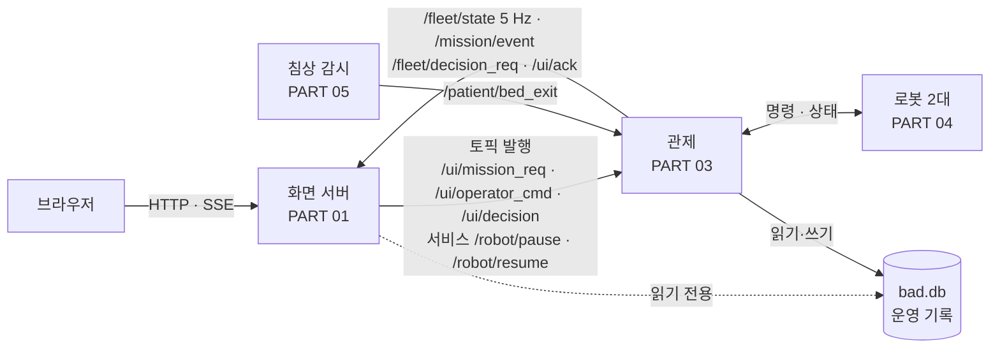
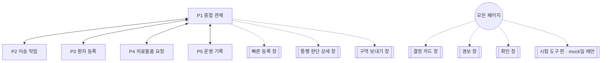
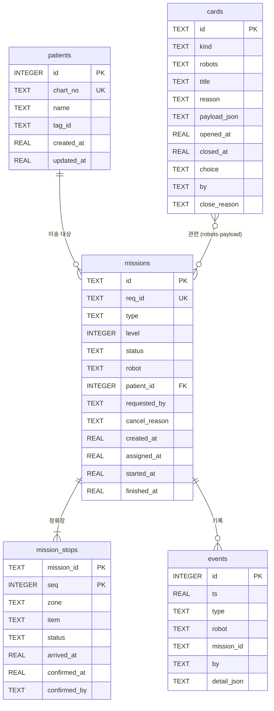
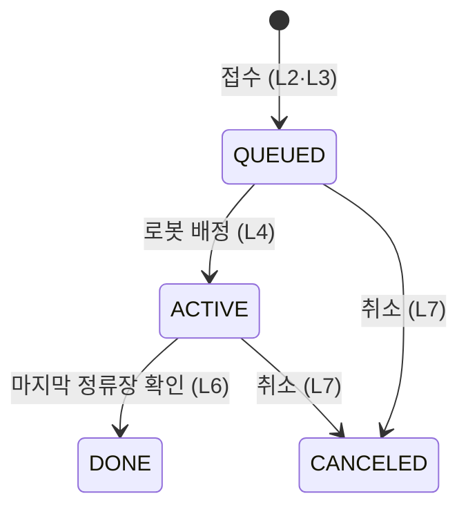
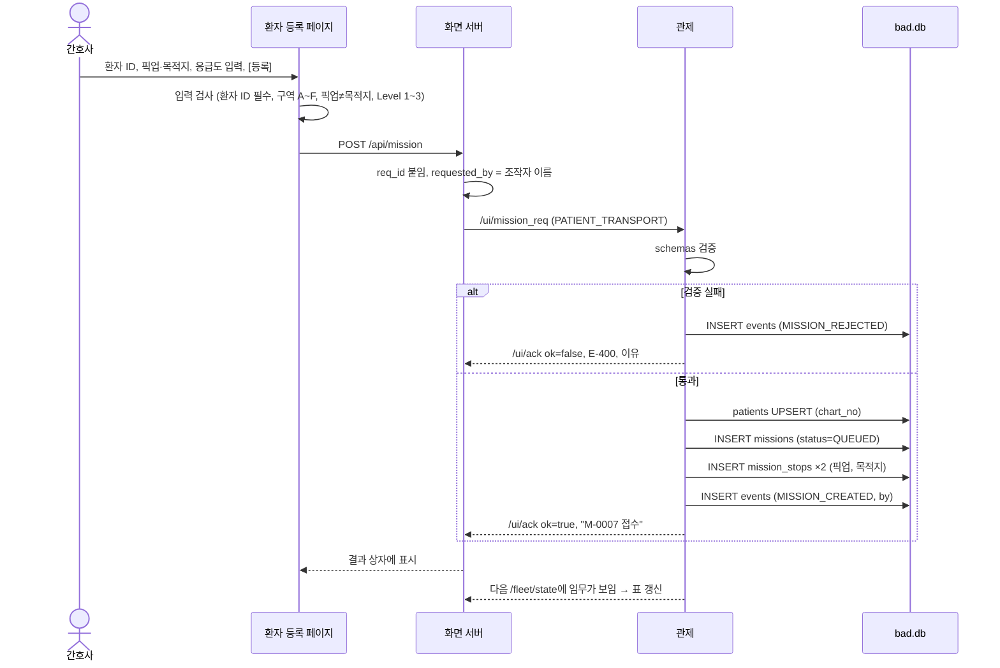
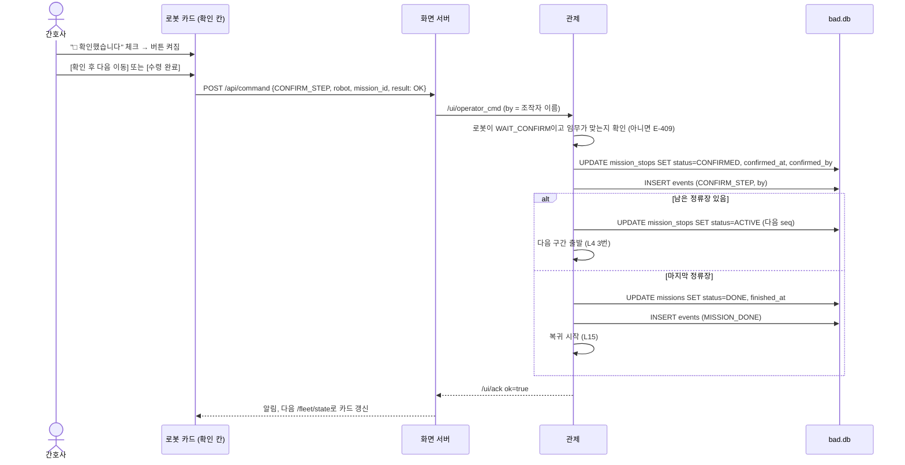

# 관제 시스템 화면·DB·로직 설계서 (PART 01 화면 + PART 03 관제)

작성 2026-11-18 · 담당 김준성 · 구현 기준 문서는 `docs/part3/BRIEF.md`. 페이지·DB·로직은 이 문서가 정본이다.

이 문서는 다음 순서로 쓴다.

1. 페이지 구성: 몇 장인지, 페이지마다 어떤 블록·표·버튼이 있는지
2. DB 설계: 어떤 테이블에 무엇을 저장하는지
3. 버튼과 레이어
4. 로직: 버튼을 누르거나 상태가 바뀌면 무엇이 어떤 순서로 처리되고, DB의 어느 칸이 바뀌는지

디자인 기준 그림은 `docs/part3/ui/design/`에 있다.

---

## 0. 지금 상태

| 항목 | 상태 | 이 문서에서 정한 것 |
|---|---|---|
| 페이지 5장 (종합 관제, 이송 작업, 환자 등록, 의료물품 요청, 운영 기록) | 만들어짐 (단계 3D) | 블록·표·버튼과 데이터 출처를 정리 |
| 운영 DB `bad.db` | 테이블 5개 (patients, missions, mission_stops, events, cards). 단계 3L에서 반영 | 3.2절 |
| 화면이 지난 기록을 DB에서 읽기 | 화면 서버가 `bad.db`를 읽기 전용으로 연다. 화면 서버를 껐다 켜도 기록이 남는다 (단계 3L 확인) | L14 |
| 누가 눌렀는지 (`by`) | 화면 왼쪽 아래 "조작자" 칸에 적은 이름 | 그대로 둔다. 로그인은 만들지 않는다 (시연용 관제 화면) |

---

## 1. 전체 구조

규칙 세 가지.

1. **지금 상태는 토픽으로, 지난 기록은 DB로.** 화면은 `/fleet/state`(초당 5번)를 받아 바로 그린다. 끝난 임무, 이벤트 기록, 카드 기록은 DB에서 읽는다.
2. **DB는 관제만 쓴다.** 화면 서버는 `bad.db`를 읽기만 한다. 화면에서 바꾸는 일은 모두 관제에 요청으로 보내고, 관제가 판단한 뒤 DB에 쓴다. 두 프로그램이 같은 표를 동시에 고쳐 상태가 엇갈리는 일을 막기 위해서다.
3. **화면은 판단하지 않는다.** 누가 먼저 복도에 들어갈지, 어느 로봇을 보낼지는 관제가 정한다. 화면은 사람의 선택을 요청으로 보내고, 관제의 응답(`/ui/ack`)과 상태를 보여 준다.

---

## 2. 페이지 구성

### 2.0 목록과 흐름

페이지 5장, 레이어(창·판) 7개.

| # | 페이지 | 주소 | 블록 | 화면 표 | 주요 버튼 |
|---|---|---|---|---|---|
| P1 | 종합 관제 | `/#/dashboard` | 8 | 2 | 안전 정지, 이송 요청, 판단 근거, 보내기, 확인, 취소 등 |
| P2 | 이송 작업 | `/#/missions` | 3 | 3 | 임무 취소, 다시 시도, 확인 |
| P3 | 환자 등록 | `/#/patient` | 2 | 1 | 등록, 초기화 |
| P4 | 의료물품 요청 | `/#/supply` | 3 | 1 | 운송 요청 등록, 호출 등록, 정류장 추가 |
| P5 | 운영 기록 | `/#/log` | 3 | 2 | 거르기, 검색, CSV 저장 |

모든 페이지(P1~P5)에 공통 틀이 있다.

- **왼쪽 메뉴**: 페이지 5개, 아래에 모드 배지(시연·실기), 관제 연결 상태, 조작자 이름 칸 (요청의 `by`·`requested_by`로 들어감).
- **위쪽 줄**: [안전 정지 요청] / [전체 재개], 침상 감시 배지, 현재 시각, [+ 이송 요청].

### 2.1 P1 종합 관제 (디자인 01)

| 블록 | 보여 주는 것 | 데이터 출처 | 버튼·입력 | 로직 |
|---|---|---|---|---|
| 요약 4칸 | 로봇 연결 n/2, 진행 중 작업 수, 응급(Level 3) 작업 수, 안전 대기 로봇 수 | `/fleet/state` | 칸 클릭 → 해당 목록 | L1 |
| 상황 띠 | 가장 최근 통행 판단 또는 대기 사유 문장 | `/fleet/state.last_decision`, `wait_reason` | [판단 근거] → 통행 판단 상세 창 | L1 |
| 병원 구역 지도 | 평면도, 구역 6개, 로봇 2대, 계획 경로, 복도 상태 글 | `/fleet/state`, `floor_plan.yaml` | 구역 클릭 → 구역 보내기 창, [−][+], 실제 맵 스위치 | L1, L9 |
| 복도 칸 | 현재 통행 로봇, 다음 대기 목록, 재개 조건 체크, B·E방 상태 | `/fleet/state.resources` | [통행 판단 상세], [현장 확인 후 복도 비움] | L13 |
| 로봇 카드 2개 | 상태 배지, 연결, 임무, 현재·목적지, 배터리, 멈춘 시간 | `/fleet/state.robots` | 상태별 버튼 (아래) | L6~L10 |
| 이송 작업 표 **(표 1)** | 진행 중·배정 대기 임무. 열: 작업/대상, 이송 경로, 응급도, 현재 상태, 다음 업무 | `/fleet/state.missions` | 줄 클릭 → P2, [전체 작업] | L1 |
| 최근 운영 기록 **(표 2)** | 최근 이벤트 8개: 시각, 제목, 보조 문장 | `/mission/event` | [전체 기록] → P5 | L1 |
| 위쪽 줄 | 공통 틀 | `/fleet/state` | [안전 정지 요청], [전체 재개], [+ 이송 요청] | L10, L2·L3 |

로봇 카드의 상태별 버튼:

| 로봇 상태 | 버튼 | 로직 |
|---|---|---|
| 대기 (`IDLE`) | 구역 선택 + [보내기] | L9 |
| 이동·대기·양보·복귀 | [정지], [임무 취소] | L10, L7 |
| 확인 대기 (`WAIT_CONFIRM`) | 확인 칸: "□ 확인했습니다" 체크 → [확인 후 다음 이동] 또는 [수령 완료], [불일치] | L6 |
| 안전 정지 (`SAFE_PAUSE`) | [재개] | L10 |
| 장애 (`FAULT`) | [다시 시도], [임무 취소] | L8, L7 |
| 연결 끊김 (`OFFLINE`) | 없음 | — |

### 2.2 P2 이송 작업

| 블록 | 보여 주는 것 | 데이터 출처 | 버튼·입력 | 로직 |
|---|---|---|---|---|
| 거르기 줄 | 탭 4개 (진행 중, 배정 대기, 완료, 취소), 종류·로봇·Level·날짜 | — | 탭, 선택 상자 | L14 |
| 작업 목록 **(표 1)** | 임무 ID, 종류, 대상(환자·물품), 경로, 응급도, 로봇, 상태, 요청자, 접수 시각 | 진행 중·대기: `/fleet/state`. 완료·취소: `bad.db` missions | 줄 클릭 → 상세 | L14 |
| 상세 패널 | 임무 정보 | `bad.db` missions + patients | [임무 취소], [다시 시도], 확인 칸 | L7, L8, L6 |
| 　정류장 **(표 2)** | 순번, 구역, 품목, 상태, 도착 시각, 확인 시각, 확인한 사람 | `bad.db` mission_stops (+ 진행 중이면 `/fleet/state`) | — | L14 |
| 　이 임무의 기록 **(표 3)** | 시각, 이벤트, 문장 | `bad.db` events (mission_id) | — | L14 |

### 2.3 P3 환자 등록 (디자인 패널 01)

| 블록 | 보여 주는 것 | 데이터 출처 | 버튼·입력 | 로직 |
|---|---|---|---|---|
| 등록 폼 | 환자 ID(차트번호, 필수), 이름(선택), 손목 태그 ID(선택, "QR 연동 후 확인"), 픽업 구역, 목적지 구역, 응급도 Level 1·2·3 | — | [등록], [초기화] | L2 |
| 결과 상자 | 성공: "M-0007 접수 · Robot A 배정" + [작업 보기]. 실패: 빨간 상자에 관제 문장 | `/ui/ack` | [작업 보기] → P2 | L2 |
| 최근 환자 이송 **(표 1)** | 최근 10건: 접수 시각, 환자 ID, 이름, 경로, 응급도, 상태 | `bad.db` missions + patients | 줄 클릭 → P2 | L14 |

### 2.4 P4 의료물품 요청 (디자인 패널 02·09·10)

| 블록 | 보여 주는 것 | 데이터 출처 | 버튼·입력 | 로직 |
|---|---|---|---|---|
| 물품 전달 탭 | 물품 이름, 요청처, 수령지 → 전달지, 응급도, 정류장 목록 | — | [+ 정류장 추가], [삭제], [운송 요청 등록] | L3 |
| 로봇 호출 탭 | 목적지, 품목(선택), 응급도 | — | [호출 등록] | L3 |
| 진행 단계 **(표 1)** | 진행 중 물품 임무를 고르면 단계 목록과 지금 단계 | `/fleet/state` + `bad.db` mission_stops | 임무 고르기 | L14 |

### 2.5 P5 운영 기록

| 블록 | 보여 주는 것 | 데이터 출처 | 버튼·입력 | 로직 |
|---|---|---|---|---|
| 지표 4칸 | 대기 횟수, 교착 횟수, 교착 평균 해소 시간, 정지 횟수 (고른 기간) | `bad.db` events 집계 | 기간 선택 | L14 |
| 이벤트 **(표 1)** | 시각, 종류, 로봇, 임무, 누가, 문장. 50개씩 쪽 넘김 | `bad.db` events | 로봇·종류·임무 거르기, 검색, [CSV 저장] | L14 |
| 결정 카드 기록 **(표 2)** | 종류, 열린 시각, 닫힌 시각, 고른 것, 누가, 닫힌 이유 | `bad.db` cards | — | L14 |

### 2.6 레이어 7개

| 레이어 | 언제 열리나 | 내용 | 버튼 | 로직 |
|---|---|---|---|---|
| 빠른 등록 창 | [+ 이송 요청] | 환자 이송 / 물품 전달 / 로봇 호출 탭 (P3·P4와 같은 폼) | 등록 | L2, L3 |
| 결정 카드 창 | `/fleet/decision_req`가 오면 어느 페이지든 | 제목, 이유, 관련 로봇, 남은 시간, 선택지 (추천 강조) | 선택지, [나중에] | L11 |
| 경보 창 | 침상 이탈, 범퍼, 침상 감시 끊김, 막힘, 연결 끊김, 장애 이벤트 | 무엇이·어느 로봇에·언제, 관제가 한 조치 | [확인] | L12 |
| 확인 창 | 임무 취소, 복도 비움 확인 | "되돌릴 수 없습니다" 문구 | [확인], [닫기] | L7, L13 |
| 통행 판단 상세 창 | [판단 근거], [통행 판단 상세] | 판단 당시 복도 상태, 경쟁 로봇·Level, 판단 문장, 기준 | [판단 기록 보기] → P5 | L1 |
| 구역 보내기 창 | 지도에서 구역 클릭 | 구역 이름, 로봇 버튼 2개 (임무 없는 로봇만 활성) | [Robot A], [Robot B] | L9 |
| 시험 도구 판 | 톱니 버튼 (mock일 때만) | 가짜 침상 감시, 장애물, 주행 실패, 연결 끊기, 배터리, 시나리오 1~5 | 각 버튼 | (시험용) |

---

## 3. DB 설계

### 3.1 파일

| 파일 | 쓰는 쪽 | 읽는 쪽 | 담는 것 |
|---|---|---|---|
| `bad.db` (`fleet.yaml db.path`, 기본 `~/.bad/bad.db`) | 관제 (PART 03 `store.py`) | 관제, 화면 서버 (읽기 전용) | 환자, 임무, 정류장, 이벤트, 결정 카드 |

- SQLite, WAL 모드. 시각은 epoch 초(REAL).
- 테이블은 5개다.

### 3.2 `bad.db` (관제가 씀)

**patients** — 이송할 환자. 차트번호 하나에 한 줄.

| 칸 | 타입 | 제약 | 뜻 | 쓰는 때 |
|---|---|---|---|---|
| id | INTEGER | PK | | L2 |
| chart_no | TEXT | NOT NULL, UNIQUE | 환자 ID (차트번호) | L2 (없으면 INSERT) |
| name | TEXT | NULL | 이름 (선택) | L2 (값이 오면 UPDATE) |
| tag_id | TEXT | NULL | 손목 태그 ID. PART 02 연동 전에는 받아 두기만 함 | L2 |
| created_at, updated_at | REAL | | | L2 |

**missions** — 요청 한 건.

| 칸 | 타입 | 제약 | 뜻 | 쓰는 때 |
|---|---|---|---|---|
| id | TEXT | PK | `M-0001` 형식 | L2·L3 |
| req_id | TEXT | UNIQUE | 화면이 만든 요청 ID. 같은 요청이 두 번 와도 임무는 하나 | L2·L3 |
| type | TEXT | NOT NULL | `PATIENT_TRANSPORT` · `MED_ROUND` · `CALL` | L2·L3 |
| level | INTEGER | 1~3 | 응급도 | L2·L3 |
| status | TEXT | NOT NULL | 3.3절 | L2~L8 |
| robot | TEXT | NULL | 배정된 로봇 | L4 |
| patient_id | INTEGER | FK → patients | 환자 이송일 때만 | L2 |
| requested_by | TEXT | | 요청한 계정 | L2·L3 |
| cancel_reason | TEXT | NULL | 취소 이유 | L7 |
| created_at, assigned_at, started_at, finished_at | REAL | | 접수, 배정, 첫 출발, 끝 | L2~L7 |

**mission_stops** — 임무의 정류장. 새로 만드는 테이블이다. 지금은 `missions.stops_json` 한 칸에 들어 있어서, 정류장마다 누가 언제 확인했는지 남지 않는다.

| 칸 | 타입 | 제약 | 뜻 | 쓰는 때 |
|---|---|---|---|---|
| mission_id | TEXT | PK, FK → missions | | L2·L3 |
| seq | INTEGER | PK | 1부터 | L2·L3 |
| zone | TEXT | A~F | 구역 | L2·L3 |
| item | TEXT | NULL | 품목 또는 "픽업"·"목적지" | L2·L3 |
| status | TEXT | | 3.3절 | L4~L7 |
| arrived_at | REAL | | 도착 시각 | L5 |
| confirmed_at, confirmed_by | REAL, TEXT | | 확인 시각과 확인한 사람(조작자 이름) | L6 |

**events** — 일어난 일 전부 (BRIEF 4.8절의 이벤트 종류). 한 번 쓰면 고치지 않는다.

| 칸 | 타입 | 뜻 |
|---|---|---|
| id | INTEGER PK | |
| ts | REAL | 시각 |
| type | TEXT | 이벤트 종류 |
| robot, mission_id | TEXT | 관련 로봇·임무 (없으면 NULL) |
| by | TEXT | 사람이 한 일이면 그 계정, 관제가 스스로 한 일이면 NULL |
| detail_json | TEXT | 판단 근거 문장(`reason`), `rule`, `contenders` 등 |

**cards** — 결정 카드.

| 칸 | 타입 | 뜻 | 쓰는 때 |
|---|---|---|---|
| id | TEXT PK | `K-0001` | L11 열림 |
| kind | TEXT | `DEADLOCK`, `BLOCKED`, `NAV_FAILED`, `MOVE_REJECTED`, `STOP_MISMATCH`, `BED_MONITOR_LOST` | L11 |
| robots | TEXT | 관련 로봇 (쉼표) | L11 |
| title, reason | TEXT | 제목, 근거 문장 | L11 |
| payload_json | TEXT | 선택지, 추천, 기본값, 제한 시간 | L11 |
| opened_at, closed_at | REAL | | L11 |
| choice, by | TEXT | 고른 선택지와 고른 계정 (시간 초과면 by NULL) | L11 |
| close_reason | TEXT | `selected` · `timeout` · `resolved` | L11 |

인덱스: `events(ts)`, `events(mission_id)`, `events(type)`, `missions(status, created_at)`, `cards(opened_at)`.

### 3.3 상태 값

**missions.status**

| 값 | 화면 글 | 뜻 |
|---|---|---|
| `QUEUED` | 배정 대기 | 접수됨, 로봇 아직 없음 |
| `ACTIVE` | 진행 중 | 로봇 배정됨. 이동·대기·확인 대기·장애 모두 여기. 자세한 상태는 로봇 상태로 본다 |
| `DONE` | 완료 | 마지막 정류장 확인 |
| `CANCELED` | 취소 | 사람이 취소 |

검증에 실패한 요청은 임무가 아니므로 `missions` 행을 만들지 않는다. `events`에 `MISSION_REJECTED`(이유, 요청자)만 남기고 화면에 오류를 돌려준다 (L2).

**mission_stops.status**: `PENDING`(아직) → `ACTIVE`(이 정류장으로 가는 중) → `ARRIVED`(도착, 확인 대기) → `CONFIRMED`(확인) / `MISMATCH`(불일치, 카드 대기) / `SKIPPED`(카드에서 건너뛰기). 임무가 취소되면 남은 정류장은 `SKIPPED`.

지금 코드의 값 이름이 다르면 코드 값을 쓰고 이 표를 고친다.

### 3.4 페이지와 테이블 (C 만들기 · R 읽기 · U 고치기)

화면은 `bad.db`를 읽기만 한다. 아래 표의 C·U는 화면 요청을 받은 관제가 한다.

| 페이지·레이어 | patients | missions | mission_stops | events | cards |
|---|---|---|---|---|---|
| P1 종합 관제 | | (토픽) | (토픽) | C (사람 조작) | |
| P2 이송 작업 | R | R U | R U | R C | |
| P3 환자 등록 | C U R | C R | C | C | |
| P4 의료물품 요청 | | C R | C R | C | |
| P5 운영 기록 | | | | R | R |
| 결정 카드 창 | | | | C | C U |
| 경보 창 | | | | (토픽) | |

---

## 4. 로직

### 4.0 공통

**화면 서버가 요청을 받으면** (모든 `POST /api/*`)

1. 입력을 검사한다 (`ui_api.py`, 관제 `schemas.py`). 틀리면 400과 이유 문장.
2. 요청 JSON에 `req_id`/`cmd_id`/`card_id`를 서버가 붙이고, `by`·`requested_by`에는 조작자 이름 칸 값을 넣어 토픽으로 보낸다.
3. POST는 붙인 요청 ID(`ref`)를 바로 돌려준다. 브라우저는 SSE로 같은 `ref`의 `/ui/ack`를 3초까지 기다려 결과 상자·알림에 보인다. 3초 안에 없으면 "관제 응답 없음"을 보인다.

**관제가 요청을 받으면**

검사 → 상태 변경 → `bad.db` 쓰기 → `/ui/ack` → 다음 `/fleet/state`에 반영. 판단과 쓰기는 10 Hz tick 한 곳에서 한다 (BRIEF 2장).

**화면이 다시 그리는 때**

| 받는 것 | 다시 그리는 곳 |
|---|---|
| `/fleet/state` (초당 5번) | 요약 4칸, 상황 띠, 지도, 복도 칸, 로봇 카드, 이송 작업 표(진행 중·대기), 침상 감시 배지, 관제 연결 상태 |
| `/mission/event` | 최근 운영 기록, 경보 창 (경보 종류일 때), P2 상세가 그 임무면 기록 표 |
| `/mission/event` 중 `MISSION_DONE`·`MISSION_CANCELED`·`CONFIRM_STEP` | P2 완료·취소 탭, P3 최근 표, P4 단계 표를 DB에서 다시 읽는다 |
| `/fleet/decision_req` | 결정 카드 창 |
| `CARD_CLOSED` 이벤트 | 그 카드 창 닫기 |
| `/ui/ack` | 누른 버튼 옆 알림 (성공 초록, 실패 빨강) |
| 페이지를 열 때 | 그 페이지의 DB 표 (L14) |

### 4.1 로직 목록

| ID | 이름 | 시작 | 끝 |
|---|---|---|---|
| L1 | 실시간 화면 갱신 | 토픽 수신 | 화면 반영 |
| L2 | 환자 이송 등록 | [등록] | 임무 접수 |
| L3 | 물품 전달·호출 등록 | [운송 요청 등록], [호출 등록] | 임무 접수 |
| L4 | 배정과 출발 | 관제 tick | 로봇 출발 |
| L5 | 도착 | 로봇 `ARRIVED` | 확인 대기 |
| L6 | 수령 확인·불일치 | [확인 후 다음 이동], [불일치] | 다음 정류장 또는 완료 |
| L7 | 임무 취소 | [임무 취소] | 취소 |
| L8 | 다시 시도 | [다시 시도] | 같은 구간 다시 출발 |
| L9 | 구역으로 보내기 | [보내기], 구역 보내기 창 | 로봇 출발 |
| L10 | 정지·재개 | [안전 정지 요청], [정지], [재개], [전체 재개] | |
| L11 | 결정 카드 | 관제가 카드 엶 | 선택·시간 초과·해소 |
| L12 | 경보 | 침상 이탈, 범퍼, 감시 끊김 등 | 경보 창 |
| L13 | 복도 비움 확인 | [현장 확인 후 복도 비움] | 복도 다시 사용 |
| L14 | 기록 조회 | 페이지 열기, 거르기, CSV | 표 |
| L15 | 복귀 | 마지막 확인 | 홈 도착 |

### 4.2 L1 실시간 화면 갱신

1. 화면 서버가 `/fleet/state`, `/mission/event`, `/fleet/decision_req`, `/ui/ack`를 구독한다.
2. 받은 것을 연결된 브라우저마다 SSE(`GET /events`)로 그대로 넘긴다. 화면 서버는 이벤트 500개를 메모리에 둔다 (새로 연결한 브라우저에 최근 것부터 보여 주기 위해).
3. 브라우저는 4.0절 "화면이 다시 그리는 때"대로 그린다.
4. `/fleet/state`가 2초 넘게 안 오면 "관제 연결 끊김"을 띄우고 조작 버튼을 막는다.

### 4.3 L2 환자 이송 등록

- 같은 `req_id`가 다시 오면 (버튼을 두 번 누름, 재전송) 새 임무를 만들지 않고 처음 응답을 다시 보낸다 (`missions.req_id` UNIQUE).

### 4.4 L3 물품 전달·호출 등록

L2와 같고, 다른 점만 적는다.

- 물품 전달: `MED_ROUND`, 정류장 2~6개 (`[수령지 "수령: 물품"], [전달지 "인계: 물품"], …`). `mission_stops`를 정류장 수만큼 INSERT. `patients`는 쓰지 않는다.
- 로봇 호출: `CALL`, 정류장 1개.

### 4.5 L4 배정과 출발 (관제가 스스로)

1. tick마다 배정 대기열(`QUEUED`)의 맨 앞 임무를 본다 (Level 높은 순 → 먼저 온 순).
2. 배정 가능한 로봇이 있으면 고른다 (대기·복귀 중, 연결 정상, 배터리 20% 초과, 배터리 많은 순).
   - `UPDATE missions SET robot, assigned_at, status = 'ACTIVE'`
   - `UPDATE mission_stops SET status = 'ACTIVE' WHERE seq = 1`
3. 첫 구간에 필요한 복도·방을 요청하고, 허가가 나면 로봇에 `MOVE`를 보낸다.
   - `INSERT events (RESOURCE_REQUEST / RESOURCE_GRANT 또는 RESOURCE_HOLD, detail: 판단 근거)`
   - `INSERT events (LEG_START)`, 첫 출발이면 `missions.started_at`
4. 배정할 로봇이 없으면 그대로 두고 `wait_reason = "쉬는 로봇 없음"` (DB 변경 없음).

### 4.6 L5 도착

1. 로봇이 `ARRIVED`를 보내고 목적지가 맞으면 로봇 상태를 `WAIT_CONFIRM`으로 바꾼다.
2. `UPDATE mission_stops SET status = 'ARRIVED', arrived_at`, `INSERT events (ARRIVE)`.
3. 화면: 로봇 카드에 확인 칸이 펼쳐지고, P2 정류장 표에 도착 시각이 찍힌다.

### 4.7 L6 수령 확인·불일치

- [불일치]: `result: MISMATCH` → `mission_stops.status = 'MISMATCH'`, `events (CONFIRM_STEP, result=MISMATCH)`, 결정 카드 `STOP_MISMATCH`를 연다 (L11). 로봇은 그 자리에서 기다린다.

### 4.8 L7 임무 취소

1. [임무 취소] → 확인 창 → [확인].
2. `POST /api/command {CANCEL_MISSION, mission_id}` → `/ui/operator_cmd`.
3. 관제 검사
   - 로봇이 복도를 점유한 채 복도 안에 있으면 거절: `E-423` "Robot A 복도 통과 중 — 통과 후 취소하세요". DB 변경 없음.
   - 아니면 로봇에 `CANCEL`, 쥔 자원 반납.
4. `UPDATE missions SET status = 'CANCELED', cancel_reason, finished_at`, 남은 `mission_stops`는 `SKIPPED`, `INSERT events (MISSION_CANCELED, by)`.
5. 로봇은 홈으로 복귀한다 (L15).

### 4.9 L8 다시 시도

- `FAULT`인 로봇의 [다시 시도] → `RETRY` → 관제가 같은 구간을 다시 보낸다. `INSERT events (LEG_START, detail: retry)`. 카드가 열려 있으면 `resolved`로 닫는다.

### 4.10 L9 구역으로 보내기

- 로봇 카드의 [보내기] 또는 지도의 구역 보내기 창 → `GO_ZONE {robot, zone}`.
- 관제: 임무가 없는 로봇만 허용 (아니면 `E-409`). 자원 규칙은 똑같이 적용한다. `INSERT events (LEG_START, by)`. 임무 테이블에는 쓰지 않는다 (운영자 이동은 임무가 아니다).

### 4.11 L10 정지·재개

| 버튼 | 보내는 것 | 관제 | DB |
|---|---|---|---|
| [안전 정지 요청] (위쪽 줄) | `PAUSE_ALL` (조작자 이름 포함) | 두 로봇 `SAFE_PAUSE`, 주행 중이면 `PAUSE` | `events (PAUSE, by)` |
| [전체 재개] | `RESUME_ALL` (조작자 이름 포함) | 침상 이탈·감시 끊김 중이면 거절, 아니면 직전 상태로 | `events (RESUME 또는 RESUME_REJECTED, by)` |
| 로봇 카드 [정지]·[재개] | `PAUSE_ROBOT`·`RESUME_ROBOT` | 그 로봇만 | 같음 |

서비스 `/robot/pause`·`/robot/resume`(ROS `Trigger`)은 ROS 명령줄용으로 남긴다. 인자를 받을 수 없어서 이 경로의 `by`는 "ROS 서비스"로 남는다.

### 4.12 L11 결정 카드

1. 관제가 사람 판단이 필요한 상황을 만나면 (교착, 30초 막힘, 주행 실패, 명령 안 받음, 불일치, 침상 감시 끊김) 카드를 연다.
   - `INSERT cards (opened_at, payload)`, `INSERT events (CARD_OPEN)`, `/fleet/decision_req` 발행.
2. 화면: 어느 페이지든 결정 카드 창. 남은 시간 막대가 줄어든다.
3. 운영자가 선택지를 누르면 `POST /api/decision {card_id, choice}` → `/ui/decision`.
   - 관제: 이미 닫힌 카드면 `E-409`. 아니면 선택을 실행한다.
   - `UPDATE cards SET choice, by, closed_at, close_reason = 'selected'`, `INSERT events (CARD_CLOSED)`.
4. 제한 시간이 지나면 기본값이 있는 카드만 기본값으로 실행 (`close_reason = 'timeout'`, `by` NULL). 기본값이 없으면 계속 기다린다.
5. 상황이 먼저 풀리면 `close_reason = 'resolved'`로 닫는다.

### 4.13 L12 경보

| 상황 | 관제가 하는 일 | DB | 화면 |
|---|---|---|---|
| 침상 이탈 (`/patient/bed_exit` true) | 대상 로봇 정지 | `events (BED_EXIT)` | 빨강 경보 창 + 위쪽 빨간 띠 (해제될 때까지) |
| 범퍼 충돌 | 그 로봇 정지 | `events (BUMP)` | 빨강 경보 창 |
| 침상 감시 끊김 (3초) | 대상 로봇 정지 + 카드 | `events (BED_MONITOR_LOST)`, `cards` | 빨강 경보 창 + 띠 + 결정 카드 |
| 30초 막힘, 연결 끊김, 장애 | 상황별 (BRIEF 5장) | 해당 이벤트 | 주황 경보 창 |

경보 창의 [확인]은 창만 닫는다. 로봇을 다시 움직이는 것은 L10 재개다.

### 4.14 L13 복도 비움 확인

- 로봇 연결이 끊긴 채 복도 근처에 있으면 관제는 복도를 "점유 불명"으로 막는다.
- 운영자가 현장을 보고 [현장 확인 후 복도 비움] → 확인 창 → `RESOURCE_CLEAR_CONFIRM {resource: CORRIDOR}`.
- 관제: 복도를 비움으로 바꾸고 `events (RESOURCE_CLEAR_CONFIRM, by)`.

### 4.15 L14 기록 조회

화면 서버가 `bad.db`를 읽기 전용(`file:...?mode=ro`)으로 열어 SELECT만 한다. 화면은 아래 주소로 요청한다.

| 주소 | 쿼리 (요지) | 쓰는 곳 |
|---|---|---|
| `GET /api/missions?status=&type=&robot=&level=&from=&to=&page=` | `missions LEFT JOIN patients … ORDER BY created_at DESC LIMIT 50 OFFSET …` | P2 표 1 |
| `GET /api/missions/<id>` | missions + patients 1줄, `mission_stops WHERE mission_id ORDER BY seq`, `events WHERE mission_id ORDER BY ts` | P2 상세, 표 2·3 |
| `GET /api/patients/recent` | `missions JOIN patients WHERE type = 'PATIENT_TRANSPORT' ORDER BY created_at DESC LIMIT 10` | P3 표 1 |
| `GET /api/events?type=&robot=&mission=&q=&from=&to=&page=` | `events … ORDER BY id DESC LIMIT 50` | P5 표 1 |
| `GET /api/events.csv?(같은 조건)` | 같은 쿼리, 쪽 나눔 없이 (최대 1만 줄) | P5 [CSV 저장] |
| `GET /api/cards?from=&to=&page=` | `cards ORDER BY opened_at DESC LIMIT 50` | P5 표 2 |
| `GET /api/kpi?from=&to=` | events 집계: `RESOURCE_HOLD` 수, `DEADLOCK_DETECTED` 수와 해소까지 평균 시간, `PAUSE` 수 | P5 지표 |

- 진행 중·배정 대기 임무는 DB가 아니라 `/fleet/state`로 보여 준다 (더 빠르고 정확하다).
- `bad.db`가 없거나 열 수 없으면 기록 표에 "기록 DB에 연결할 수 없습니다"를 쓰고 나머지 화면은 그대로 둔다.

### 4.16 L15 복귀

1. 마지막 확인(L6) 뒤 관제가 로봇을 홈 구역으로 보낸다: 로봇 상태 `RETURNING`, `events (LEG_START, detail: return)`.
2. 도착하면 `IDLE`, `events (ARRIVE, detail: return)`.
3. 복귀 중 새 임무가 배정되면 복귀를 취소하고 바로 새 임무로 간다 (BRIEF 5.1절 복귀).

---

## 5. 화면 서버 주소 목록

| 메서드·주소 | 하는 일 | 로직 |
|---|---|---|
| `GET /` | 관제 화면 | |
| `GET /events` | SSE (실시간 상태·이벤트·카드·응답) | L1 |
| `GET /api/map`, `/map/meta`, `/map/image` | 지도 설정, 평면도, 실제 맵 | L1 |
| `POST /api/mission` | 임무 요청 | L2, L3 |
| `POST /api/command` | `CONFIRM_STEP`, `CANCEL_MISSION`, `RETRY`, `PAUSE_ROBOT`, `RESUME_ROBOT`, `GO_ZONE`, `RESOURCE_CLEAR_CONFIRM` | L6~L10, L13 |
| `POST /api/decision` | 결정 카드 선택 | L11 |
| `POST /api/service/pause`, `/api/service/resume` | 전체 정지·재개 | L10 |
| `GET /api/missions…`, `/api/events…`, `/api/cards`, `/api/kpi`, `/api/patients/recent` | 기록 조회 (`bad.db` 읽기 전용) | L14 |
| `POST /api/test/<action>` | 시험 도구 (mock일 때만) | |

---

## 6. 지금 코드에서 바꿀 것 (단계 3L)

1. PART 01: `bad.db` 읽기 전용 조회 주소(L14)와 P2 완료·취소 탭, P2 상세의 정류장·기록 표, P3 최근 표, P5 이벤트·카드 표, 지표, CSV를 DB 기준으로.
2. PART 03 `store.py`: `mission_stops` 테이블을 만들고 L2~L7에서 채운다. `patients.tag_id`·`updated_at`·UNIQUE(chart_no), `missions`의 `req_id`(UNIQUE)·`assigned_at`·`cancel_reason`, `events.by`, `cards.title`·`reason` 칸을 더한다. 기존 DB 파일은 칸을 더하는 방식으로 옮긴다 (지우지 않는다). `stops_json`은 한동안 같이 채운다.
3. 상태 값을 3.3절에 맞춘다 (다르면 코드 값을 문서에 반영).

단계 3L은 끝났다 (테스트 300건 통과). 그 뒤 고친 것은 다음과 같다.

- 거절된 요청은 임무 행을 만들지 않는다 (3.3절).
- 화면 요청은 POST 뒤 SSE로 결과를 받는다 (4.0절).
- 전체 정지·재개에 누른 사람을 남긴다 (L10, 단계 3O).
- 기록 문장은 실시간 화면과 DB 조회가 같은 한국어 문장을 쓴다. `OK`·`MISMATCH`·`selected` 같은 코드 값이나 `robot_a` 같은 ID를 보이지 않는다 (BRIEF 14.8절, 단계 3O).
