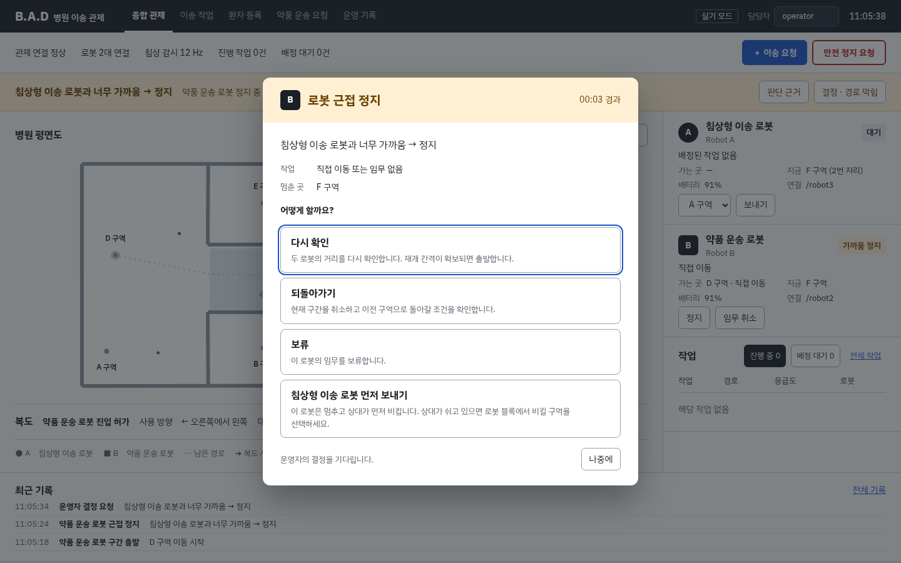
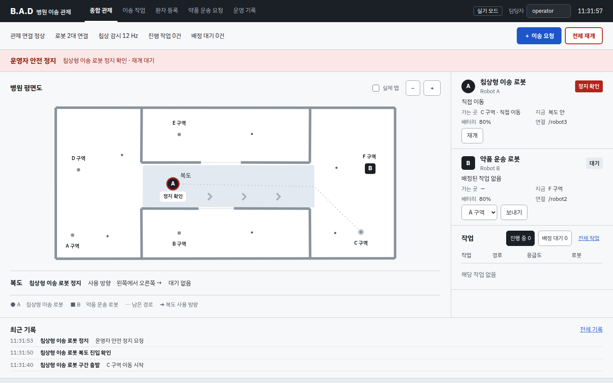

# Gazebo 시뮬레이션 검증 보고서 (로봇 2대 + PART 04 + PART 03 관제 + PART 01 대시보드)

- 작성일: 2026-11-20
- 시뮬레이션 DB: `~/.bad/bad_sim.db` (실기 `~/.bad/bad.db`와 완전 분리; 최종 110 missions / 983 events / 17 cards 기록)
- 원시 데이터(10 Hz CSV · DB 정합 로그 · 요약 JSON): [`docs/part3/sim/data/`](data/)
- 사전 점검 결과: [`docs/part3/sim/preflight.txt`](preflight.txt)

---

## 1. 검증 환경 및 전제 조건

### 1.1 소프트웨어 및 구성
| 항목 | 내용 |
| --- | --- |
| 시뮬레이터 | Gazebo Harmonic `gz sim 8.15` (화면 없는 서버 모드 `-s`, RViz 비활성, NVIDIA GLX 오프로드) |
| 로봇 모델 | TurtleBot4 Lite 2대 (`turtlebot4_gz_bringup`): `/robot3`(`robot_a`, 침상형 이송 로봇, D 근처 도크 `(-0.05, 0.40)`), `/robot2`(`robot_b`, 약품 운송 로봇, F 도크 `(-0.33, -5.11, -3°)`) |
| 지도 원본 | `main_map/main_maps.yaml` (`main_maps.pgm`, 해상도 `0.050 m`, origin `[-5.288, -11.068, 0]`) |
| 세계 파일 | `src/part3_fleet_manager/sim/main_maps.sdf` (`origin/feat/part1-part3-gazebo-imsohy:main_map/main_maps.sdf` 파일만 추출 후 수정, 브랜치 미병합) |
| Localization · Nav2 | **TurtleBot4 기본값** (`turtlebot4_navigation/config/localization.yaml`, `nav2.yaml`) — 로봇별 `component_container_mt` 단일 컨테이너 구성 |
| PART 04 | `hospital_nav command_receiver` 2대 실행 (`--robot robot3`, `--robot robot2`), **코드 미수정** |
| PART 03 · PART 01 | `part1_ui_dashboard/launch/real.launch.py` (`db_path:=$HOME/.bad/bad_sim.db`), **코드 미수정** |
| ROS 2 통신 격리 | 로컬 FastDDS 발견 서버 `127.0.0.1:11888`, `ROS_DOMAIN_ID=97`, `RMW_IMPLEMENTATION=rmw_fastrtps_cpp` (실기 도메인 2 · 현장 11811과 완전 분리) |

### 1.2 중요 전제 (보고 필수 사항)
1. **Nav2 설정은 TurtleBot4 기본값이다**: 저장소에 실제 로봇용 Nav2 설정 파일이 없어 `turtlebot4_navigation`의 기본 `nav2.yaml`과 `localization.yaml`을 그대로 사용했다. 주요 기본값은 다음과 같다.
   - 최고 병진 속도 `max_vel_x: 0.26 m/s`
   - 목표 도달 허용 반경 `xy_goal_tolerance: 0.25 m`
   - 로컬·글로벌 비용지도 팽창 반경 `inflation_radius: 0.45 m`
   - AMCL 위치 갱신 최소 이동 거리 `update_min_d: 0.25 m`
2. **시스템 영구 설정 미변경**: `sysctl`, `/etc`, `~/.bashrc`는 변경하지 않았고, `pip` 패키지도 설치하지 않았다.
3. **타 파트 및 관제 로직 미수정**: `src/part1*`, `src/part2*`, `src/part3_fleet_manager/part3_fleet_manager/*`(`collision.py` 포함), `src/part4*`, `src/part5*`, `src/part6*`, `README.md`, `AGENTS.md`는 수정하지 않았다. 새로 추가한 파일은 `src/part3_fleet_manager/sim/`, `src/part3_fleet_manager/launch/`, `docs/part3/sim/`에만 두었다.

---

## 2. 실행 방법 (명령 순서)

모든 시뮬레이션 터미널은 실기와 섞이지 않도록 `src/part3_fleet_manager/sim/sim_env.sh`를 먼저 불러온다. 이 스크립트는 다음 환경 변수를 설정한다.

```bash
unset ROS_AUTOMATIC_DISCOVERY_RANGE ROS_LOCALHOST_ONLY ROS_SUPER_CLIENT
export ROS_DISCOVERY_SERVER=127.0.0.1:11888
export ROS_DOMAIN_ID=97
export RMW_IMPLEMENTATION=rmw_fastrtps_cpp
# CLI · preflight · 측정 스크립트 · 관제 쪽은 --super 인자로 ROS_SUPER_CLIENT=True 추가
```

### 단계별 실행 명령

**1) 터미널 1 — 로컬 FastDDS 발견 서버 (포트 11888)**
```bash
source ~/venvs/rokey_venv/bin/activate
source /opt/ros/jazzy/setup.bash
fastdds discovery --server-id 0 --ip-address 127.0.0.1 --port 11888
```

**2) 터미널 2 — Gazebo Harmonic 세계 (헤드리스 서버 + `/clock` 브리지)**
```bash
source src/part3_fleet_manager/sim/sim_env.sh
ros2 launch src/part3_fleet_manager/launch/sim_world.launch.py headless:=true
```

**3) 터미널 3 — 첫 번째 로봇 `/robot3` (침상형, D 근처) 스폰 + Localization + Nav2**
```bash
source src/part3_fleet_manager/sim/sim_env.sh
ros2 launch src/part3_fleet_manager/launch/sim_spawn_robot.launch.py \
  namespace:=robot3 model:=lite x:=-0.05 y:=0.40 yaw:=0.0
```

**4) 터미널 4 — 두 번째 로봇 `/robot2` (약품, F 도크) 스폰 + Localization + Nav2**
```bash
source src/part3_fleet_manager/sim/sim_env.sh
ros2 launch src/part3_fleet_manager/launch/sim_spawn_robot.launch.py \
  namespace:=robot2 model:=lite x:=-0.33 y:=-5.11 yaw:=-0.052
```

**5) 터미널 5·6 — PART 04 `command_receiver` 실행 (로봇별 1개, 코드 미수정)**
```bash
# 터미널 5: robot3 (침상형 — D 근처 도크 좌표를 실행 인자로 전달)
source src/part3_fleet_manager/sim/sim_env.sh
ros2 run hospital_nav command_receiver --robot robot3 --dock -0.05 0.40 0.0

# 터미널 6: robot2 (약품 — PART 04 기본 DOCKS['robot2'] (-0.33, -5.11, -3.0°) 사용)
source src/part3_fleet_manager/sim/sim_env.sh
ros2 run hospital_nav command_receiver --robot robot2
```
> 참고: `command_receiver.py`는 `argparse.parse_args()`를 직접 사용하여 `--ros-args -p use_sim_time:=true`를 인자로 받지 못한다. 별도 수정 없이 기본 벽시계로 실행했으며, 이 덕분에 `hospital_nav/status`(`STATE`)가 관제의 벽시계 `link_timeout_s = 3.0 s`에 맞춰 정확히 1 Hz로 발행되고 Nav2 액션 목표 전송도 정상 동작했다.

**6) 터미널 7 — `/patient/bed_exit` 테스트용 한 줄 발행**
```bash
source src/part3_fleet_manager/sim/sim_env.sh
# 정상 상태(기본 유지)
ros2 topic pub -r 12 /patient/bed_exit std_msgs/msg/Bool "{data: false}"
# 시나리오 f 침상 이탈 모의 시
ros2 topic pub -r 12 /patient/bed_exit std_msgs/msg/Bool "{data: true}"
```

**7) 토픽 확인 및 `preflight` 실행**
```bash
source src/part3_fleet_manager/sim/sim_env.sh --super
ros2 daemon stop
ros2 topic list | grep -E "robot[23]/(scan|amcl_pose|hospital_nav/status)"
ros2 run part3_fleet_manager preflight
```
- 확인 결과: 두 로봇의 `/robotN/scan`(라이다 `robot3` 640/640, `robot2` 638/640 유효), `/robotN/amcl_pose`, `/robotN/hospital_nav/status` 모두 수신 확인.
- `preflight` 결과([`preflight.txt`](preflight.txt)): **`실제 실행 가능`**
  - 발견 서버 `127.0.0.1:11888` OK, `goal_manager.py` `SLOTS` 대조 OK
  - `/robot3` OK (`STATE=IDLE`, 배터리 `100% / 16.47 V`, pose `(-0.111, 0.364)`, `docked`, `navigate_to_pose`, `STATE.slot` 지원)
  - `/robot2` OK (`STATE=IDLE`, 배터리 `100% / 16.47 V`, pose `(-0.353, -5.075)`, `docked`, `navigate_to_pose`, `STATE.slot` 지원)
  - `/patient/bed_exit` `10.4 Hz` (10초간 104건, 마지막 값 정상)
  - PART 06 장애물 분류기 미기동 경고(`구독자 0 — 판별 없이 사진만 표시`)는 시뮬레이션 범위상 정상 경고.

**8) 터미널 8 — 관제 + 대시보드 (실제 연결 launch, 별도 DB)**
```bash
source src/part3_fleet_manager/sim/sim_env.sh --super
ros2 launch part1_ui_dashboard real.launch.py db_path:=$HOME/.bad/bad_sim.db
```

**9) 측정 도구 및 시나리오 실행**
```bash
source src/part3_fleet_manager/sim/sim_env.sh --super

# (단독 측정) Gazebo GT 10 Hz 중심 거리 + AMCL + RTF CSV 기록 및 DB 이벤트 정합
python3 src/part3_fleet_manager/sim/gt_distance_logger.py --out /tmp/trial.csv --world main_maps
python3 src/part3_fleet_manager/sim/align_events.py --csv /tmp/trial.csv --db ~/.bad/bad_sim.db

# (자동 검증) 회차 초기화(sim_reset.py) 포함 a~g 각 3회 실행
python3 src/part3_fleet_manager/sim/run_scenarios.py --scenarios a b c d e f g --trials 3
```

---

## 3. 고친 세계 파일 내용 (`main_maps.sdf`)

원본 `origin/feat/part1-part3-gazebo-imsohy:main_map/main_maps.sdf`를 추출한 뒤, `turtlebot4_gz_bringup/worlds/maze.sdf` 및 `warehouse.sdf`와 비교하여 다음 4곳을 수정했다.

| 변경 항목 | 원본 (`main_map/main_maps.sdf`) | 수정본 (`src/part3_fleet_manager/sim/main_maps.sdf`) | 수정 이유 |
| --- | --- | --- | --- |
| `<world name>` | `main_map` | `main_maps` | 파일명(`main_maps.sdf`)과 `ros_gz_bridge`의 `/world/main_maps/model/...` 토픽·서비스 경로 일치 |
| `<physics>` | `max_step_size: 0.001` (update rate 미지정) | `max_step_size: 0.003`, `real_time_update_rate: 1000` | `turtlebot4_gz_bringup/worlds/maze.sdf`와 동일하게 물리 스텝을 조정해 CPU 부하 절감 및 RTF 확보 |
| 시스템 플러그인 | `Physics`, `UserCommands`, `SceneBroadcaster`만 존재 | `gz-sim-contact-system` (`Contact`), `gz-sim-imu-system` (`Imu`) 추가; **`Sensors(ogre2)`는 미추가(주석 명시)** | Create3 범퍼·IMU 동작에 필요. 단, `irobot_create_description/urdf/create3.urdf.xacro`가 자체적으로 `Sensors(ogre)`(Ogre 1.9)를 로드하므로 세계 파일에 `ogre2`를 추가하면 Ogre1/Ogre2 심볼 충돌로 세그폴트(`exit 139`) 발생 (`maze.sdf`도 동일하게 미기재) |
| `<scene>` · `<light name="sun">` | `ambient: 0.4`, `shadows: true`, `<light name="sun">` 존재 | `ambient: 1 1 1 1`, `shadows: false`, `<light name="sun">` 제거 | 2번째 Create3 스폰 시 Ogre 1.9 렌더러가 `Ogre::ItemIdentityException: A scene node with the name sun already exists`로 크래시하는 문제 회피 (`warehouse.sdf` 방식) |

```diff
--- origin/feat/part1-part3-gazebo-imsohy:main_map/main_maps.sdf
+++ src/part3_fleet_manager/sim/main_maps.sdf
-  <world name="main_map">
+  <world name="main_maps">
     <physics name="default_physics" type="ignored">
-      <max_step_size>0.001</max_step_size>
+      <max_step_size>0.003</max_step_size>
       <real_time_factor>1.0</real_time_factor>
+      <real_time_update_rate>1000</real_time_update_rate>
     </physics>
     <plugin filename="gz-sim-physics-system" name="gz::sim::systems::Physics"/>
     <plugin filename="gz-sim-user-commands-system" name="gz::sim::systems::UserCommands"/>
     <plugin filename="gz-sim-scene-broadcaster-system" name="gz::sim::systems::SceneBroadcaster"/>
+    <plugin filename="gz-sim-contact-system" name="gz::sim::systems::Contact"/>
+    <plugin filename="gz-sim-imu-system" name="gz::sim::systems::Imu"/>
     <scene>
-      <ambient>0.4 0.4 0.4 1</ambient>
+      <ambient>1 1 1 1</ambient>
       <background>0.85 0.85 0.85 1</background>
-      <shadows>true</shadows>
+      <shadows>false</shadows>
     </scene>
-    <light name="sun" type="directional"> ... </light>
```

---

## 4. 실시간 배율(RTF) 및 관제 벽시계 기준 왜곡 분석

### 4.1 RTF 측정 결과
- 헤드리스 서버(`gz sim -r -s`) + NVIDIA RTX 4060 GLX 오프로드(`__NV_PRIME_RENDER_OFFLOAD=1`, `__GLX_VENDOR_LIBRARY_NAME=nvidia`) 환경에서 측정한 전체 24회차 RTF:
  - **범위**: `0.749 ~ 0.836`
  - **산술 평균 / 중앙값**: **`0.797` / `0.800`**
  - **시간 가중 평균**: **`0.796`** (총 시뮬레이션 시간 `1280.9 s` / 총 벽시계 시간 `1609.6 s`)
- 참고: 초기 시도에서 `--headless-rendering`(CPU EGL)을 켰을 때는 RTF가 `0.09 ~ 0.51`까지 추락하고 `OgreGpuRays` 라이다 640개 중 628개가 `range_min(0.164 m)`으로 붕괴했으나, `--headless-rendering`을 제거하고 NVIDIA GLX 오프로드를 적용해 라이다 정상화(640/640)와 RTF `~0.80`을 동시에 확보했다.

### 4.2 관제 벽시계 타이머(3초·10초·30초) 왜곡 영향
관제(`fleet_manager_node`)의 모든 타임아웃은 시스템 벽시계(`time.monotonic()`) 기준이다. `RTF ≈ 0.80`(시뮬레이션이 실기보다 약 1.25배 느림) 환경에서 각 기준이 실제 시뮬레이션 시간으로 얼마나 짧아지는지는 아래와 같다.

| 관제 타이머 (`fleet.yaml`) | 벽시계 기준 | `RTF = 0.80` 환산 시뮬레이션 시간 | 본 시뮬레이션에서의 영향 |
| --- | ---: | ---: | --- |
| `link_timeout_s` / `accept_timeout_s` / `bed_monitor.lost_s` | `3.0 s` | `~2.4 s` | `command_receiver`의 `STATE`(1 Hz)와 `/patient/bed_exit`(12 Hz)가 벽시계 기반으로 발행되므로 오탐 없음. 단, 시나리오 f의 `ros2 topic pub` 재기동 공백(~3.1 s)이 `lost_s = 3.0 s`를 넘어 1회차 `BED_MONITOR_LOST` 발생 |
| `stall.short_s` / `PROXIMITY_CARD_S` / `yield_timeout_s` | `10.0 s` | `~8.0 s` | 로봇 이동·회복 동작이 20% 느리게 진행되므로, B 방 좁은 문(시나리오 d) 회복 중 `STALL_SHORT`가 실기 대비 약 2초(sim 기준) 빨리 발동. 시나리오 c 근접 정지 후 `BLOCKED` 카드도 sim `~8.0 s`(벽시계 `10.1 s`) 만에 열림 |
| `stall.long_s` | `30.0 s` | `~24.0 s` | 시나리오 d 1회차에서 Nav2 자체가 먼저 `ABORTED`되어 `stall.long_s`에는 도달하지 않음 |
| `decision_window_s` / `clear_hold_s` / `control_retry_s` | `1.0 s` / `1.5 s` | `~0.8 s` / `~1.2 s` | `PAUSE_ROBOT` 확인(`0.335~0.444 s` 벽시계)이 `1.5 s`보다 훨씬 빨라 `STOP_RESENT = 0` 유지 |

> 요약: `RTF ≈ 0.80`으로 1.0 대비 약 20% 낮아 시간 기준의 왜곡 폭은 제한적이었으나, 정체 판정(`10 s`/`30 s`)과 제동·응답 시간은 실제 로봇에서 RTF 1.0 환경으로 재확인해야 한다. 모든 시나리오 표에 벽시계 시간과 sim 시간을 함께 적었다.

---

## 5. 시나리오별 측정 결과 (a~g, 총 24회)

### 5.1 회차 초기화 및 채점 기준
- **회차 초기화 (`sim_reset.py` + `run_scenarios.py`)**:
  1. 관제 API로 진행 중 임무 취소 및 열린 카드 정리 → 두 로봇 `IDLE` 확인
  2. Gazebo `/world/main_maps/set_pose`로 시작 자리로 순간 이동(GT 위치 재확인·재시도 포함) → `/robotN/initialpose` 발행 + 양 로봇 local/global costmap 비우기
  3. 각 로봇에 자기 구역 `GO_ZONE`을 1회 실행해 관제가 `zone`·`slot`을 다시 기록하게 함
  4. **시작 조건 검사**: 두 로봇 `IDLE`, 열린 카드 0건, 의도한 `zone`·`slot` 일치, 목표 자리 좌표 `0.35 m` 이내. 하나라도 불만족이거나 시나리오 명령의 HTTP 응답이 `200`/`202`가 아니면 해당 회차를 `INVALID`로 기록하고 즉시 시나리오를 중단(`FAIL`과 구분).
- **채점 기준**:
  - 최소 GT/AMCL 거리는 **명령 수락 후 한 대라도 움직이는 구간(`gt_v > 0.015 m/s` 또는 `amcl_v > 0.015 m/s`)**만 집계하며 **`0.45 m` 이상 여부**를 함께 표기했다.
  - 단독 요청에도 남는 1초 결정창 `RESOURCE_HOLD`는 대기 판정에서 제외했다.
  - 반대 방향(시나리오 a)은 **복도 동시 보유 1대 이하 + 늦게 출발한 로봇의 대기 사유가 방향 충돌(`DIRECTION`)**로 판정했다.

### 5.2 전체 요약표 (24회 중 `PASS 19`, `FAIL 5`, `INVALID 0`)
| 시나리오 | 내용 | 유효 회차 | 결과 (`PASS/FAIL/INVALID`) | 이동 구간 최소 GT 거리 (`>= 0.45 m`) | 이동 구간 최소 AMCL 거리 | 정지 거리 (GT) | 벽시계 / sim 시간 (평균) | RTF 범위 |
| --- | --- | ---: | --- | --- | --- | --- | --- | --- |
| **a** | 복도 반대 방향 (`A: D→C`, `B: F→A`, 선출발 교대) | 3 | **3 / 0 / 0** | `0.812 ~ 1.003 m` (**3/3 ≥ 0.45**) | `0.857 ~ 1.052 m` | — | `76.4 s` / `58.0 s` | `0.749 ~ 0.773` |
| **b** | 같은 방향 따라가기 (`A: D→C`, `B: A→F`, `1.0 / 1.4 m`) | 3 | **3 / 0 / 0** | `0.948 ~ 0.965 m` (**3/3 ≥ 0.45**) | `0.987 ~ 1.027 m` | — | `51.6 s` / `39.2 s` | `0.751 ~ 0.770` |
| **c** | F1 대기 중 `A→F2` 진입 후 `B: F1→D` 이탈 (`0.45 m` 검증) | 3 | **0 / 3 / 0** *(Phase 1 F2는 3/3)* | **`0.350 ~ 0.351 m`** (**0/3 < 0.45, 접촉**) | `0.246 ~ 0.427 m` | — | `63.0 s` / `49.1 s` | `0.771 ~ 0.790` |
| **d** | B 방: `A` B1 대기 → `B` 교차로 경유 B2 → 동시 이탈 | 3 | **2 / 1 / 0** *(문·교차로 중복 0/3)* | `0.755 ~ 0.785 m` (**3/3 ≥ 0.45**) | `0.853 ~ 0.883 m` | — | `174.7 s` / `141.2 s` | `0.805 ~ 0.810` |
| **e** | 복도 주행 중 `PAUSE_ROBOT` 정지 거리 · 정지 확인 표시 | 3 | **3 / 0 / 0** | `0.951 ~ 1.027 m` (**3/3 ≥ 0.45**) | `1.026 ~ 1.062 m` | **`0.055 ~ 0.064 m`** (평균 `0.060 m`) | `44.5 s` / `35.4 s` | `0.792 ~ 0.799` |
| **f** | `/patient/bed_exit` True → 침상형만 정지 · False 후 재개 | 3 | **2 / 1 / 0** *(1회차 하네스 전환 공백)* | `3.080 ~ 3.610 m` (**3/3 ≥ 0.45**) | `3.116 ~ 3.799 m` | `0.039 ~ 0.066 m` *(2회차 선행 끊김 정지)* | `46.4 s` / `37.8 s` | `0.802 ~ 0.821` |
| **g (A→F)** | `robot3` D1 대기, `robot2` `A→F` 통과 | 3 | **3 / 0 / 0** | `0.756 ~ 0.826 m` (**3/3 ≥ 0.45**) | `0.746 ~ 0.899 m` | — | `39.0 s` / `32.3 s` | `0.824 ~ 0.833` |
| **g (F→A)** | `robot3` D1 대기, `robot2` `F→A` 통과 | 3 | **3 / 0 / 0** | `0.750 ~ 0.880 m` (**3/3 ≥ 0.45**) | `0.897 ~ 0.994 m` | — | `41.0 s` / `34.0 s` | `0.826 ~ 0.836` |

---

### 5.3 시나리오 a — 복도 반대 방향 (`A: D→C`, `B: F→A`, 3/3 PASS)
- 1·3회차는 `robot3(A)` 먼저, 2회차는 `robot2(B)` 먼저 요청을 전송했다.
- 전 회차에서 복도 동시 보유는 **1대 이하**, 늦게 요청된 로봇은 복도 밖(`BOTTOM` 또는 `TOP`)에서 **`복도 반대 방향 통행 중 → 복도 밖 대기`**(`DIRECTION`)로 대기한 뒤 선행 로봇의 `RESOURCE_RELEASE` 이후 진입·도착했다. 근접 정지 및 카드 0건.

| 회차 | 선출발 | 결과 | 복도 최대 보유 | 후발 대기 위치 · 사유 | 최소 GT (이동, ≥0.45) | 최소 AMCL (이동) | 벽시계 / sim 시간 | RTF | 정합 로그 |
| --- | --- | --- | ---: | --- | --- | --- | --- | ---: | --- |
| 1 | `robot3(A)` | **PASS** | 1 | `BOTTOM` · 방향 충돌(`DIRECTION`) | `1.0033 m` (OK) | `1.0519 m` | `76.0 s` / `58.73 s` | `0.773` | [`a_trial1`](data/a_trial1_aligned.md) |
| 2 | `robot2(B)` | **PASS** | 1 | `TOP` · 방향 충돌(`DIRECTION`) | `0.8118 m` (OK) | `0.8566 m` | `74.5 s` / `56.32 s` | `0.756` | [`a_trial2`](data/a_trial2_aligned.md) |
| 3 | `robot3(A)` | **PASS** | 1 | `BOTTOM` · 방향 충돌(`DIRECTION`) | `0.9461 m` (OK) | `1.0261 m` | `78.7 s` / `58.91 s` | `0.749` | [`a_trial3`](data/a_trial3_aligned.md) |

---

### 5.4 시나리오 b — 같은 방향 따라가기 (`A: D→C`, `B: A→F`, 3/3 PASS)
- 두 로봇이 복도 북쪽에서 같은 방향(남쪽)으로 동시 요청되어 `CORRIDOR` 사용 허가를 함께 받았다.
- 출발 직후 복도 축 간격이 `0.084 ~ 0.107 m`(`<= 1.0 m`)로 판정되어 `CORRIDOR_FOLLOW_STOP (rule=GAP)`으로 `robot2(B)`가 즉시 대기했고, `robot3(A)`가 복도로 진입해 축 간격이 `1.4 m`를 넘자(`GT 축 간격 1.420 ~ 1.627 m`) `CORRIDOR_FOLLOW_CLEAR`로 재개되어 두 대가 같은 방향으로 연속 통과했다.
- 해제 시점 GT 축 간격이 `1.40 m`보다 `0.02 ~ 0.23 m` 큰 이유는 AMCL `update_min_d = 0.25 m`와 `STATE` 1 Hz 발행 주기 때문이다.
- 두 로봇 모두 TurtleBot4 기본 최고 속도(`0.26 m/s`)가 동일해 복도 중간에서 후행 로봇이 선행을 추격해 다시 `1.0 m` 이하로 좁히는 상황은 자연 발생하지 않았다(6장 참조).

| 회차 | 결과 | 정지 발동 (`db_gap` / GT 축간격) | 재개 시점 GT 축간격 (≥1.4 m) | 최소 GT (이동, ≥0.45) | 최소 AMCL (이동) | 벽시계 / sim 시간 | RTF | 정합 로그 |
| --- | --- | --- | ---: | --- | --- | --- | ---: | --- |
| 1 | **PASS** | `0.084 m` / `0.094 m` | `1.627 m` | `0.9475 m` (OK) | `1.0145 m` | `52.0 s` / `39.38 s` | `0.757` | [`b_trial1`](data/b_trial1_aligned.md) |
| 2 | **PASS** | `0.093 m` / `0.094 m` | `1.420 m` | `0.9621 m` (OK) | `0.9867 m` | `50.3 s` / `38.74 s` | `0.770` | [`b_trial2`](data/b_trial2_aligned.md) |
| 3 | **PASS** | `0.107 m` / `0.094 m` | `1.525 m` | `0.9650 m` (OK) | `1.0266 m` | `52.4 s` / `39.35 s` | `0.751` | [`b_trial3`](data/b_trial3_aligned.md) |

---

### 5.5 시나리오 c — F 1번 자리 대기 중 `A→F2` 진입 후 `B` F1 이탈 (`0/3 PASS`, Phase 1 `3/3`, Phase 2 `0/3 FAIL`)
- **Phase 1 (`A: D→F`, 3/3 성공)**: `robot2(B)`가 `F1(-1.40, -5.40)`에 대기 중일 때 `robot3(A)`를 F로 보내자 `ZONE_OCCUPIED_HOLD` 없이 곧바로 **`F 구역 (2번 자리)`**(`F2(-1.35, -4.70)`)로 배정·도착했다.
- **Phase 2 (`B: F1→D`, 3/3 실패 — 물리 접촉 및 근접 정지 카드)**: `robot2(B)`가 `F1`에서 복도 입구 `BOTTOM(-1.72, -4.20)`으로 빠져나가려 할 때, `F2` 근처 `(-1.50 ~ -1.53, -4.57 ~ -4.62)`에 정차한 `robot3(A)`와 **전 회차에서 실제 물리 접촉(`GT 최소 거리 0.3495 ~ 0.3507 m`, TurtleBot4 외경 ~0.35 m)** 이 발생했다. 직후 `PROXIMITY_STOP`이 발동하고 10초 뒤 `BLOCKED` 카드가 열렸다.

| 회차 | Phase 1 (F2 도착) | Phase 2 (F1 이탈) | 결과 | Phase 2 최소 GT (이동, ≥0.45) | Phase 2 최소 AMCL (이동) | DB `PROXIMITY_STOP` 거리 | 열린 카드 | 벽시계 / sim 시간 | RTF | 정합 로그 |
| --- | --- | --- | --- | --- | --- | ---: | --- | --- | ---: | --- |
| 1 | OK (`slot=2`) | 근접 정지 중단 | **FAIL** | **`0.3495 m` (< 0.45)** | `0.4273 m` | `0.428 m` | `BLOCKED` | `60.8 s` / `47.16 s` | `0.776` | [`c_trial1`](data/c_trial1_aligned.md) |
| 2 | OK (`slot=2`) | 근접 정지 중단 | **FAIL** | **`0.3498 m` (< 0.45)** | **`0.2463 m`** *(밀림 괴리)* | `0.246 m` | `BLOCKED` | `74.7 s` / `59.00 s` | `0.790` | [`c_trial2`](data/c_trial2_aligned.md) |
| 3 | OK (`slot=2`) | 근접 정지 중단 | **FAIL** | **`0.3507 m` (< 0.45)** | `0.3968 m` | `0.397 m` | `BLOCKED` | `53.5 s` / `41.22 s` | `0.771` | [`c_trial3`](data/c_trial3_aligned.md) |



---

### 5.6 시나리오 d — B 방 2번 자리 진입 및 문·교차로 상호배제 (`2/3 PASS`, 문·교차로 중복 `0/3`)
- **Phase 1 (`B: F→B`, 3/3 성공)**: `robot3(A)`가 `B1(-2.50, -1.25)`에 대기 중일 때 `robot2(B)`를 B로 보내자 전 회차에서 교차로 `CROSSROAD(-1.50, -2.18)`를 경유(`saw_via=True`)한 뒤 `B2(-2.60, -2.80)`에 도착했다.
- **Phase 2 (`A: B1→D`, `B: B2→F` 동시 요청)**: 전 회차에서 `ROOM_B` 동시 보유 **1대 이하**, 두 로봇의 교차로(`0.6 m` 이내) 동시 사용 **0회**였다. `robot2(B)`는 먼저 **`B 구역 출입 정원 1대 사용 중 (침상형 이송 로봇) — 빈자리 대기`**로 대기했고, `robot3(A)`가 문을 통과해 `ROOM_B`를 반납하자 이어서 **`복도 반대 방향 통행 중 → 복도 밖 대기`**로 전환되어 `robot3(A)`가 복도를 완전히 빠져나갈 때까지 B2에서 안전 대기했다.
- **1회차 `FAIL` 사유**: `robot3(A)`는 D에 정상 도착했으나, 뒤이어 출발한 `robot2(B)`가 폭 `0.75 m`인 B 방 문을 통과하다 TurtleBot4 기본 Nav2 `inflation_radius = 0.45 m` 비용지도에 걸려 `STALL_SHORT(10 s)` → `NAV_FAILED(Nav2 ABORTED)` → `OBSTACLE_REPORT` → PART 06 미기동으로 `장애물 판별 불가` `BLOCKED` 카드가 열렸다. 2·3회차는 회복 동작 끝에 통과해 완주했다.

| 회차 | Phase 1 (교차로→B2) | `ROOM_B` 최대 보유 | 교차로 동시 사용 (GT) | Phase 2 완주 | 결과 | 최소 GT (이동, ≥0.45) | 최소 AMCL (이동) | 벽시계 / sim 시간 | RTF | 정합 로그 |
| --- | --- | ---: | --- | --- | --- | --- | --- | --- | ---: | --- |
| 1 | OK (`via`, `slot=2`) | 1 | 없음 (`False`) | `robot_b` B문 `Nav2 ABORTED` | **FAIL** | `0.7556 m` (OK) | `0.8531 m` | `168.2 s` / `135.45 s` | `0.805` | [`d_trial1`](data/d_trial1_aligned.md) |
| 2 | OK (`via`, `slot=2`) | 1 | 없음 (`False`) | 양쪽 완주 (`D`, `F`) | **PASS** | `0.7851 m` (OK) | `0.8834 m` | `178.0 s` / `144.12 s` | `0.810` | [`d_trial2`](data/d_trial2_aligned.md) |
| 3 | OK (`via`, `slot=2`) | 1 | 없음 (`False`) | 양쪽 완주 (`D`, `F`) | **PASS** | `0.7550 m` (OK) | `0.8685 m` | `178.0 s` / `143.90 s` | `0.808` | [`d_trial3`](data/d_trial3_aligned.md) |

---

### 5.7 시나리오 e — 정지 거리 및 정지 확인 표시 (`PAUSE_ROBOT`, 3/3 PASS)
- `robot3(A)`가 복도 주행 중(`~0.24 ~ 0.26 m/s`, `y ≈ -1.28 ~ -1.46`) 운영자 정지 API(`PAUSE_ROBOT`)를 전송하고, **HTTP 명령 송신 시각부터 GT 속도가 `0.015 m/s` 이하로 완전히 멈출 때까지**의 이동 거리와 UI `정지 확인`(`part4_state == PAUSED`) 전환 시점을 측정했다.
- 3회 평균 정지 거리는 **`0.0596 m` (약 6.0 cm)**, UI `정지 확인` 전환은 명령 후 **`0.335 ~ 0.444 s`(벽시계) / `0.225 ~ 0.402 s`(sim)** 만에 완료되었다(`control_retry_s = 1.5 s`보다 훨씬 빨라 `STOP_RESENT = 0`, `정지 미확인` 카드 0건). 재개(`RESUME_ROBOT`) 후 3회 모두 C 구역까지 정상 완주했다.

| 회차 | 결과 | 정지 거리 (HTTP 명령 기준) | 정지 소요 (벽 / sim) | 정지 거리 (DB `PAUSE` 기준) | UI `정지 확인` 전환 (벽 / sim) | `STOP_RESENT` | 최소 GT (이동, ≥0.45) | 전체 벽 / sim 시간 | RTF | 정합 로그 |
| --- | --- | ---: | --- | ---: | --- | ---: | --- | --- | ---: | --- |
| 1 | **PASS** | **`0.0642 m`** | `0.500 s` / `0.432 s` | `0.0418 m` | **`+0.335 s`** / `+0.255 s` | 0 | `1.0272 m` (OK) | `46.3 s` / `36.93 s` | `0.798` | [`e_trial1`](data/e_trial1_aligned.md) |
| 2 | **PASS** | **`0.0551 m`** | `0.599 s` / `0.453 s` | `0.0364 m` | **`+0.340 s`** / `+0.225 s` | 0 | `1.0081 m` (OK) | `43.8 s` / `34.67 s` | `0.792` | [`e_trial2`](data/e_trial2_aligned.md) |
| 3 | **PASS** | **`0.0596 m`** | `0.500 s` / `0.408 s` | `0.0596 m` | **`+0.444 s`** / `+0.402 s` | 0 | `0.9510 m` (OK) | `43.4 s` / `34.67 s` | `0.799` | [`e_trial3`](data/e_trial3_aligned.md) |



---

### 5.8 시나리오 f — 침상 이탈 (`/patient/bed_exit`, 2/3 PASS · 1회차 테스트 발행 전환 공백)
- `robot3(A)`가 `D→B`로 복도 진입 시점에 `robot2(B)`를 `F→C`로 출발시키고 `/patient/bed_exit`를 `True`로 전환한 뒤, `B` 완주·`True` 중 재개 거절·`False` 전환 후 자동 미재개·운영자 `RESUME_ROBOT` 후 `A` 완주를 확인했다.
- **3회 공통 검증 완료 항목**:
  - `True` 수신 시 **침상형(`robot3`)만 정지**(`cause=BED_EXIT`, `part4_state=PAUSED`), **약품(`robot2`)은 3회 모두 단 한 번도 멈추지 않고 C 구역 도착** (`b_ever_paused=False`).
  - `True` 유지 중 `RESUME_ROBOT` 요청은 `RESUME_REJECTED` (`침상 이탈 해제 전에는 재개할 수 없습니다`)로 거절.
  - `False`로 되돌려도 자동 재개되지 않음(`no_auto_resume=True`).
- **1회차 `FAIL` 및 2회차 참고 사유**: 테스트 스크립트가 한 줄 `ros2 topic pub` 프로세스를 종료 후 재기동해 값을 바꿀 때 ROS 2 CLI 기동 + 발견 서버 매칭에 **약 2.5 ~ 3.2초** 공백이 발생해 `bed_monitor.lost_s = 3.0 s`와 맞물렸다.
  - 1회차: `True→False` 전환 공백이 `3.0 s`를 넘어 `BED_MONITOR_LOST` 카드가 열리며 회차 대기가 중단(`FAIL`).
  - 2회차: `False→True` 전환 시 `BED_MONITOR_LOST`가 0.38초 먼저 발동해 `0.0356 m` 정지한 직후 `BED_EXIT`로 승격되고 2초 뒤 신호 복구(`BED_MONITOR_BACK`)로 카드가 닫힌 뒤 정상 재개 완주(`PASS`).
  - 3회차: 전환 공백이 `3.0 s` 미만으로 유지되어 `BED_MONITOR_LOST` 없이 `BED_EXIT` 정지(`0.0386 m`) → `False` → 운영자 재개 완주(`PASS`).

| 회차 | 결과 | A 정지 (`BED_EXIT` 정지 거리) | B 미정지 완주 | `True` 중 재개 거절 | `False` 자동 미재개 | 운영자 재개 완주 | 최소 GT (이동, ≥0.45) | 벽시계 / sim 시간 | RTF | 정합 로그 |
| --- | --- | --- | --- | --- | --- | --- | --- | --- | ---: | --- |
| 1 | **FAIL** *(전환 공백)* | OK (`0.0658 m`) | OK | OK | OK | `BED_MONITOR_LOST` 중단 | `3.6104 m` (OK) | `36.2 s` / `29.02 s` | `0.802` | [`f_trial1`](data/f_trial1_aligned.md) |
| 2 | **PASS** | OK (`0.0356 m` 선행 끊김 + `0.0004 m`) | OK | OK | OK | OK | `3.1085 m` (OK) | `51.9 s` / `42.40 s` | `0.817` | [`f_trial2`](data/f_trial2_aligned.md) |
| 3 | **PASS** | OK (`0.0386 m`) | OK | OK | OK | OK | `3.0803 m` (OK) | `51.0 s` / `41.87 s` | `0.821` | [`f_trial3`](data/f_trial3_aligned.md) |

---

### 5.9 시나리오 g — `robot3` D1 정차 상태에서 `robot2` `A→F` / `F→A` 통과 (6/6 PASS)
- `robot3(A)`를 `D1(-1.00, 0.80)`에 세워 두고 `robot2(B)`를 `A→F` 3회, `F→A` 3회 주행시켜 지나갈 때의 최소 GT·AMCL 거리와 `PROXIMITY_STOP` · `BLOCKED` 카드 발생 여부를 측정했다.
- **6회 측정 결과**: `PROXIMITY_STOP` **0건**, `BLOCKED` 카드 **0건**, 6회 모두 정상 통과(`PASS`). 최소 GT 거리는 **`0.7496 ~ 0.8801 m`**, 최소 AMCL 거리는 **`0.7457 ~ 0.9936 m`**로 모두 `proximity_stop_m(0.60 m)` 및 `0.45 m` 기준을 여유 있게 넘겼다.
- 6회 정상 회차에서 `BLOCKED` 카드가 뜨지 않아 조건부 `robot3 D→C` 교착 시험은 자동 실행되지 않았다.

| 방향 · 회차 | 결과 | `robot3(D1)` 정차 좌표 (GT) | 통과 최접근 `robot2` 좌표 (GT) | 최소 GT (이동, ≥0.45) | 최소 AMCL (이동) | `PROXIMITY_STOP` / 카드 | 벽시계 / sim 시간 | RTF | 정합 로그 |
| --- | --- | --- | --- | --- | --- | --- | --- | ---: | --- |
| `A→F` 1 | **PASS** | `(-1.018, 0.682)` *(남쪽 0.12 m)* | `(-1.658, 0.279)` | `0.7561 m` (OK) | `0.7457 m` | 없음 / 없음 | `38.8 s` / `32.32 s` | `0.833` | [`g_af_trial1`](data/g_af_trial1_aligned.md) |
| `A→F` 2 | **PASS** | `(-0.998, 0.800)` | `(-1.667, 0.325)` | `0.8201 m` (OK) | `0.8987 m` | 없음 / 없음 | `39.2 s` / `32.32 s` | `0.824` | [`g_af_trial2`](data/g_af_trial2_aligned.md) |
| `A→F` 3 | **PASS** | `(-0.998, 0.800)` | `(-1.684, 0.340)` | `0.8259 m` (OK) | `0.8982 m` | 없음 / 없음 | `38.9 s` / `32.28 s` | `0.830` | [`g_af_trial3`](data/g_af_trial3_aligned.md) |
| `F→A` 1 | **PASS** | `(-0.998, 0.800)` | `(-1.672, 0.325)` | `0.8245 m` (OK) | `0.8969 m` | 없음 / 없음 | `40.9 s` / `33.88 s` | `0.828` | [`g_fa_trial1`](data/g_fa_trial1_aligned.md) |
| `F→A` 2 | **PASS** | `(-0.998, 0.800)` | `(-1.752, 0.346)` | `0.8801 m` (OK) | `0.9936 m` | 없음 / 없음 | `40.9 s` / `33.80 s` | `0.826` | [`g_fa_trial2`](data/g_fa_trial2_aligned.md) |
| `F→A` 3 | **PASS** | `(-0.998, 0.800)` | `(-1.621, 0.383)` | `0.7496 m` (OK) | `0.9031 m` | 없음 / 없음 | `41.2 s` / `34.42 s` | `0.836` | [`g_fa_trial3`](data/g_fa_trial3_aligned.md) |

> **보충 관찰 (정지 오차에 따른 D1 경계 위험)**:
> 1. 위 `A→F` 1회차에서 `robot3`가 `D1` 중심에서 남쪽으로 불과 `0.12 m` 내려온 `(-1.018, 0.682)`에 서자 통과 거리가 `0.82 m → 0.756 m`(AMCL `0.746 m`)로 줄었다.
> 2. 본 측정 전 회차 초기화 없이 연속 주행하던 예비 시험에서는, `robot3`가 복도(`C→D`)에서 올라와 Nav2 `xy_goal_tolerance = 0.25 m` 가장자리인 `(-1.007, 0.684)`에 정차한 상태에서 `robot2`가 코너를 안쪽으로 돌며 `(-1.525, 0.418)`까지 접근해 **최소 GT `0.5829 m` (`< proximity_stop_m 0.60 m`)** 로 `PROXIMITY_STOP` 및 `BLOCKED` 카드가 실제로 발생했다. 그 상태에서 `robot3`에 `D→C`를 내리자 `robot3`는 `앞 로봇 정지 → 대기`, `robot2`는 `너무 가까움 → 정지` 상태로 **두 로봇 모두 움직이지 않는 교착 상태**가 관찰되었다. 즉 `D1` 정확 정차 시에는 안전(`0.75 ~ 0.88 m`)하지만, `D1` 남서쪽 허용 오차(`0.25 m`) 경계에 정차하고 통과 로봇이 코너를 좁게 돌면 `0.60 m` 기준에 걸릴 수 있다.

---

## 6. 문제와 원인 추정

### 6.1 [핵심 결함] 시나리오 c — F1/F2 배치와 `slot_stop_m = 0.45 m`의 물리 접촉 (`0.350 m`)
- **현상**: 3회 모두 `robot3(A)`가 `F2`에 주차된 뒤 `robot2(B)`가 `F1`에서 `D`로 출발하면 `0.3495 ~ 0.3507 m`까지 접근해 실제 차체 접촉 후 `PROXIMITY_STOP` 및 `BLOCKED` 카드가 열렸다.
- **원인 추정**:
  1. **자리 배치 + Nav2 정지 오차**: `F1(-1.40, -5.40)`과 `F2(-1.35, -4.70)`의 중심 간 거리는 `0.70 m`이고, `F2`가 `F1`에서 복도 남쪽 입구 `BOTTOM(-1.72, -4.20)`로 향하는 출구 동선 바로 앞에 놓여 있다. 게다가 `robot3`가 북쪽(복도)에서 `F2`로 접근할 때 TurtleBot4 기본 `xy_goal_tolerance = 0.25 m` 때문에 목표 중심까지 들어가지 않고 서북쪽 가장자리 `(-1.50 ~ -1.53, -4.57 ~ -4.62)`에 멈춰 출구 통로를 더 좁혔다.
  2. **`slot_stop_m = 0.45 m`의 여유 부족**: TurtleBot4(Create3)의 물리 외경은 약 `0.35 m`이므로, 중심 거리 `0.45 m` 기준은 차체 표면 간 여유가 `0.10 m`에 불과하다. 여기에 AMCL `update_min_d = 0.25 m` 갱신 지연 + `STATE` 1 Hz 발행 주기 + 제동 거리(`~0.06 m`)가 겹치면, 관제가 `0.45 m` 미만을 감지해 정지를 내렸을 때는 이미 물리 접촉(`0.350 m`)에 도달해 있다.
  3. **접촉 후 AMCL 괴리**: 2회차에서 `robot2`가 정지 중인 `robot3`를 밀어 GT 기준 북쪽으로 `~0.16 m`(`y: -4.61 → -4.45`) 밀려났으나, `robot3`는 바퀴 오도메트리 변화가 없어 AMCL 위치가 갱신되지 않았고 그 결과 관제가 계산한 AMCL 거리가 실제 GT(`0.353 m`)보다 훨씬 짧은 `0.246 m`로 왜곡되었다.

### 6.2 [Nav2 기본 설정 이슈] 시나리오 d — B 방 좁은 문(`0.75 m`)과 `inflation_radius = 0.45 m`
- **현상**: B 방 1회차에서 `robot2(B)`가 B2에서 빠져나오다 `Nav2 ABORTED`로 실패했고, 성공한 2·3회차에서도 B 문 통과에만 32~40초가 걸려 전체 소요가 `178 s`까지 길어졌다.
- **원인 추정**: `main_maps.sdf`에서 B 방 문 개구부 폭은 정확히 **`0.750 m`** (`y = -1.668` ~ `-2.418`)인데, TurtleBot4 기본 Nav2의 `inflation_radius = 0.45 m`는 양쪽 문틀 팽창 반경 합이 `0.90 m > 0.75 m`로 문 중앙까지 높은 비용 영역이 겹친다. 관제의 문·교차로 상호배제 자체는 3/3 완벽했으나, 기본 Nav2 파라미터로 좁은 문을 통과할 때 잦은 회전·후진 회복 동작과 경로 포기(`ABORTED`)가 발생했다.

### 6.3 [경계 조건] 시나리오 g — D1 정지 편차와 `proximity_stop_m = 0.60 m`
- **현상**: 초기화 후 `D1` 중심 정차 6회차는 `0.75 ~ 0.88 m`로 모두 통과했으나, 예비 시험에서 `D1` 남쪽 `0.12 m` 편차 + 통과 로봇의 안쪽 선회가 겹치며 `0.583 m < 0.60 m` 근접 정지 및 후속 `D→C` 교착이 관찰되었다.
- **원인 추정**: `D` 구역에서 `A↔F` 통과 로봇은 `D` 출발·도착이 아니므로 `collision.py`의 `slot_stop_m(0.45 m)` 완화가 적용되지 않고 일반 `proximity_stop_m(0.60 m)`가 적용된다. `xy_goal_tolerance = 0.25 m`로 `robot3`가 `D1` 남서쪽에 멈추면 `A↔F` 코너 경로와 `0.60 m` 경계에 걸릴 여지가 있다.

### 6.4 [테스트 하네스 한계] 시나리오 f — `ros2 topic pub` 재기동 공백(~3.1 s)
- **현상**: 1회차 `True→False` 전환에서 `BED_MONITOR_LOST` 카드가 열려 `FAIL`, 2회차 `False→True` 전환에서도 일시적 `BED_MONITOR_LOST`가 0.38초 선행했다.
- **원인 추정**: 한 줄 `ros2 topic pub` 명령을 종료 후 새 프로세스로 다시 띄우는 데 약 `2.5 ~ 3.2 s`가 걸려 `fleet.yaml`의 `bed_monitor.lost_s = 3.0 s`를 넘겼다. 실제 `part5_bed_exit` 노드는 단일 프로세스가 연속으로 `Bool`을 발행하므로 이 전환 공백은 발생하지 않는다.

### 6.5 [조건 한계] 시나리오 b — 동일 최고 속도(`0.26 m/s`)
- **현상**: 동시 출발 직후 `<= 1.0 m` 정지와 `>= 1.4 m` 재개는 3/3 검증되었으나, 두 대가 복도에 모두 진입한 뒤 주행 중에 거리가 `1.0 m` 이하로 좁혀지는 추격 정지는 재현되지 않았다.
- **원인 추정**: 두 시뮬레이션 로봇이 동일한 TurtleBot4 기본 `max_vel_x = 0.26 m/s`를 쓰므로 일단 `1.4 m` 이상 벌어진 뒤에는 후행 로봇이 선행을 따라잡지 못한다.

### 6.6 시뮬레이션 인프라 이슈 및 조치 요약
- **FastDDS `LOCALHOST` 한계**: 2대 + Nav2 구성(약 85~116 참가자)에서 `ROS_AUTOMATIC_DISCOVERY_RANGE=LOCALHOST`는 일부 토픽이 상호 탐색되지 않아, 실기 현장과 동일한 **로컬 FastDDS 발견 서버(`127.0.0.1:11888`) + `ROS_SUPER_CLIENT=True`** 구조로 전환해 해결했다.
- **헤드리스 렌더링 라이다 결함**: `--headless-rendering`(CPU EGL)에서 `OgreGpuRays`가 628/640 레이를 `range_min`으로 반환했으나, `-s` 서버 모드 + NVIDIA GLX 오프로드로 640/640 정상화했다.

---

## 7. 실제 로봇에서 다시 볼 것

1. **실제 로봇의 Nav2 · AMCL 파라미터 확인**: 본 검증은 TurtleBot4 기본값(`xy_goal_tolerance: 0.25 m`, `inflation_radius: 0.45 m`, `max_vel_x: 0.26 m/s`, `update_min_d: 0.25 m`) 기준이다. 실기 로봇의 실제 파라미터를 확인하고, 특히 B·E 방 문폭(`0.75 m`) 통과에 무리가 없도록 `inflation_radius`와 `cost_scaling_factor`, 자리 정밀도를 위한 `xy_goal_tolerance`를 현장 점검해야 한다.
2. **F 구역 1·2번 자리 배치 및 `slot_stop_m = 0.45 m` 재검토 (최우선)**: 시나리오 c에서 3/3 물리 접촉(`0.350 m`)이 재현되었다. 실기에서 `F2` 좌표를 `F1` 출구 동선 밖(동쪽 등)으로 재배치할 수 있는지, 또는 `F1` 이탈 시 `F2` 로봇 회피·선출발 절차 및 `slot_stop_m` 기준을 조정해야 하는지 현장 실측으로 결정해야 한다(같은 구조인 A·C·D의 1·2번 자리도 함께 확인).
3. **D1 정차 편차별 `A↔F` 통과 거리 실측**: 실기에서 `robot3`가 `C→D`로 진입해 자연 정차한 뒤 `robot2`가 `A↔F`를 양방향 주행할 때 실제 중심 거리와 `PROXIMITY_STOP(0.60 m)` 발동 여부를 확인하고, 발동 시 `BLOCKED` 카드의 "침상형 이송 로봇 먼저 보내기" 또는 대피 구역 유도가 교착 없이 풀리는지 검증한다.
4. **실기 제동 거리 및 Wi-Fi 지연 포함 `PAUSE_ROBOT` 확인 시간**: 시뮬레이션 정지 거리는 `0.060 m`, `정지 확인`은 `0.34 ~ 0.44 s`였으나, 실기는 바닥 마찰·적재 하중(침상/약품)·Wi-Fi RTT·`RTF = 1.0` 조건이 다르다. 실제 `STOP_RESENT` 발생 여부와 최대 제동 거리를 재측정한다.
5. **실제 `part5_bed_exit` 웹캠 노드 연동 및 정지 대상 합의**: 연속 발행 중인 실제 `part5_bed_exit`와 연결해 `BED_MONITOR_LOST` 오탐 없이 이탈/복구가 동작하는지 확인하고, `fleet.yaml`의 `bed_exit_pause_targets`(`[robot_a]` vs `[robot_a, robot_b]`)를 팀 최종 합의한다.
6. **복도 중간 따라가기 (`1.0 m` 정지 / `1.4 m` 재개) 재검증**: 실제 두 로봇 간 미세 속도 차 또는 선행 로봇을 복도 중간에서 잠깐 정지(`PAUSE_ROBOT`)시켰다가 재개하는 조건으로, 복도 **주행 중** `1.0 m` 정지와 `1.4 m` 재개를 추가로 확인한다.
7. **PART 06 장애물 분류기 연동 검증**: 본 시뮬레이션에서는 PART 06을 띄우지 않아 장애물 발생 시 `장애물 판별 불가`로 귀결되었다. 실기에서 PART 04 촬영 이미지 → PART 06 분류 → PART 03 카드 표시 종단간 흐름을 확인한다.
