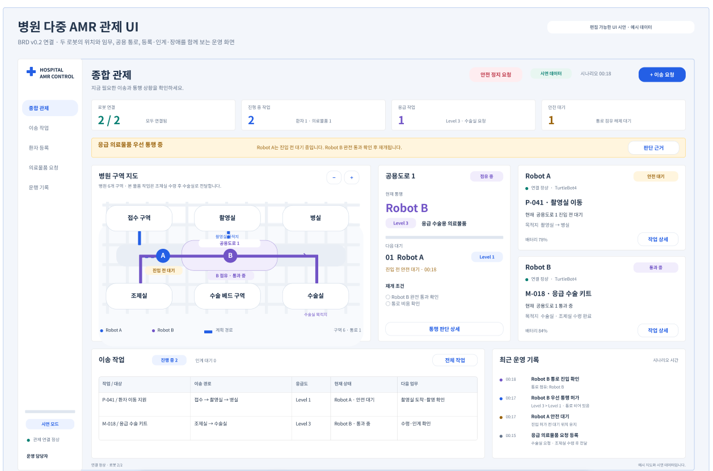
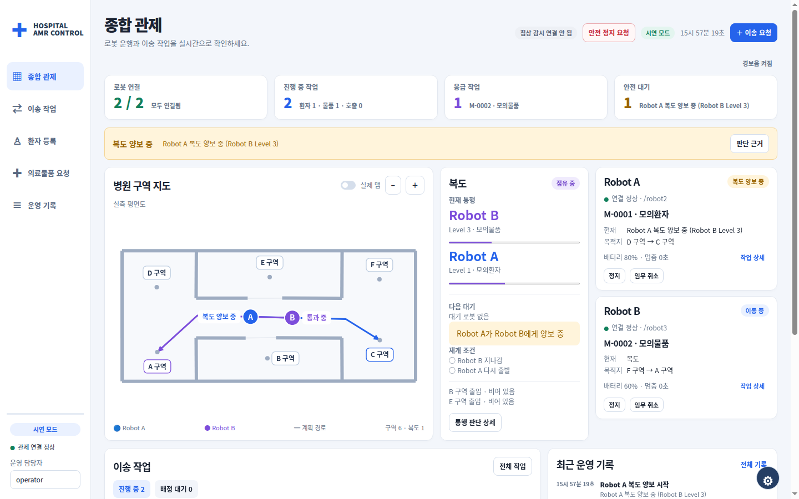
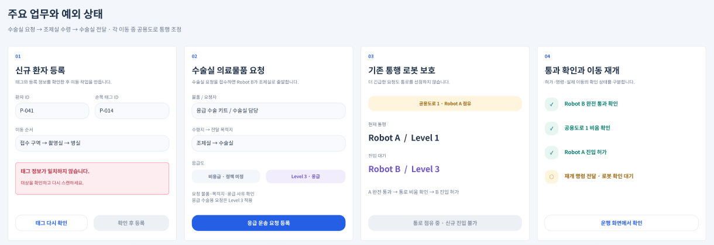
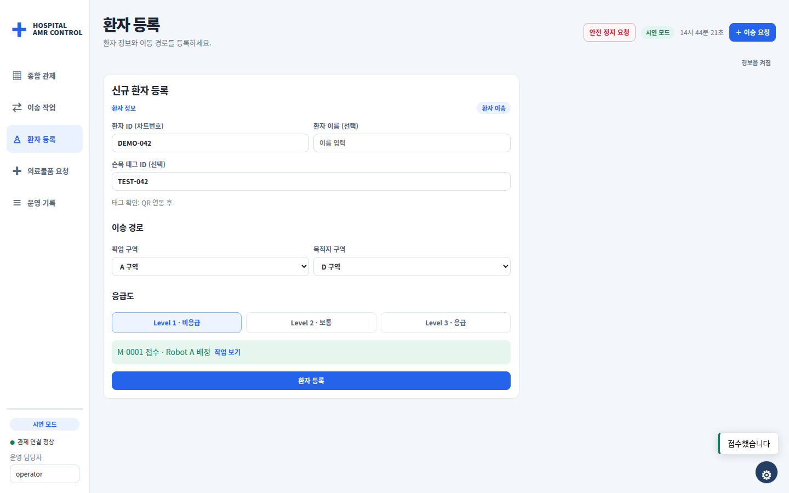
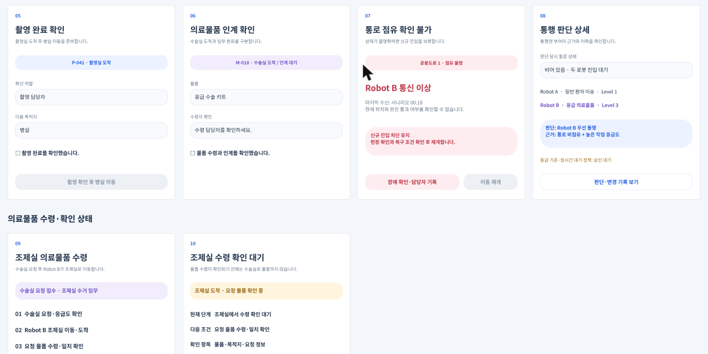
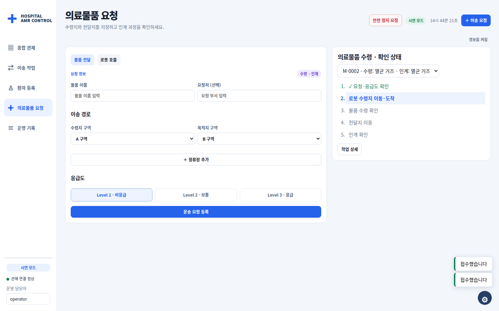

# 단계 3D 관제 화면 검증

**단계 3D-2 갱신.** 현재 종합 관제에는 실측 평면도가 표시되고, 환자 이름을 생략하면 차트번호만 표시한다. 01·02 캡처도 갱신됐다. [최신 지도 비교와 검증](stage3d2-report.md)

2026-11-18에 PART 01 화면, PART 03 관제, Robot A와 B의 mock을 ROS 2 Jazzy에서 함께 실행했다. 새 화면을 적용하기 전에도 PART 01 launch로 기존 3U 화면을 먼저 열어 기본 CALL 폼과 두 로봇의 배터리 80%, 60%를 확인했다.

## 화면에서 재현한 다섯 시나리오

각 실행에 새 DB를 사용했다. 브라우저에서 **시험 도구**의 시나리오 버튼을 누른 뒤 종합 관제와 이송 작업의 확인 칸, 결정 카드, 경보 창을 조작했다. 아래 번호는 독립된 실행의 결과다. 시나리오 1의 역할별 대기열 검증에는 `ROLE`과 구형 Robot B를 사용했다. 2~5에는 기본 배터리 배정을 사용했다. mock 속도는 기존 시나리오와 같은 0.6 m/s였다. [실행 명령과 화면 조작 순서](../stage3-scenarios.md)

| 시나리오 | 화면에서 확인한 결과 |
|---|---|
| 1 · 동시 임무 | A와 B가 각각 환자와 물품 임무를 수행했다. **배정 대기** 탭에서 두 후속 건의 담당 로봇을 확인했다. 정류장별 수령 확인 후 완료 탭에 4건이 남았다. |
| 2 · 통로 양보 | A가 통로 안에서 Level 3의 B에게 양보했다. **판단 근거**에 ‘높은 응급도 우선’이 표시됐다. B가 지나간 뒤 A가 재개했고 본 임무 2건이 완료됐다. |
| 3 · 교착 | B방의 A와 E방의 B가 서로 기다렸다. 20초 결정 카드에서 추천안을 누르자 종료 사유가 `selected`로 기록됐다. A가 D로 양보한 뒤 두 임무가 모두 완료됐다. 초기 방 배치용 직접 이동 2건도 운영 기록에 남았다. |
| 4 · 막힘 | A가 통로에서 멈춘 뒤 **이동 경로 막힘** 경보를 확인했다. B는 진입 전 대기에 머물렀다. A가 다시 움직이자 막힘이 풀리고 카드가 `resolved`로 닫혔다. 두 직접 이동이 완료됐다. |
| 5 · CALL 세 건 | 첫 호출은 A, 둘째는 B, 셋째는 미배정으로 표시됐다. A의 작업 상세에서 **확인했습니다 → 수령 완료**를 누른 뒤 A가 셋째 호출을 맡았다. 호출 3건이 완료되고 두 로봇이 홈에 도착했다. |

추가로 환자 등록에서 차트번호와 시험 태그를 넣어 A 배정을 확인했다. 빠른 등록 창에서 F→E 물품 전달을 요청하자 B가 배정됐고 의료물품 페이지에 인계 단계가 나타났다. 침상 이탈을 켜자 경보와 지속 경고 띠가 나타나고 **전체 재개**가 비활성화됐다. 이탈을 끈 뒤 같은 버튼으로 재개했다. 별도의 화면 단독 launch에서는 맵 파일이 없을 때 간이 지도가 열리고, 실기 모드의 시험 도구가 숨겨지며 그 HTTP 요청에 403이 반환되는 것도 확인했다.

## 설계와 실측 화면 비교

왼쪽은 팀 디자인 원본이고 오른쪽은 1440×900 브라우저 캡처다. 종합 관제는 1280픽셀 폭에서도 가로 스크롤 없이 조작할 수 있었다. 실측 맵은 113×253 PGM이며 반시계 90도 회전한 뒤 위쪽 D·E·F, 아래쪽 A·B·C 순서로 표시된다.

| 팀 디자인 | 동작 화면 |
|---|---|
|  |  |
|  |  |
|  |  |

- 지도는 실제 벽과 입구의 기울기를 유지한다. 공유 통로에는 보유 로봇 두 대와 양보 관계를 함께 표시한다. 3D 시험 당시에는 구역 이름을 비워 두었다. 현재 표기는 응급실(A)부터 조제실(F)까지 4N의 구역표를 따른다.
- 디자인의 P-041, M-018, 고정 배터리 수치와 경과 시간 자리에는 실행 때 받은 임무 번호, 배터리, 이벤트 시각을 표시한다. 카드에는 로봇 모델명 대신 관제가 제공하는 ROS 네임스페이스가 들어간다.
- 손목 태그 값은 접수된다. PART 02에서 대조 결과를 받는 계약이 아직 없어 ‘태그 확인: QR 연동 후’라고 표시한다. 설계의 촬영 담당자, 실제 수령 담당자, 서명·태그 일치 여부를 입증할 데이터도 없다. 현재 수령 확인의 근거는 로그인 직종이나 서명이 아니라 조작자 이름과 직접 누른 확인이다.
- 요청처·환자명은 운영자가 입력할 수 있다. 이름을 생략하면 기존 환자 ICD의 필수 이름 칸에 차트번호를 사용한다. 실운영 부서나 임상 역할을 자동 지정하지 않았다. 연결·임무·교착 해소 기록이 없을 때는 ‘미수신’, ‘해당하는 작업이 없습니다’, ‘해소 기록 없음’ 등으로 상태를 알린다.

### 캡처 8장

| 종합 관제 | 예외·작업 | 등록·기록 |
|---|---|---|
| [01 평상시](screens/01-dashboard.png) | [03 결정 카드](screens/03-decision-card.png) | [06 환자 등록](screens/06-patient.png) |
| [02 통로 대기](screens/02-corridor-wait.png) | [04 경보](screens/04-alarm.png) | [07 의료물품 요청](screens/07-supply.png) |
| | [05 이송 작업 상세](screens/05-mission-detail.png) | [08 운영 기록](screens/08-log.png) |

## 변경 파일

| 범위 | 신설·이관·수정 내용 |
|---|---|
| PART 01 패키징 | `package.xml`, `setup.py`, `config/ui.yaml`, `launch/ui.launch.py`, `launch/demo_mock.launch.py` |
| PART 01 서버·화면 | `part1_ui_dashboard/ui_server_node.py`, `ui_api.py`, `web.py`, `static/index.html`, `style.css`, `app.js`, `map.js`, `start.js`, `pages/dashboard.js`, `missions.js`, `forms.js`, `log.js`, `tools.js` |
| PART 01 테스트 | `test/test_ui_api.py`, `test/test_ui_routes.py`에 이관한 3U 테스트와 32~34번 및 Flask 라우트 검증 |
| PART 03 관제·mock | `core/config.py`, `deadlock.py`, `fleet_core.py`, `mission.py`, `resource_manager.py`, `robot_protocol.py`, `route_planner.py`, `schemas.py`, `store.py`, `mock_hospital_nav.py` |
| PART 03 패키징·테스트 | `config/fleet.yaml`, `launch/fleet_mock.launch.py`, `package.xml`, `setup.py`, `test/test_corridor_yield.py`, `test/test_fleet_core.py`, `test/test_resource_manager.py` |
| PART 03 이관 정리 | 옛 `part3_fleet_manager/monitor/`와 화면 전용 테스트를 제거하고 옛 화면 실행 항목, `fleet.yaml`의 monitor 블록, mock launch의 monitor 인자를 정리했다. |
| 문서 | 이 보고서, `ui/screens/` 8장, [시나리오 실행 안내](../stage3-scenarios.md), [복귀 취소 기록의 단계 3D 갱신](../troubleshooting/2026-11-18-home-cancel-arrival.md) |

## 자동 검증

```bash
PYTHONDONTWRITEBYTECODE=1 PYTHONNOUSERSITE=1 PYTHONPATH=src/part1_ui_dashboard:src/part3_fleet_manager \
  /usr/bin/python3 -m pytest -p no:cacheprovider src/part1_ui_dashboard/test src/part3_fleet_manager/test -q
```

PART 01 38건, PART 03 243건으로 총 281건 통과, 실패·건너뜀 0건. 두 패키지의 colcon 빌드와 설치된 launch 실행도 성공했다.
