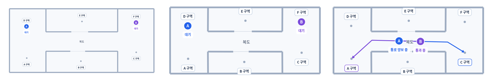

# 단계 3D-2 · 복도 평면도 검증

종합 관제의 기본 지도는 실제 맵에서 잰 벽 12개와 문 2개로 그린다. 기본 화면에는 바닥·벽·문과 복도 이름이 보인다. **실제 맵**을 켜면 정리된 점유 격자가 35% 불투명도로 깔리고, 관제에 쓰는 복도 다각형이 점선으로 나타난다. 초기 화면과 더블클릭 초기화는 외벽 전체를 16px 여백으로 맞춘다.

## 기준 그림과 실제 화면

왼쪽부터 팀의 기준 그림, 8090에서 캡처한 평상시, 시나리오 2의 통로 양보다. 비교 그림은 원본의 지도 부분만 잘라 비율을 유지해 나란히 놓았다.



[기준 그림 원본](design/04-map-target.png) · [평상시 전체 화면](screens/01-dashboard.png) · [양보 중 전체 화면](screens/02-corridor-wait.png)

- 위쪽 D·E·F와 아래쪽 A·B·C, 가운데 복도, B·E방의 문틈과 외벽 비율이 기준 그림과 일치한다. 평상시 A는 D, B는 F에서 대기한다.
- 실제 대시보드에는 지도 옆에 복도와 로봇 카드가 함께 있다. 지도 패널이 기준 그림보다 좁아 고정 픽셀 크기의 로봇 원과 이름표가 건물에 비해 크게 보인다. B 이름표는 아래 외벽에 걸치지만 글자와 바깥 벽 전체가 패널 안에 보인다.
- 양보 중에는 실제 남은 경로와 화살촉, 두 로봇의 상태 글, 목적지 이름표 테두리가 추가된다. 복도의 바탕색은 평상시와 같다.

## 원본 맵과 대조한 값

| 검사 | 결과 |
|---|---|
| 자동 기울기 보정 | 반시계 4.1°. 이어서 반시계 90° 회전 |
| 정리한 실제 맵 | 0.05 m/칸, 160×79, PGM P5 |
| 벽과 원본 점유 격자의 일치 | 12개 선분 각각을 5cm 이하 간격으로 검사. 모든 선분에서 표본의 100%가 원본 벽 칸 중심에서 0.10 m 이내 |
| 각 벽의 수평·수직 오차 | 최대 0.357° |
| 여섯 구역 점과 가장 가까운 평면도 벽 | 최소 0.550 m |
| 문 중심과 복도 긴 변 사이 거리 | B방 0.029 m, E방 0.058 m |

배포 평면도는 BRIEF 14.7절 좌표를 그대로 사용한다. 측정 명령은 원본 PGM만 읽어 선분과 문틈을 다시 추정한다. 워크스페이스 루트에서 기본 명령을 실행하면 소스의 `config/floor_plan.yaml`을 갱신한다. 비교용으로 다른 파일에 쓰려면 다음처럼 경로를 지정한다. 검증에서는 임시 파일에 벽 12개와 문 2개가 생성되는 것을 확인했다.

```bash
ros2 run part1_ui_dashboard measure_floor_plan --map-yaml main_map/main_maps.yaml --output /tmp/measured-floor-plan.yaml
ros2 launch part1_ui_dashboard demo_mock.launch.py
```

## 관제 회귀와 mock 시나리오

통로 다각형을 바꾼 직후 PART 03 테스트에서 241건이 통과했고 기존 경계 판정 사례 2건이 실패했다. 원인은 `test_regions_follow_tilted_edges`의 좌표가 옛 끝변의 연장선을 기준으로 방 안쪽에 놓여 있었기 때문이다.

| 기존 시험점 | 새 경계에서의 실제 영역 | 수정한 시험점과 확인한 영역 |
|---|---|---|
| (−2.10, −0.48) | TOP | (−2.10, −0.52), ROOM_B |
| (−0.50, −4.30) | BOTTOM | (−0.50, −4.26), ROOM_E |

같은 x에서 TOP·BOTTOM 쪽을 확인하는 기존 짝 시험점도 유지했다. 구역 판정 알고리즘과 mock 입구 중심점 네 개는 그대로다.

| 시나리오 | 8090 브라우저에서 확인한 결과 |
|---|---|
| 2 · 통로 양보 | A가 Level 3의 B에게 양보해 `GIVE_WAY`로 표시됐다. 판단 창에서 높은 응급도 우선을 확인했다. B 통과 뒤 A가 재개해 임무 2건이 완료되고 두 로봇이 D·F로 복귀했다. |
| 4 · 막힘 | A가 복도에서 멈추자 막힘 경보가 열리고 B가 진입 전 대기에 머물렀다. A가 움직이자 `UNBLOCKED`가 기록됐고 두 직접 이동이 완료됐다. |

브라우저에서 **실제 맵**을 켰다 끄면 평상시 지도가 복원됐고, 확대 후 더블클릭해도 처음 화면으로 돌아왔다. 8090을 쓰던 이전 3U mock launch를 종료한 뒤 새 PART 01 화면을 같은 포트에 띄웠다.

## 변경 파일

| 범위 | 파일 |
|---|---|
| PART 01 설정·명령 | `config/floor_plan.yaml` 신설, `config/ui.yaml`, `setup.py` |
| PART 01 서버 | `part1_ui_dashboard/occupancy.py` 신설, `ui_api.py`, `ui_server_node.py`, `web.py` |
| PART 01 화면 | `static/map.js`, `style.css`, `app.js`, `pages/dashboard.js`, `pages/missions.js` |
| PART 01 테스트 | `test/test_ui_api.py`, `test/test_ui_routes.py` |
| PART 03 | `config/fleet.yaml`, `core/schemas.py`, `core/store.py`, `test/test_geometry.py`, `test/test_store.py` |
| 문서·캡처 | 이 보고서, `stage3d2-map-comparison.png`, `screens/01-dashboard.png`, `screens/02-corridor-wait.png`, 이전 단계 보고서의 갱신 안내 |

환자 이름은 생략하거나 비워 둘 수 있다. 관제 요청과 저장소에서 차트번호와 이름을 따로 유지하고, 이름이 없는 환자는 작업 표·상세·수령 확인에서 차트번호로 표시한다.

**BRIEF에 없어서 정한 값.** 재측정 명령은 두 홀과 두 방의 배치에서 평행 벽 후보를 구분할 때 0.35 m의 최소 간격을 쓰며, 후보 선에서 좌우 0.10 m 이내의 벽 칸으로 중심선을 구한다. 출력은 미터 단위 소수 둘째 자리로 반올림한다. 격자 정리에서 벽 덩어리는 명시된 8이웃, 빈 칸과 모르는 칸은 4이웃을 쓴다. 자동 기울기 점수가 같으면 절댓값이 작은 보정각을 우선한다.

## 테스트

```bash
PYTHONDONTWRITEBYTECODE=1 PYTHONNOUSERSITE=1 PYTHONPATH=src/part1_ui_dashboard:src/part3_fleet_manager \
  /usr/bin/python3 -m pytest -p no:cacheprovider src/part1_ui_dashboard/test src/part3_fleet_manager/test -q
```

PART 01 40건, PART 03 244건. 총 284건 통과, 실패·건너뜀 0건. 두 패키지의 colcon 빌드와 설치된 측정 명령 실행도 성공했다.
