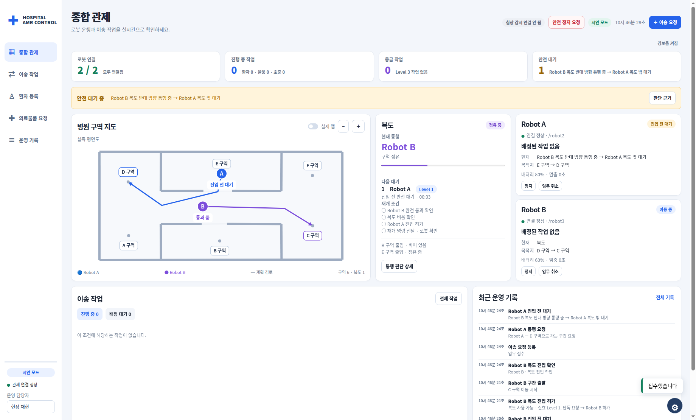
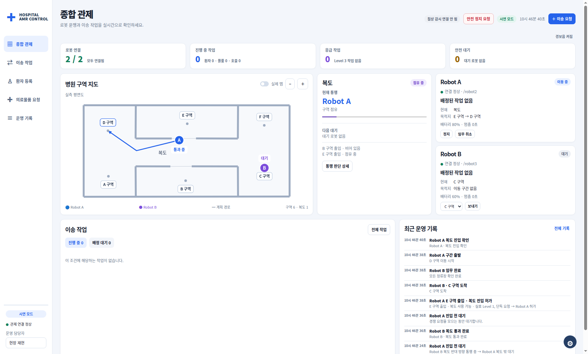

# 단계 4F · E방에서 나오는 로봇의 복도 진입 대기

2026-11-19. mock 두 대로 11/18 동선을 재현했다. Robot B가 C로 향하는 동안 Robot A는 E방 좌표 **(−0.55, −2.40) m**에 머물렀다. B의 복도 반납 **1.1초 뒤** A에 D행 허가가 났다. 화면에서 수신한 상태 144건과 관제 DB의 전체 이벤트에서 복도 안 양보는 **0건**이었다.

## 재현과 캡처

팀 가상환경의 임시 설치본에서 발견 서버·슈퍼 클라이언트·정적 피어 설정을 해제했다. 도메인 89, `ROS_AUTOMATIC_DISCOVERY_RANGE=LOCALHOST`, Fast DDS UDPv4 루프백 인터페이스만 사용했다. `demo_mock.launch.py`에 임시 DB와 설정 사본을 넘겼다. 사본에서 시작 위치를 A=E, B=D로 두고 mock 속도는 0.35 m/s로 지정했다. 복도 모드는 배포 기본값인 `DIRECTIONAL`을 사용했다.

종합 관제에서 Robot B의 목적지를 C로 골라 **보내기**를 눌렀다. B의 복도 진입이 확인되자 Robot A의 목적지를 D로 골라 **보내기**를 눌렀다. 두 요청 모두 직접 이동 Level 1이다.

| 시각 (KST) | 관제 DB와 화면에서 확인한 내용 |
|---|---|
| 10:46:24.800 | B가 복도에 진입했다. |
| 10:46:24.900 | A의 판단은 `RESOURCE_HOLD / DIRECTION`. 반대 방향 대기 사유가 표시된 상태 59건 모두 A의 좌표가 같고, E방 보유자는 A, 복도 보유자는 B였다. |
| 10:46:36.900 | B가 복도를 완전히 벗어나 여유 거리·유지 시간 조건을 충족했다. 관제가 B의 복도를 해제했다. |
| 10:46:38.000 | A가 E방에서 D로 갈 허가를 받았다. |
| 10:46:40.100 | A가 복도에 진입했다. B는 C에 도착해 대기 중이었다. |
| 10:46:48.100 | A가 D에 도착했다. 두 로봇 모두 대기, 복도는 비어 있었다. |

**B가 통과하는 동안 A는 E방에서 진입 전 대기.** 왼쪽 지도에 두 로봇의 실제 mock 위치가, 가운데 복도 패널에 통행자 B와 대기자 A가 보인다.



**B가 나간 뒤 A가 출발.** 복도 패널의 통행자가 A로 바뀌고, B의 카드에 C 구역 대기가 표시됐다.



## 관제와 현장 설정

- 복도 허가 시점에 방향을 정하고 허가만 받은 로봇도 자리와 방향을 보유한다. 같은 방향은 최대 두 대, 반대 방향은 선점 없이 밖에서 대기한다. B↔E 횡단과 방향을 확인할 수 없는 보유자는 단독 통행으로 처리한다. 시작 때 이미 복도 안에 반대 방향으로 있는 두 대에는 BRIEF 5.3절 11번 양보 절차를 적용한다.
- 범퍼 상승 신호를 받으면 충돌 로봇과 설정 거리 이내의 이웃에 안전 정지를 건다. 주행 중인 대상에는 각각 `PAUSE`가 나가며 `BUMP.detail.targets`에 ID를 남긴다. 0.8 m와 정확히 1.0 m에서는 두 대, 1.01 m에서는 충돌 로봇 한 대가 멈췄다. E방에 서 있는 A의 범퍼를 눌렀을 때도 옆을 지나던 B에 정지 명령이 나갔다. 개별 재개 시험에서 먼저 재개한 로봇만 움직였다.
- 실기용 launch를 격리 도메인에서 띄워 인자 생략 시 복도 정원 2, `corridor_mode:=EXCLUSIVE` 지정 시 정원 1을 확인했다. 현장에서 한 대씩 운행할 때의 재시작 절차를 반영했다. [현장 순서](../REAL_TEST.md)
- 배정의 최종 동점은 YAML의 앞선 로봇, 복도·교착에서 비킬 로봇은 뒤의 로봇이다. 설정 순서를 반대로 한 테스트에서 세 판단이 함께 바뀌었다. 명령 스키마와 화면 서버는 활성 설정의 로봇 ID를 검증한다.
- ACK 캐시는 최근 접근한 요청 500개를 유지한다. 완료·취소 이력의 화면 표시 한도는 재시작 시 DB 조회와 실행 중 상태에 동일하게 적용한다. 0건과 2건 설정을 시험한 뒤 DB에는 세 임무가 모두 남아 있음을 확인했다. 막힘은 `stall_blockers`로 관리하고 주행 연결은 `HOSPITAL_NAV`만 지원한다.

## 검증 명령과 결과

워크스페이스 루트에서 Jazzy와 팀 가상환경을 불러온 뒤 사용한 pytest 명령이다.

```bash
unset ROS_DISCOVERY_SERVER ROS_SUPER_CLIENT ROS_STATIC_PEERS
export ROS_AUTOMATIC_DISCOVERY_RANGE=LOCALHOST ROS_DOMAIN_ID=89
export PYTHONDONTWRITEBYTECODE=1
export PYTHONPATH="src/part1_ui_dashboard:src/part3_fleet_manager:$PYTHONPATH"
python -m pytest -p no:cacheprovider -q src/part1_ui_dashboard/test src/part3_fleet_manager/test
```

| 범위 | 결과 |
|---|---|
| BRIEF 44~46 (방향별 허가·횡단·이미 진입한 경우, 범퍼 거리·개별 재개, 세 모드) | 16 통과, 0 실패 |
| PART 01·03 전체, 배포 기본값 `DIRECTIONAL` | 352 통과, 0 실패 |
| 임시 소스 사본의 기본값을 `SHARED_YIELD` / `EXCLUSIVE`로 변경한 뒤 같은 전체 테스트 | 각각 352 통과, 0 실패 |
| 두 패키지 빌드 | `colcon build --symlink-install --packages-select part3_fleet_manager part1_ui_dashboard`를 임시 소스·빌드·설치 경로에서 실행. 2개 성공, 0개 실패 |
| PART 05를 포함한 추가 검사 | 437 통과, 1 실패. PART 05만 다시 실행해도 85 통과, 1 실패 |

복도 양보·교착·장애물 시나리오는 필요한 모드를 테스트 설정에 명시했다. 예전 파일의 누락 키를 확인하는 테스트에는 사본의 현재 모드에 의존하는 단언이 남아 있어 수정했다. [기본값 변경 검사 기록](../troubleshooting/2026-11-19-corridor-mode-default-test.md)

추가 검사에서 실패한 테스트는 `test_ros_boundary_skips_camera_exceptions_and_bad_returns_then_rewarms`다. PART 05의 `BedExitNode.process_frame()`에서 `capture.read()`가 던진 `RuntimeError('camera disconnected')`가 콜백 밖으로 전파됐다. 이 테스트는 ROS와 카메라를 모의 처리하며 PART 01·03 없이도 실패한다. PART 05는 이번 수정 금지 범위다. [테스트](../../../src/part5_bed_exit/test/test_part5_integration.py) · [콜백](../../../src/part5_bed_exit/part5_bed_exit/bed_exit_node.py)

## 변경 파일

| 위치 | 파일 |
|---|---|
| `src/part3_fleet_manager/` | `config/fleet.yaml`, `part3_fleet_manager/defaults.py` (신규), `part3_fleet_manager/fleet_manager_node.py` |
| `src/part3_fleet_manager/part3_fleet_manager/core/` | `config.py`, `deadlock.py`, `fleet_core.py`, `mission.py`, `resource_manager.py`, `safety.py`, `schemas.py`, `store.py` |
| `src/part3_fleet_manager/test/` | `test_config.py`, `test_corridor_yield.py`, `test_deadlock.py`, `test_field_traffic.py` (신규), `test_fleet_core.py`, `test_resource_manager.py` |
| `src/part1_ui_dashboard/` | `launch/real.launch.py`, `part1_ui_dashboard/ui_api.py`, `part1_ui_dashboard/web.py`, `test/test_event_sentences.py`, `test/test_ui_routes.py` |
| `docs/part3/` | `BRIEF.md`, `REAL_TEST.md`, `STAGES.md`, `troubleshooting/2026-11-19-corridor-mode-default-test.md` (신규) |
| `docs/part3/ui/` | 이 보고서, `screens/4f-01-room-hold.png`, `screens/4f-02-after-release.png` (신규) |

## 구현에서 정한 사항과 남은 확인

완료 이력 설정 키는 `publish.finished_mission_limit`이며 기본은 20, 0은 화면 이력 숨김이다. 범퍼 이벤트의 대상 키는 기존 안전 이벤트와 같은 `targets`를 쓴다. 거리 비교에는 마지막으로 수신한 지도 위치를 사용한다. 위치가 없는 로봇은 이웃 거리 판정에서 제외하고 충돌 신호를 낸 로봇은 위치와 관계없이 정지한다.

실물 범퍼 신호가 관제 PC에 도달하는지와 실제 로봇의 정지 거리는 단계 4 현장 확인 항목이다. 11/18 관제 DB에는 범퍼 이벤트가 없었으므로 이번 mock·단위 테스트 결과만으로 실물 신호 수신까지 확인할 수는 없다.
