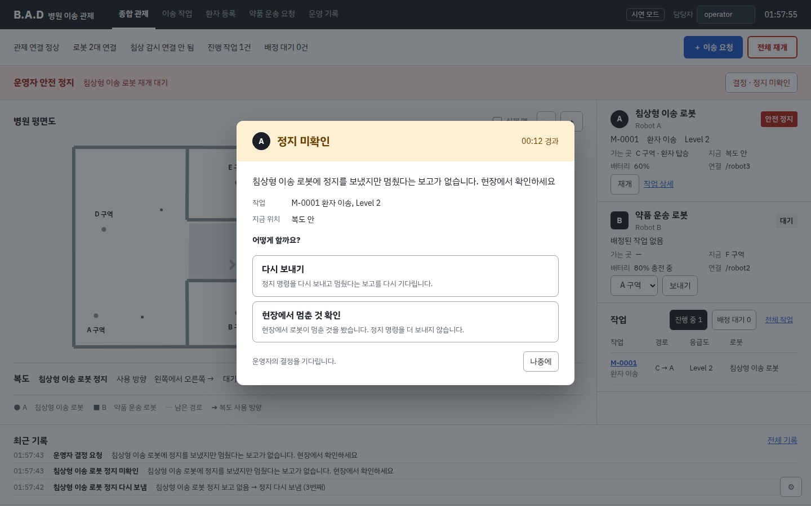

# 단계 4K · 정지 확인, B·E 해제 버튼, 도착 복구, 자동 재출발 끄기

2026-11-20. PART 01·03만 고쳤다. PART 04 `mission_manager.py`는 읽기만 했고(`pause()`는 `MOVING`이 아니면 무시, `_tick`과 STATE `snapshot`이 같은 잠금이라 `ARRIVED`가 STATE `COMPLETE`보다 먼저 나감), PART 04와 주고받는 메시지 형식은 그대로다. 항목마다 지금 코드에서 실패하는 시험을 먼저 쓰고, 실패를 확인한 뒤 고쳤다. PART 01·03 테스트는 **505개 통과, 실패 0개**(PART 01 63개, PART 03 442개)다. 두 패키지 colcon 빌드가 성공했다. 커밋·푸시는 하지 않았다.

## 1. 항목별 결과

### 1.1 정지 명령 확인과 재전송 (D-32)

| 고치기 전 실패한 시험 | 실패 출력 요약 |
|---|---|
| `test_64_pause_is_resent_when_state_stays_moving_for_retry_time` | `KeyError: 'robot_a'` — 1.5초 뒤 STATE가 계속 `MOVING`인데 그 tick에 robot_a 명령이 없음 (PAUSE 한 번뿐) |
| `test_64_more_than_three_resends_opens_stop_unconfirmed_card` | `assert [] == [4.5, 6.0, 7.5]` — 재전송 0번 |
| `test_64_paused_closes_the_card_and_nothing_more_is_sent` | `ValueError: not enough values to unpack (expected 1, got 0)` — 카드가 열리지 않음 |
| `test_64_paused_after_one_resend_stops_resending` | `assert [] == [4.5]` — 재전송 없음 |
| `test_64_card_choices_resend_or_field_confirmed` | `ValueError: … (expected 1, got 0)` — 카드 없음 |
| `test_64_card_closes_when_the_stop_is_no_longer_needed` | `ValueError: … (expected 1, got 0)` — 카드 없음 |
| `test_64_stop_wording_waits_for_the_robot_state` (PART 01) | `assert ['침상형 이송 로봇 안전 정지', ''] == ['침상형 이송 로봇 정지 요청 중(확인 전)', 'amber-text']` — STATE를 안 보고 "안전 정지" |
| 처음부터 통과 | `test_64_stopping_pause_is_not_resent` — 지금 코드는 원래 다시 안 보내므로 통과. 고친 뒤 `STOPPING_PAUSE`에서 다시 보내지 않는지 지키는 시험으로 남겼다 |

고친 것:

- `robot_protocol.py`: PAUSE 보낸 시각·횟수를 기록한다. 정지가 필요하고 `robot_link.control_retry_s`(1.5초) 뒤에도 STATE가 `MOVING`이면 다시 보낸다. `STOPPING_PAUSE`·`PAUSED`면 보내지 않는다. 다시 보낸 횟수가 `control_retries`(3)를 넘으면 더 보내지 않고 "미확인"으로 표시한다. 정지가 필요 없어지면 횟수를 지운다.
- `mission.py`: 재전송마다 `STOP_RESENT`, 미확인이 되면 `STOP_UNCONFIRMED` 이벤트와 카드 "정지 미확인"(이유 "침상형 이송 로봇에 정지를 보냈지만 멈췄다는 보고가 없습니다. 현장에서 확인하세요", [다시 보내기] [현장에서 멈춘 것 확인]). STATE가 `PAUSED`이거나 정지가 더 필요 없으면 카드를 `resolved`로 닫는다.
- `fleet_core.py`: [다시 보내기]는 그 tick에 PAUSE를 보내고 횟수를 처음부터 센다. [현장에서 멈춘 것 확인]은 이번 정지에서 더 보내지 않는다. `decisions.py`에 카드 종류 추가.
- `app.js` 326~327 부근(`alarmAction`): 정지 원인이 있고 STATE가 `PAUSED`가 아니면 "정지 요청 중(확인 전)" 주황, `PAUSED`면 "정지 확인" 빨강. 침상 감시 끊김 경보에도 같은 규칙.
- 설정: `fleet.yaml robot_link.control_retry_s: 1.5`, `control_retries: 3`.

### 1.2 B·E 방 문 점유 해제 버튼 (D-33)

| 고치기 전 실패한 시험 | 실패 출력 요약 |
|---|---|
| `test_65_each_unknown_resource_has_its_own_clear_button` (PART 01) | `assert [['', '현장 확인 후 복도 비움']] == [['CORRIDOR', …], ['ROOM_B', '현장 확인 후 B 구역 출입 비움'], ['ROOM_E', …]]` — 세 자원이 모두 점유 불명인데 버튼은 복도 하나, 자원 이름 없음 |
| (참고 확인) 같은 브라우저에서 `actions["clear-ok"]("ROOM_B")` 직접 실행 | 보낸 본문 `{"cmd": "RESOURCE_CLEAR_CONFIRM", "resource": "CORRIDOR", …}` — B를 눌러도 복도를 보냄 |
| 처음부터 통과 | `test_65_door_unknown_is_cleared_by_operator_confirm[B-ROOM_B]`·`[E-ROOM_E]` (PART 03), `test_65_command_route_publishes_the_resource_unchanged` ×3 (PART 01 화면 서버 경로). **관제와 화면 서버 쪽 지적은 맞지 않았다.** 그래서 PART 03 `clear_unknown`·`web.py`는 고치지 않았다. 문제는 `app.js`의 고정값뿐이었다 |

고친 것: `app.js`의 `clear`·`clear-ok`가 버튼의 자원 이름을 그대로 보낸다. `dashboard.js` 복도 줄 아래에 점유 불명 자원마다 버튼("현장 확인 후 복도 비움"·"… B 구역 출입 비움"·"… E 구역 출입 비움")을 둔다. 확인 창은 "현장에서 B 구역 출입의 점유 상태를 확인했습니까?". 상황 줄 제목도 "B 구역 출입 점유 불명"으로 맞췄다(전에는 "B 구역 점유 불명").

### 1.3 도착 알림이 빠졌을 때 복구 (D-34)

| 고치기 전 실패한 시험 | 실패 출력 요약 |
|---|---|
| `test_66_complete_state_alone_reaches_wait_confirm_in_one_tick` | `assert 'MOVING' == 'WAIT_CONFIRM'` — STATE `COMPLETE`가 와도 임무가 이동 중으로 남음 |
| `test_66_late_arrived_after_recovery_is_ignored` | `assert 'MOVING' == 'WAIT_CONFIRM'` — 같은 이유 (늦은 `ARRIVED` 전 단계에서 실패) |
| 처음부터 통과 | `test_66_complete_for_another_mission_or_destination_is_ignored` ×3(다른 임무 ID·목적지·자리), `test_66_same_tick_state_then_arrived_counts_once` — 지금 코드는 `COMPLETE`를 아예 안 보므로 통과. 고친 뒤 잘못 짝짓지 않는지 지키는 시험이다 |

고친 것: `robot_protocol.py`가 STATE `COMPLETE`이고 `mission_id`가 지금 이동의 PART 04 ID와 같고 `destination`(그리고 STATE에 `slot`이 있으면 보낸 MOVE의 자리)이 같으면 기억해 두고, 그 입력 묶음이 끝날 때(`settle`) 진짜 `ARRIVED`가 없었으면 도착으로 넘긴다. `mission.py`는 `ARRIVED_FROM_STATE`를 남긴 뒤 보통 도착과 똑같이 처리한다. 늦게 온 `ARRIVED`는 이미 끝난 이동이라 버려진다. DOCK은 그대로다. 묶음 끝까지 기다리는 이유: 시뮬레이터는 같은 tick에 STATE를 STATUS보다 먼저 넣는데, 그때 바로 도착으로 바꾸면 모든 정상 도착에 `ARRIVED_FROM_STATE`가 붙는다.

### 1.4 장애물 "상자 없음"이어도 자동 재출발하지 않기 (D-31 갱신)

| 고치기 전 실패한 시험 | 실패 출력 요약 |
|---|---|
| `test_67_none_verdict_opens_card_without_automatic_move` | `ValueError: not enough values to unpack (expected 1, got 0)` — NONE 판별 tick에 카드가 없음 (3초 뒤 자동 재출발 대기 중) |

고친 것: `fleet.yaml obstacle.retry_if_clear: false`(설정 클래스 기본값도 false). 그때 NONE 카드 이유는 "의료용 상자는 보이지 않음 — 길이 비었다는 뜻은 아님, 로봇이 찍은 사진과 현장 확인"이다. 예전 문구 "자동 재출발 뒤 다시 멈춤"은 `retry_if_clear: true`일 때만 쓴다. D-31에 이유("상자 없음"은 길이 비었다는 뜻이 아니다, 시연에서 상자 장면은 하지 않는다)를 적었다.

## 2. 격리한 가짜 로봇 실행과 캡처

ROS Jazzy. `unset ROS_DISCOVERY_SERVER ROS_SUPER_CLIENT`, `ROS_AUTOMATIC_DISCOVERY_RANGE=LOCALHOST`, `ROS_DOMAIN_ID=98` 셸에서 `demo_mock.launch.py`를 띄웠다(화면 127.0.0.1:8098, DB는 작업 폴더). `ros2 node list`는 이 실행의 노드 6개뿐이었다. 가짜 로봇에 시험용 매개변수 `ignore_pause`(기본 false)를 새로 두고 robot3(침상형)에서 켰다.

1. 환자 이송(C → A)을 보내고 robot_a가 복도로 들어서며 `MOVING`일 때 [정지](`PAUSE_ROBOT`).
2. 11.6초 `PAUSE` → 13.1·14.7·16.3초 `STOP_RESENT`(1·2·3번째) → 17.9초 `STOP_UNCONFIRMED` + 카드. 가짜 로봇 로그 "시험: PAUSE 무시" 4번(처음 1 + 재전송 3).
3. 화면을 헤드리스 크롬(DevTools 프로토콜, 1440×900)으로 열어 캡처했다. 페이지 스크립트 오류 0건. [캡처](screens/4k-01-stop-unconfirmed.png)
4. 로봇은 계속 달려 C에 도착했고(`COMPLETE`) 카드는 "상황이 풀려 닫힘"으로 저절로 닫혔다.
5. 다음 구간(C → A)에서 다시 같은 카드를 열고, `ignore_pause`를 끈 뒤 [다시 보내기]를 골랐다. 카드 닫힘('다시 보내기' 선택) → PAUSE → 0.1초 뒤 STATE `PAUSED`. 그 뒤 8초 동안 재전송 없음.



## 3. 바뀐 파일과 시험 수

| 구분 | 파일 |
|---|---|
| PART 03 코드 | `core/robot_protocol.py`, `core/mission.py`, `core/fleet_core.py`, `core/decisions.py`, `core/config.py`, `core/obstacle_report.py`, `mock_hospital_nav.py`(`ignore_pause`), `config/fleet.yaml` |
| PART 01 코드 | `static/app.js`, `static/pages/dashboard.js`, `ui_api.py`(새 이벤트 제목 3개) |
| 새 시험 | `src/part3_fleet_manager/test/test_4k_stop_arrive.py` (16개), `src/part1_ui_dashboard/test/test_4k_screen.py` (5개) |
| 바꾼 기존 시험 (줄이지 않음) | `test_config.py`: 기본값 `retry_if_clear` True → False 기대, `control_retry_s`·`control_retries` 확인 추가. `test_4j_obstacle_report.py` 58번: 시험 안에서 `retry_if_clear: true`로 정함. `test_event_sentences.py` 41번: report 시나리오는 `retry_if_clear: true`, 새 이벤트 3종을 실제로 만드는 4K 장면 추가 |
| 문서 | `docs/part3/BRIEF.md`(3.3·3.4·4.8·5.1·5.3·5.5a·5.6·5.7·7·8·9장 64~67번), `docs/part3/DECISIONS.md`(D-31 갱신, D-32~D-34), `docs/part3/WEB_DB_DESIGN.md`(카드 설명, 5.11·5.13·5.14), `docs/part3/STAGES.md`(4K 줄, 3.1c), 이 보고서, 캡처 1장 |

| 대상 | 4J | 4K |
|---|---|---|
| PART 01 | 58 통과 | 63 통과, 0 실패 |
| PART 03 | 426 통과 | 442 통과, 0 실패 |
| colcon 빌드 | 2개 성공 | 2개 성공 |

```bash
PYTHONDONTWRITEBYTECODE=1 PYTHONNOUSERSITE=1 PYTHONPATH=src/part1_ui_dashboard:src/part3_fleet_manager \
  python3 -m pytest -p no:cacheprovider -q src/part1_ui_dashboard/test src/part3_fleet_manager/test
colcon build --symlink-install --packages-select part3_fleet_manager part1_ui_dashboard
```

- PART 01 화면 시험 2개(`test_64_stop_wording…`, `test_65_each_unknown…`)는 관제 PC에 node가 없어서 설치된 google-chrome을 임시 프로필로 헤드리스 실행해 실제 `app.js`·`dashboard.js`를 돌린다. 크롬이 없는 PC에서는 건너뛴다(skip).

## 4. 지시에 없어서 정한 것 (모두 D-32~34에 적음)

1. **주행이 끝난 STATE도 "멈췄다는 보고"로 본다.** `IDLE`·`COMPLETE`·`CANCELED`·`FAILED`는 PAUSE를 받을 일이 없고 서 있다는 보고다. 화면은 "정지 확인"(빨강), 서버는 카드를 닫는다. 지시는 "`PAUSED`가 아니면 확인 전"이었지만, 정류장에 서 있는 로봇에 "정지 요청 중"이 계속 뜨는 것을 피하려고 넓혔다. 연결이 끊긴 로봇은 확인 전이다.
2. **정지가 더 필요 없어지면 카드를 닫는다** (재개 등). 횟수도 지워서 다음 정지는 처음부터 센다.
3. **두 로봇이 섞인 경보**는 "침상형 이송 로봇 정지 확인 · 약품 운송 로봇 정지 요청 중(확인 전)"처럼 이어 쓰고, 한 대라도 확인 전이면 주황.
4. **도착 자리 비교**는 보낸 MOVE의 자리로 한다. 번호를 안 붙인 MOVE는 PART 04에서 1번 자리다.
5. 정지 미확인 카드의 위치 칸 이름은 "멈춘 곳" 대신 "지금 위치".
6. 새 이벤트 문장: `STOP_RESENT` "침상형 이송 로봇 정지 보고 없음 → 정지 다시 보냄 (1번째)", `ARRIVED_FROM_STATE` "도착 알림이 빠져 로봇 상태 보고(완료)로 도착을 확인했습니다." 화면 제목 "… 정지 다시 보냄", "… 정지 미확인", "… · C 구역 도착 (상태 보고로 확인)".

## 5. 남은 질문 (11/20 답변 반영은 6장)

- **로봇 블록 배지와 상황 줄**은 여전히 관제 판단 기준이다. 캡처에서도 로봇은 계속 달리는데 배지는 "안전 정지", 상황 줄은 "운영자 안전 정지"다. 같은 규칙(STATE 확인 전이면 주황 "정지 요청 중(확인 전)")을 여기도 적용할지 정해 주세요. 이번에는 지시 범위(경보 창 관제 조치)만 바꿨다.
- **운영자 정지(`PAUSE_ROBOT`·`PAUSE_ALL`)는 경보 창이 없다.** 그래서 "정지 요청 중(확인 전)" 문구는 침상 이탈·범퍼·침상 감시 끊김 때만 보인다. 운영자 정지에서는 카드(6초)가 유일한 표시다.
- 위 4장 1번(주행 끝 STATE를 확인으로 보기)이 맞는지.
- 1.5초·3번은 mock 기준이다. 실제 PART 04에서 PAUSE → `PAUSED`까지 시간을 보고 정한다 (STAGES 3.1c).
- [현장에서 멈춘 것 확인] 뒤에도 STATE가 `MOVING`이면 이번 정지 동안 더 보내지 않는다. 재개해도 STATE가 `PAUSED`가 아니라서 `RESUME`은 나가지 않는다. 이 동작이 현장 절차와 맞는지.
- "시연에서 상자 장면은 하지 않는다"(D-31): 시연 5막 시험(`test_4j_demo.py` ④ 상자)과 BRIEF 61번 시연 순서는 그대로 두었다. 시연 대본에서 빼면 시험도 고칠지.
- 문제 해결 기록(`docs/troubleshooting/`)은 새로 쓰지 않았다. 캡처는 4J 기록의 DevTools 방법을 그대로 썼고(작업용 스크립트는 저장소 밖), 그 밖에 막힌 일은 없었다.

## 6. 답변 반영 (11/20)

1. 로봇 블록 배지·지도 표시와 상황 줄도 경보 창과 같은 규칙이다. 정지 원인이 있고 STATE가 멈춤 보고(`PAUSED`·`IDLE`·`COMPLETE`·`CANCELED`·`FAILED`)가 아니면 "정지 요청 중(확인 전)" 주황, 멈춤 보고면 "정지 확인" 빨강(상황 줄은 "… 정지 확인 · 재개 대기"). 범퍼 충돌 상황 줄은 빨강 경보로 두고 정지 문장만 이 규칙을 따른다. 고치기 전 새 화면 시험 12개(`test_64_robot_block_badge_follows_the_robot_state` 5개, `test_64_situation_line_follows_the_robot_state` 7개)가 모두 실패했다: 배지 `['안전 정지', 'badge red']`, 상황 줄 "침상형 이송 로봇 재개 대기"·`risk`. 고친 파일은 `app.js`(`displayState`, `situation`, `renderTop`).
2. 운영자 정지에는 경보 창을 새로 만들지 않았다. 1번 배지와 상황 줄로 확인 전 상태가 보인다.
3. 시연 5막 시험과 BRIEF 61번은 그대로 두었다. `REAL_TEST.md` 5장에 "시연에서는 4막(상자)을 건너뛴다"를 적었다. 같은 칸에 남아 있던 "3초 뒤 한 번 저절로 다시 간다"는 4K 기본값(자동 재출발 없음)에 맞게 고쳤다.

시험: PART 01 75개(63 + 12), PART 03 442개 통과, 실패 0개.

