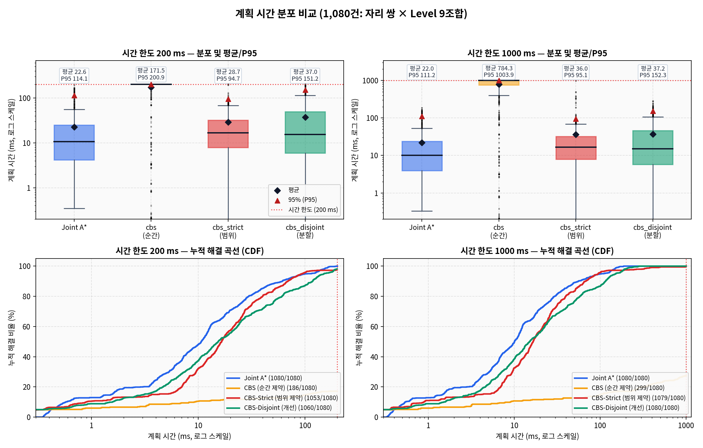
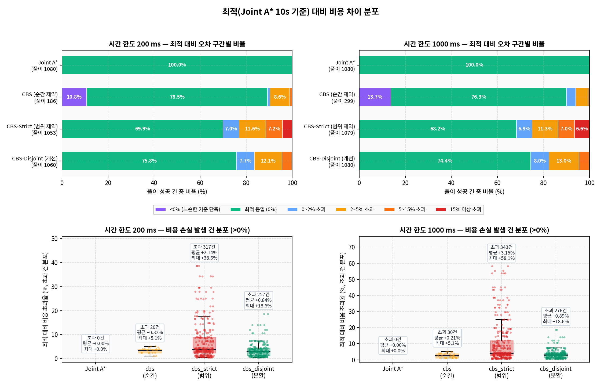
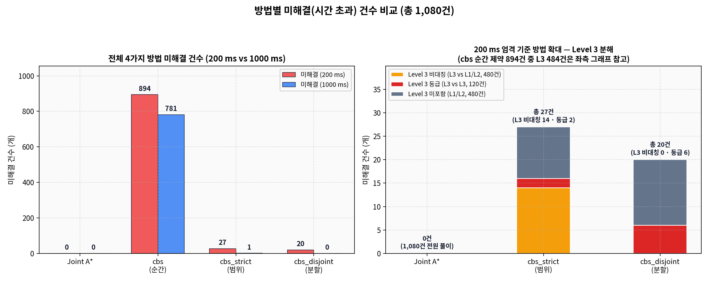

# PART 03 교통 계획 비교 실험: Joint A* vs CBS 변형

`src/part3_fleet_manager`의 운영 계획기(**Joint A\***: 두 로봇 시공간 함께 탐색)와 동일한 그래프(`PlanGraph`), 동일한 저수준 탐색(`Planner._search`), 동일한 엄격 충돌 기준 위에서 실험용 CBS 3종을 비교한 결과입니다. 관제 운영 코드(`src/`)는 일절 수정하지 않고 `experiments/cbs/` 안에서만 구현·측정했습니다.

## 1. 비교 대상 및 개선 설계

| 방법 | 파일 | 제약 방식 | 충돌 기준 | 비고 |
| --- | --- | --- | --- | --- |
| **Joint A\*** | `src/.../core/planner.py` | 두 로봇 동시 시공간 A\* (시간 초과 시 우선순위 대체) | 계획기 자체 규칙 | 운영 기본 방식 |
| **cbs** | `cbs.py` | 순간 제약 `[t, t]` (스왑 시 `[t-1, t]`) | 느슨한 기준 (`test_4o_plan.assert_clean`) | 복도 대치 시 1스텝씩 분기해 타임아웃 다수 |
| **cbs_strict** | `cbs_strict.py` | 양쪽 모두 상대 체류 전체 범위 `[t, stay]` 충돌 집합 제약 | 엄격 기준 (`first_conflict`) | 빠르지만 비완전 분기로 최적 손실 큼 (최대 +58.1%) |
| **cbs_disjoint** | `cbs_disjoint.py` | **Disjoint Splitting** (한쪽 구간 확정 + 다른쪽 겹침 종료 시점 `t_star` 단일 부정 제약) | `cbs_strict.py`와 완전 동일 | `cbs_strict` 대비 비용 손실 대폭 감소, 1000 ms 전원 풀이 |

### `cbs_disjoint.py` 개선 핵심
`cbs_strict.py`가 317~343건에서 최적 해를 잃은 원인(최대 +38.6% @ 200 ms, +58.1% @ 1000 ms)은 두 가지입니다.
1. **비완전한 충돌 집합 분기**: 두 갈래가 각각 `¬conflict(π_a, pb)`와 `¬conflict(π_b, pa)`를 강제하면, `pb`와 충돌하면서 `pa`와도 충돌하지만 **서로는 충돌하지 않는 유효 해 `(pa', pb')`**(예: `B1->E / E1->B`에서 `(B1 정차, B2 이동)`)가 양쪽 갈래 모두에서 잘려 나갑니다.
2. **전체 체류 범위 제약 `[t, stay]`**: 상대가 머무는 구간 전체를 양쪽 모두에서 막아 타이밍이 약간 어긋난 최적 해가 배제됩니다.

`cbs_disjoint.py`는 저수준 탐색(`Planner._search`)과 엄격 충돌 기준(`cbs_strict.CBS.first_conflict`)을 그대로 유지한 채 다음 구조로 이를 줄였습니다.
- **충돌·분기 로봇 선택**: 엄격 기준 충돌 중 이동-이동 겹침이 가장 긴 구간(예: `CROSSROAD`/복도 셀)을 우선 선택하고, 이동 로봇 > 높은 Level 가중치 > 좁은 용량 구간(`graph.capacity`) > 긴 체류 순으로 분기 기준 로봇 `a`를 고릅니다.
- **긍정 갈래(Positive on `a`)**: `a`의 `t_commit` 이전 지점·스텝 접두 경로를 확정하고(단, 같은 복도 접두를 공유하는 형제 목표 슬롯 예: `E2->B1` vs `E2->B2`는 후미에 제약이 걸릴 때 열어 둠), `b`에게는 확정 구간에 따른 함의 충돌 집합 제약 `("avoid", pa, t_c0, t_c1)`을 부여합니다.
- **부정 갈래(Negative on `a`)**: `a`에게 겹침 종료 시점 `t_star`에만 `("forbid", pa, t_star, t_star)` 제약을 합성 원거리 장애물(`CBS_NEG_*`)로 부여합니다.
  - 좁은 용량 구간(`graph.capacity`: 복도 셀, 교차로, 문)에서는 `(point, standing, capacity_segs)` 동치류를 함께 막아 같은 1차선 병목을 지나는 경로 중복 분기를 제거합니다.
  - 슬롯·홀·방에서는 정확한 `piece_id`만 막아 출구 방향이 다른 유효 대안(예: `A2->D1` vs `A2->D2`)을 보존합니다.

---

## 2. 실행 방법

저장소 루트(`~/bad_ws`)에서 실행합니다.

```bash
# 1) 기존 bench2.py로 단일 모듈 재현 (사용법: bench2.py <저장소 경로> <한도 ms> <개수, 0=전체> <모듈>)
python3 experiments/cbs/bench2.py /home/kimjunseong852/bad_ws 200 0 cbs_strict
python3 experiments/cbs/bench2.py /home/kimjunseong852/bad_ws 200 0 cbs_disjoint

# 2) 4가지 방법 통합 비교 (1,080건 × 200 ms, 1000 ms) -> results/summary.json 생성
python3 experiments/cbs/compare_all.py /home/kimjunseong852/bad_ws \
    --limits 200,1000 \
    --raw-out /tmp/cbs_compare_raw.json \
    --summary-out experiments/cbs/results/summary.json

# 3) 그래프 3종 생성 -> experiments/cbs/results/*.png
MPLCONFIGDIR=/tmp/mpl python3 experiments/cbs/plot_results.py \
    --raw /tmp/cbs_compare_raw.json \
    --summary experiments/cbs/results/summary.json \
    --out-dir experiments/cbs/results
```

---

## 3. 실험 결과

- **벤치마크 문제**: 서로 다른 구역으로 향하는 모든 순서 슬롯 쌍(`12 × 10 = 120`) × Level 9조합(`(1,2,3)²`) = **1,080건** (이 중 Level 3 포함 **600건** = 비대칭 `L3 vs L1/L2` 480건 + 동급 `L3 vs L3` 120건).
- **최적 기준 (`opt`)**: `Planner._search` 10초 한도 실행 결과(1,080/1,080 성공, 평균 22.2 ms, 최대 188.3 ms).
- **Step 1 재현 확인 (`bench2.py`, `cbs_strict` 200 ms)**: 본 장비(단일 스레드 성능이 기존 측정 장비 대비 ~1.6배 빠름)에서 `cbs_strict` 200 ms 재현 시 최적 동일 건수는 **736건**(풀이 1,052건 중 70.0%)으로 기존 기록(736/1,043 = 70.6%)과 **정확히 일치**했고, 평균 비용 차이 +2.10%(기존 +2.0%), 미해결 28건(기존 37건), 최대 차이 +38.59%(기존 타임아웃 제외 +34%)가 재현되었습니다.
- 전체 표의 정확한 수치는 [`results/summary.json`](results/summary.json)에 저장되어 있습니다.

### 3.1 전체 1,080건 비교 — 시간 한도 200 ms

| 방법 | 평균 (ms) | 95% (ms) | 최대 (ms) | 미해결 | 엄격 통과 / 풀이 | 최적 동일 (풀이 대비 / 전체) | 최적 대비 평균 차이 | 최적 대비 최대 차이 |
| --- | ---: | ---: | ---: | ---: | ---: | ---: | ---: | ---: |
| **Joint A\*** | 22.6 | 114.1 | 201.6 | **0** *(대체 0)* | 1,060* / 1,080 | **100.0% / 100.0%** (1,080) | **+0.00%** | **+0.00%** |
| **cbs** (순간 제약) | 171.5 | 200.9 | 215.4 | 894 | 166 / 186 | 78.5% / 13.5% (146) | +0.32%† | +5.06%† |
| **cbs_strict** (범위 제약) | 28.7 | 94.7 | 200.4 | 27 | 1,053 / 1,053 | 69.9% / 68.1% (736) | +2.14% | +38.59% |
| **cbs_disjoint** (개선) | 37.0 | 151.2 | 200.7 | **20** | **1,060 / 1,060** | **75.8% / 74.4%** (803) | **+0.84%** *(+0.67%‡)* | **+18.56%** *(+7.41%‡)* |

### 3.2 전체 1,080건 비교 — 시간 한도 1000 ms

| 방법 | 평균 (ms) | 95% (ms) | 최대 (ms) | 미해결 | 엄격 통과 / 풀이 | 최적 동일 (풀이 대비 / 전체) | 최적 대비 평균 차이 | 최적 대비 최대 차이 |
| --- | ---: | ---: | ---: | ---: | ---: | ---: | ---: | ---: |
| **Joint A\*** | 22.0 | 111.2 | 187.8 | **0** *(대체 0)* | 1,060* / 1,080 | **100.0% / 100.0%** (1,080) | **+0.00%** | **+0.00%** |
| **cbs** (순간 제약) | 784.3 | 1003.9 | 1019.5 | 781 | 254 / 299 | 76.3% / 21.1% (228) | +0.21%† | +5.06%† |
| **cbs_strict** (범위 제약) | 36.0 | 95.1 | 1001.5 | 1 | 1,079 / 1,079 | 68.2% / 68.1% (736) | +3.15% | +58.13% |
| **cbs_disjoint** (개선) | 37.2 | 152.3 | **287.6** | **0** | **1,080 / 1,080** | **74.4% / 74.4%** (804) | **+0.89%** *(+0.72%‡)* | **+18.56%** *(+7.41%‡)* |

> \* Joint A\*의 엄격 검사 20건 차이는 계획기 건너뛰기와 검사기 시점 차이 때문이며([6절 한계](#6-한계) 참고), 느슨한 운영 테스트 기준(`assert_clean`)은 1,080/1,080 전원 통과합니다.
> † `cbs`(순간 제약)는 느슨한 충돌 기준만 검사해 200 ms에서 20건(1000 ms에서 45건)이 엄격 기준을 위반하며, 이 중 20건(1000 ms 41건)은 엄격 위반 단축 경로로 인해 `opt`보다 비용이 낮게(-0.43%~-0.91%) 측정됩니다.
> ‡ `opt` 자체가 엄격 검사를 통과하는 **1,060건**으로 한정하면 `cbs_disjoint`의 평균 비용 차이는 **+0.67%(200 ms) / +0.72%(1000 ms)**, 최대 차이는 **+7.41%**로 줄어듭니다. `cbs_disjoint`의 +18.56% 최대치(`A1->D L3 / D1->A L1`)는 `opt`가 엄격 검사에 걸리는 20건에서 엄격 유효 해를 찾느라 생긴 불가피한 차이입니다. 반면 `cbs_strict`의 최대치 **+58.13%**(`B1->E L1 / E1->B L3`, 406 vs 642)는 `opt`도 엄격 검사를 통과하는 순수 최적성 손실입니다.

### 3.3 Level 3 포함 문제(600건) 비교

Level 3가 포함된 600건을 전체와 **비대칭(`L3 vs L1/L2`, 480건)** / **동급(`L3 vs L3`, 120건)**으로 나누어 비교한 결과입니다.

#### Level 3 전체 (600건)

| 한도 | 방법 | 평균 (ms) | 95% (ms) | 최대 (ms) | 미해결 | 최적 동일 (풀이 대비) | 최적 대비 평균 차이 | 최적 대비 최대 차이 |
| --- | --- | ---: | ---: | ---: | ---: | ---: | ---: | ---: |
| 200 ms | **Joint A\*** | 17.4 | 75.1 | 194.4 | 0 | 100.0% | +0.00% | +0.00% |
| 200 ms | **cbs** | 169.1 | 200.9 | 215.4 | 484 | 77.6% *(전체 15.0%)* | +0.32% | +5.06% |
| 200 ms | **cbs_strict** | 24.7 | 85.0 | 200.4 | 16 | 72.6% *(전체 70.7%)* | +2.36% | +38.59% |
| 200 ms | **cbs_disjoint** | 26.0 | 126.7 | 200.3 | **6** | **78.8%** *(전체 78.0%)* | **+0.74%** *(+0.57%‡)* | **+18.56%** *(+7.41%‡)* |
| 1000 ms | **Joint A\*** | 16.7 | 72.1 | 187.8 | 0 | 100.0% | +0.00% | +0.00% |
| 1000 ms | **cbs** | 732.0 | 1003.7 | 1019.5 | 379 | 75.1% *(전체 27.7%)* | +0.19% | +5.06% |
| 1000 ms | **cbs_strict** | 30.8 | 91.3 | 995.4 | 0 | 70.7% | +3.56% | +58.13% |
| 1000 ms | **cbs_disjoint** | **26.0** | 125.0 | **287.6** | **0** | **78.0%** | **+0.77%** *(+0.59%‡)* | **+18.56%** *(+7.41%‡)* |

#### Level 3 세부 분해 (200 ms / 1000 ms: 비대칭 480건 vs 동급 120건)

| 세부 집합 | 방법 | 200 ms 평균 / P95 / 최대 (ms) | 200 ms 미해결 | 1000 ms 미해결 | 1000 ms 최적 동일 | 1000 ms 평균 / 최대 비용 차이 |
| --- | --- | ---: | ---: | ---: | ---: | ---: |
| **L3 비대칭 (480건)** | Joint A\* | 11.2 / 44.4 / 105.1 | 0 | 0 | 100.0% | +0.00% / +0.00% |
| **L3 비대칭 (480건)** | cbs_strict | 19.6 / 48.7 / 200.4 | 14 | 0 | 73.8% | +4.01% / +58.13% |
| **L3 비대칭 (480건)** | **cbs_disjoint** | **11.7 / 32.1 / 71.7** | **0** | **0** | **82.5%** | **+0.66% / +18.56%** *(엄격최적 +0.46% / +7.26%)* |
| **L3 동급 (120건)** | Joint A\* | 42.6 / 156.3 / 194.4 | 0 | 0 | 100.0% | +0.00% / +0.00% |
| **L3 동급 (120건)** | cbs_strict | 45.2 / 109.2 / 200.4 | 2 | 0 | 58.3% | +1.76% / +32.41% |
| **L3 동급 (120건)** | **cbs_disjoint** | 83.2 / 200.2 / 200.3 | 6 | **0** *(최대 287.6 ms)* | **60.0%** | **+1.21% / +11.90%** *(엄격최적 +1.11% / +7.41%)* |

- **Level 3가 한쪽에만 걸린 응급 우선 시나리오(480건)**에서는 `cbs_strict`가 오히려 비-L3(+2.63%)보다 더 큰 비용 손실(+4.01%, 최대 +58.13%)과 200 ms 타임아웃 14건을 겪은 반면, `cbs_disjoint`는 가중치가 큰 L3 로봇을 우선 확정하고 L1/L2가 양보하도록 분기해 **200 ms 내 480건 전원 풀이(최대 71.7 ms), 평균 비용 차이 +0.66%(엄격최적 +0.46%)**로 `cbs_strict` 대비 비용 손실을 약 6배 줄였습니다.

---

## 4. 그래프

### 계획 시간 분포


### 최적 대비 비용 차이 분포


### 방법별 미해결 건수


---

## 5. 결론

1. **현행 PART 03(로봇 2대, 200 ms 실시간 한도)에서는 Joint A\*가 여전히 가장 적합합니다.**
   - 평균 22.6 ms, P95 114.1 ms로 모든 CBS 변형보다 빠르고, 시간 내 풀이 시 100% 최적 해를 보장하며, 느린 장비에서 200 ms를 초과하더라도 우선순위 대체(fallback)로 항상 실행 가능한 계획을 반환합니다.
2. **순간 제약 `cbs.py`는 연속 체류 구간이 긴 병원 복도 그래프에서 실용적이지 않습니다.**
   - 1스텝씩 충돌을 밀어내므로 200 ms에서 82.8%(894/1,080), 1000 ms에서도 72.3%(781/1,080)가 시간 초과로 실패하며, 느슨한 충돌 검사 때문에 45건(1000 ms 기준)은 엄격 기준을 통과하지 못합니다.
3. **Disjoint Splitting(`cbs_disjoint.py`)은 `cbs_strict.py`의 최적성 손실과 미해결 문제를 크게 개선했습니다.**
   - 동일한 저수준 탐색과 엄격 충돌 기준을 유지하면서, 200 ms 기준 미해결을 **27건 → 20건**(Level 3 비대칭 **14건 → 0건**), 최적 동일 비율을 **69.9% → 75.8%**, 평균 비용 차이를 **+2.14% → +0.84%**, 최대 비용 차이를 **+38.59% → +18.56%(엄격최적 기준 +7.41%)**로 줄였습니다.
   - 1000 ms 기준으로는 **1,080건 전원 엄격 유효 해 풀이(최대 287.6 ms)**를 달성했고, `cbs_strict`가 추가 풀이 건에서 보인 +58.13% 급등을 완전히 억제했습니다.
   - 남은 200 ms 미해결 20건은 모두 **동급 Level(`la == lb`) 긴 복도 정면 대치**에서만 발생하며, 향후 로봇이 3대 이상으로 늘어나 Joint A\*의 결합 상태공간이 폭발하는 구간에서 CBS 계열의 출발점으로 활용할 수 있습니다.

---

## 6. 한계

1. **실험용 구현**: `cbs.py`, `cbs_strict.py`, `cbs_disjoint.py`는 모두 `experiments/cbs/` 내부의 연구·비교용 구현이며, 운영 관제(`src/part3_fleet_manager`)의 동적 재계획·ADG 실행기·ROS 2 노드와 연동하거나 실물/시뮬레이션 검증을 거친 코드가 아닙니다.
2. **로봇 2대 조건 한정**: 세 CBS 구현 모두 `len(movers) == 2`인 경우만 처리하며(`로봇 2대만` 반환), 3대 이상 다중 로봇 확장 시 충돌 선택·양보 우선순위·제약 트리 분기 비용은 본 벤치마크로 검증되지 않았습니다.
3. **엄격 검사기가 Joint A\* 계획을 위반으로 잡는 현상(본 환경 20건 / 이전 측정 28건)**:
   - `cbs_strict.CBS.first_conflict` 검사기는 Joint A\* 계획 중 **20건**(이전 장비에서 우선순위 대체 30건이 포함된 200 ms 실행에서는 **28건**)을 엄격 충돌 위반으로 판정합니다.
   - 이는 실제 충돌이 아니라 **탐색의 건너뛰기 방식과 검사기의 시점 차이** 때문입니다. 예를 들어 `A1->D L2 / D1->A L1`의 `t=12`에서 Joint A\*는 `t=10 -> 12`로 구간 경계까지 건너뛰며 `q`가 `D2` 도착 정차 상태(`D2 standing`)로 전환된 직후 같은 시각 `t=12`에 `D2->A` 이동 구간(`piece 493`)을 시작하는 전이를 `(51, 493)`, `(50, 493)`, `(51, D2 standing)` 모두 충돌 없음으로 검증합니다. 그러나 `Planner._result`가 이벤트 리스트를 기록할 때 동일 시각 `t=12`의 `(12, D2 standing)`이 `(12, 493)`으로 덮어씌워지기 때문에, 1스텝씩 직전 상태 `sb[t-1]`을 읽는 검사기는 `t=12`에서 `qb = sb[11] = piece 460(도착 직전 이동 구간)`과 `pa = piece 51`을 교차 비교해 거짓 양성 충돌(`conflict(51, 460)`)로 잡아냅니다.
   - 반대로 모든 CBS 구현은 이 엄격 검사기를 종료 조건으로 삼기 때문에, 해당 20건에서는 Joint A\*가 찾은 최적 해보다 한 박자 더 양보한 엄격 통과 해를 찾을 수밖에 없어 `cbs_disjoint`의 최대 오차(+18.56%)에 반영됩니다.
4. **CPU 성능에 따른 절대 시간 편차**: 본 측정 장비는 이전 측정 대비 단일 스레드 속도가 빨라 Joint A\* 200 ms에서 우선순위 대체가 0건(이전 30건), `cbs_strict` 200 ms 미해결이 27~28건(이전 37건)으로 감소했습니다. 절대 ms 수치보다 동일 장비·동일 문제 집합에서의 **상대 비율과 최적성 격차**로 해석해야 합니다.
