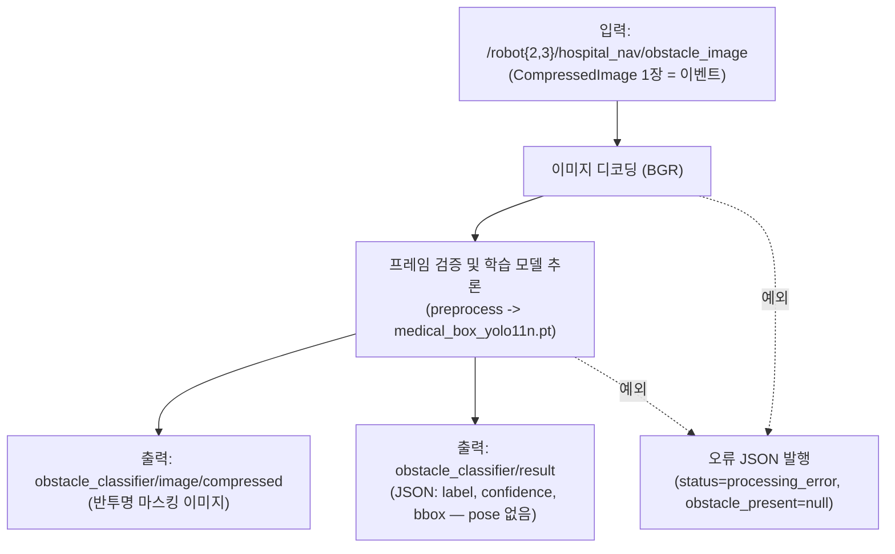
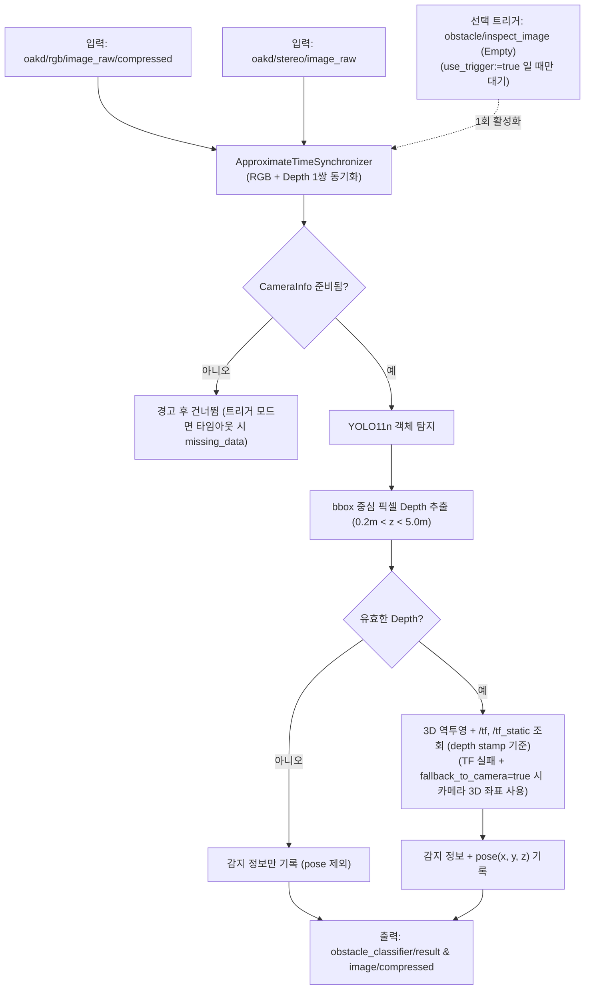
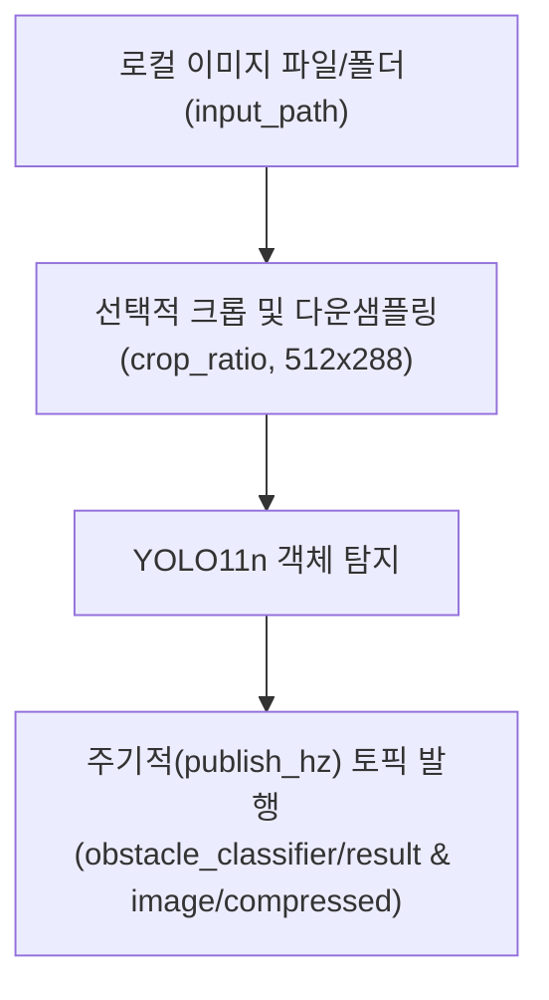

# `part6_obstacle_classifier` 설계도 (1~4단계 기능별 분리)

## 1. 전체 노드 구성 요약

| 순서 | ROS 2 실행 이름 (`ros2 run ...`) | 파일 | 역할 | 위치(`pose`) 출력 |
|---|---|---|---|---|
| **1번** | `obstacle_classifier` | `step1_image_event_node.py` | 타 파트 이미지 1장 이벤트 → 객체 종류·마스킹 발행 | 없음 |
| **2번** | `rgbd_event_classifier` | `step2_rgbd_event_node.py` | RGB + Depth(+CameraInfo/TF) 이벤트 → 객체 위치·종류·마스킹 발행 | 있음 (`map` 또는 카메라 3D) |
| **3번** | `local_image_classifier` | `step3_local_image_node.py` | 로컬 이미지 파일/폴더 → 객체 종류·마스킹 토픽 발행 | 없음 |
| **4번** | `bag_realtime_obstacle` | `step4_bag_realtime_node.py` | `ros2 bag play` 실시간 RGB+Depth(+CameraInfo/TF) → 실시간 위치·종류·마스킹 발행 | 있음 (`map` 또는 카메라 3D) |
| *공통* | *(라이브러리)* | `obstacle_classifier.py` `ros_utils.py` | YOLO11n 추론, 전처리/크롭, Depth 역투영, 반투명 마스킹, ROS 디코딩/TF2/발행 | — |
| *테스트* | `test_turtlebot_viewer` `test_image_downsample` | `test_turtlebot_viewer.py` `test_image_downsample.py` | TurtleBot4 실시간 RGB(마스크)+Depth GUI 뷰어 / 로컬 다운샘플링·크롭 CLI 테스트 | — |

---

## 2. 단계별 노드 상세 설계

### 2.1 1번 노드: `obstacle_classifier` (`step1_image_event_node.py`)
다른 파트에서 **이미지 1장**을 이벤트로 전송하면 즉시 `medical_box`를 탐지하고, `pose` 없는 JSON과 반투명 마스킹 이미지를 발행합니다.

- **주요 파라미터**: `input_topic` (`hospital_nav/obstacle_image`), `use_compressed` (`true`), `output_topic` (`obstacle_classifier/result`), `image_output_topic` (`obstacle_classifier/image/compressed`), `model_path` (`models/medical_box_yolo11n.pt`), `conf_threshold` (`0.25`)

---

### 2.2 2번 노드: `rgbd_event_classifier` (`step2_rgbd_event_node.py`)
**RGB + Depth 이벤트**를 받아 `CameraInfo`와 `/tf`, `/tf_static`을 조회해 `map` 좌표계 위치(`pose`)까지 포함한 JSON과 마스킹 이미지를 발행합니다.

- **주요 파라미터**: `use_trigger` (`false`), `rgb_topic`, `depth_topic`, `camera_info_topic`, `trigger_topic`, `target_frame` (`map`), `fallback_to_camera` (`true`), `min_depth` (`0.2`), `max_depth` (`5.0`), `sync_slop` (`0.1`), `capture_timeout_sec` (`3.0`)

---

### 2.3 3번 노드: `local_image_classifier` (`step3_local_image_node.py`)
로컬 디스크에 보유한 **이미지 파일 또는 폴더(`input_path`)** 를 주기(`publish_hz`)에 맞춰 순회하며, 선택적 ROI 크롭 및 `512x288` 다운샘플링 후 **ROS 2 토픽으로 마스킹 이미지와 객체 종류 JSON을 발행**합니다.

- **주요 파라미터**: `input_path` *(필수)*, `publish_hz` (`2.0`), `loop` (`false`), `resize_width` (`512`), `resize_height` (`288`), `crop_ratio` (`""`)

---

### 2.4 4번 노드: `bag_realtime_obstacle` (`step4_bag_realtime_node.py`)
`ros2 bag play`로 재생되는 **실시간 RGB + Depth 스트림**을 받아, `CameraInfo`와 `/tf`, `/tf_static`이 있으면 실시간으로 객체 위치(`pose`)·종류·마스킹 이미지를 연속 발행합니다.
*(bag에 `CameraInfo`가 없으면 감지 정보만 발행하고, `/tf`가 없으면 `fallback_to_camera=true` 설정 시 카메라 기준 3D 상대 좌표를 제공합니다.)*

- **주요 파라미터**: `rgb_topic`, `depth_topic`, `camera_info_topic`, `target_frame` (`map`), `fallback_to_camera` (`true`), `min_depth` (`0.2`), `max_depth` (`5.0`), `sync_slop` (`0.1`)

---

## 3. 공통 입출력 토픽 규격 (네임스페이스 `/robot2`, `/robot3` 적용)

| 방향 | 파라미터 | 기본 토픽명 | 메시지 타입 | 데이터 형태 |
|---|---|---|---|---|
| 출력 (결과 JSON) | `output_topic` | `obstacle_classifier/result` | `std_msgs/msg/String` | `{"status", "header", "obstacle_present", "detections": [{"label", "confidence", "bbox", "pose"?}], "error"?}` |
| 출력 (마스킹 이미지) | `image_output_topic` | `obstacle_classifier/image/compressed` | `sensor_msgs/msg/CompressedImage` | `format: "jpeg"`, 반투명 마스킹·박스·라벨·좌표 이미지 |

---

## 4. 공통 모듈 내부 구조
- **`obstacle_classifier.py` (ROS 비의존)**: `resolve_default_model_path`, `crop_and_downsample`, `Detection`, `Yolo11Classifier`, `preprocess`, `classify_obstacles`, `extract_valid_depth`, `deproject_pixel_to_3d`, `attach_poses`, `draw_detections`, `process_frame`, `build_result`, `build_error`
- **`ros_utils.py` (ROS 2 공용)**: `load_node_classifier`, `header_to_dict`, `decode_compressed_bgr`, `decode_raw_bgr`, `publish_outputs`, `TfTargetTransformer`
