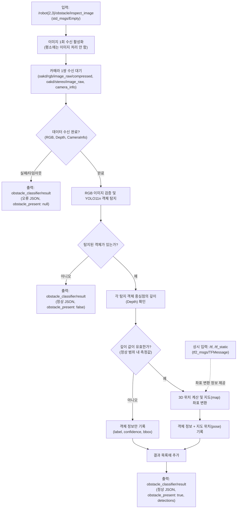

# `part6_obstacle_classifier` 설계도

## 1. 처리 플로우차트

## 2. 입출력 토픽 (네임스페이스 `/robot2`, `/robot3` 적용)

| 방향 | 파라미터 | 기본 토픽명 | 메시지 타입 | 메시지 형태 (필드/구조) |
|---|---|---|---|---|
| 입력 (이벤트) | `trigger_topic` | `obstacle/inspect_image` | `std_msgs/msg/Empty` | 필드 없음 (`{}`) |
| 입력 (RGB) | `rgb_topic` | `oakd/rgb/image_raw/compressed` | `sensor_msgs/msg/CompressedImage` | `header`, `format`, `data` (`uint8[]`) |
| 입력 (Depth) | `depth_topic` | `oakd/stereo/image_raw` | `sensor_msgs/msg/Image` | `header`, `height`, `width`, `encoding` (`16UC1`/`32FC1`), `data` |
| 입력 (카메라 정보) | `camera_info_topic` | `oakd/rgb/camera_info` | `sensor_msgs/msg/CameraInfo` | `k` (`float64[9]`: `fx, cx, fy, cy`) |
| 입력 (좌표 변환) | *(TF2 자동 구독)* | `/tf`, `/tf_static` | `tf2_msgs/msg/TFMessage` | `transforms` (`TransformStamped[]`) |
| 출력 (결과) | `output_topic` | `obstacle_classifier/result` | `std_msgs/msg/String` | `data`: JSON (`status`, `header`, `obstacle_present`, `detections[{label, confidence, bbox, pose?}]`, `error?`) |
| 출력 (시각화 이미지) | `image_output_topic` | `obstacle_classifier/image/compressed` | `sensor_msgs/msg/CompressedImage` | `header`, `format: "jpeg"`, `data` (`uint8[]`) |

---

## 3. 내부 구조

### 3.1 `obstacle_classifier.py` (ROS 비의존 파이프라인)
- `Detection`: 탐지 결과 데이터 클래스 (`label`, `confidence`, `bbox`, `pose`)
- `Yolo11Classifier`: Ultralytics YOLO11n(`yolo11n.pt`) 추론 어댑터
- `preprocess` / `classify_obstacles`: 입력 BGR 프레임 검증 및 탐지 결과 유효성 검사
- `extract_valid_depth` / `deproject_pixel_to_3d`: 바운딩 박스 중심 깊이 추출(유한값·범위 필터링) 및 카메라 3D 역투영
- `attach_poses`: 유효한 Depth를 가진 객체에만 `pose`를 추가하고, 무효한 객체는 감지 정보만 유지
- `draw_detections`: 바운딩 박스, 라벨, 신뢰도, `map` 좌표를 이미지에 시각화
- `process_frame` / `build_result` / `build_error`: 전체 파이프라인 실행 및 JSON 응답 딕셔너리 생성

### 3.2 `obstacle_classifier_node.py` (ROS 2 노드)
- `ObstacleClassifierNode`:
  - `trigger_callback`: `obstacle/inspect_image` 수신 시 `pending_capture = True`로 1회 수신 활성화 및 타임아웃 타이머 시작
  - `synced_callback`: `pending_capture`가 `True`일 때만 `CompressedImage` 디코딩 후 `process_frame` 실행 (평소에는 즉시 리턴해 리소스 절약)
  - `camera_info_callback`: `CameraInfo`에서 내부 파라미터 행렬 `K` 저장
  - `_transform_to_target`: `TF2 Buffer`를 이용해 `depth_msg.header.stamp` 시점의 `camera_frame` → `map` 좌표 변환
  - `_on_capture_timeout`: 지정 시간 내 데이터 미수신 시 `missing_data` 오류 JSON 발행
  - `publish_result` / `publish_annotated_image`: 결과 JSON(`String`) 및 JPEG 압축 시각화 이미지(`CompressedImage`) 발행
