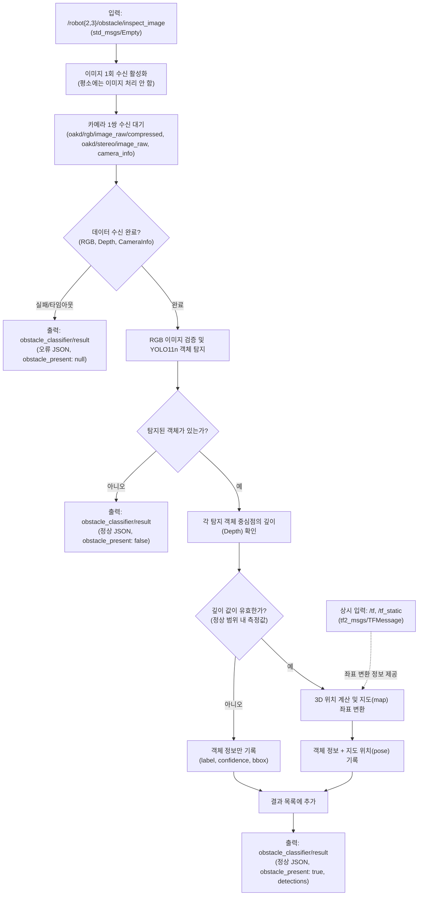

# `part6_obstacle_classifier` 설계도

## 1. 처리 플로우차트

## 2. 입출력 토픽 (네임스페이스 `/robot2`, `/robot3` 적용)

| 방향 | 파라미터 | 기본 토픽명 | 메시지 타입 |
|---|---|---|---|
| 입력 (이벤트) | `trigger_topic` | `obstacle/inspect_image` | `std_msgs/msg/Empty` |
| 입력 (RGB) | `rgb_topic` | `oakd/rgb/image_raw/compressed` | `sensor_msgs/msg/CompressedImage` |
| 입력 (Depth) | `depth_topic` | `oakd/stereo/image_raw` | `sensor_msgs/msg/Image` |
| 입력 (카메라 정보) | `camera_info_topic` | `oakd/rgb/camera_info` | `sensor_msgs/msg/CameraInfo` |
| 입력 (좌표 변환) | *(TF2 자동 구독)* | `/tf`, `/tf_static` | `tf2_msgs/msg/TFMessage` |
| 출력 (결과) | `output_topic` | `obstacle_classifier/result` | `std_msgs/msg/String` (JSON) |
